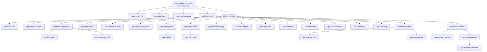
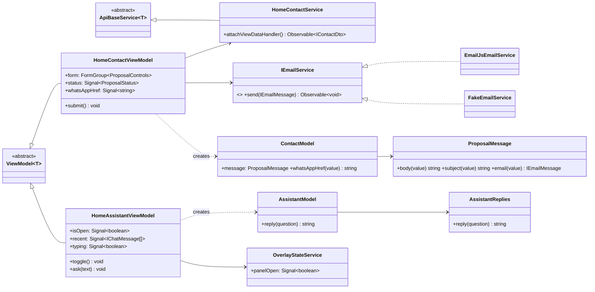

# 02 · Design — Home page

## Component tree

Every `app-home-*` is a container with its own `@Injectable()` view model; children are
presentational (`input()` / `output()` only).

## Class diagram

## Sequence diagram

The proposal request and the chat are in
[architecture/sequence-diagrams.md](../../architecture/sequence-diagrams.md) (§3 and §5).

## Data model / endpoints

`ApiEndpoint` values map 1:1 to `fake-db.json` paths (and later to Firestore documents):
`home/hero`, `home/marquee`, `home/trust`, `home/offer`, `home/audiences`, `home/experiences`,
`home/shows`, `home/drumCircle`, `home/rhythmGame`, `home/videos`, `home/gallery`,
`home/philosophy`, `home/midCta`, `home/cities`, `home/how`, `home/team`, `home/instagram`,
`home/proof`, `home/faq`, `home/contact`, `home/assistant`, plus the `videos`, `gallery` and
`team` collections. See [architecture/data-model.md](../../architecture/data-model.md).

## ADRs raised

- [ADR-0006](../../architecture/adr/0006-email-port-emailjs.md): email port with EmailJS and fake adapters.
- [ADR-0007](../../architecture/adr/0007-defer-below-the-fold-on-idle.md): `@defer (on idle)` instead of `on viewport`.
- [ADR-0008](../../architecture/adr/0008-accessibility-over-design-parity.md): accessibility fixes that deviate from the design.

---

**Approval:** ☐ Pending
