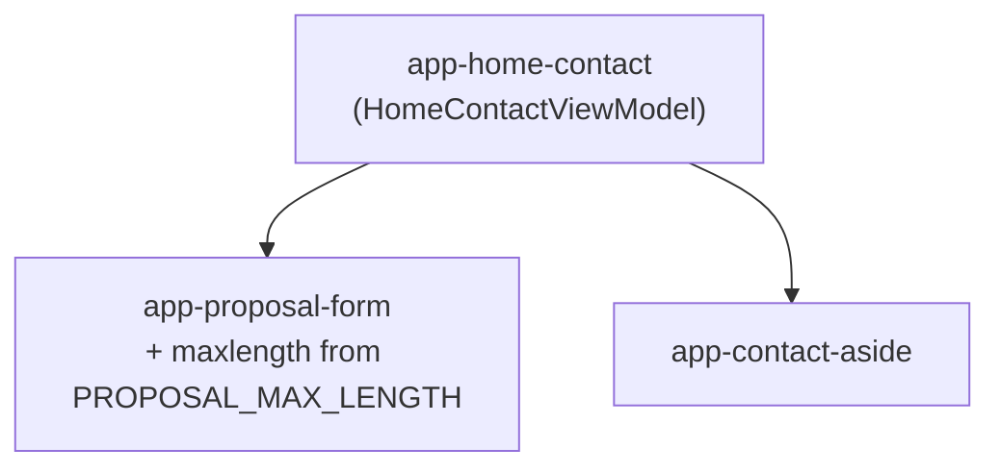
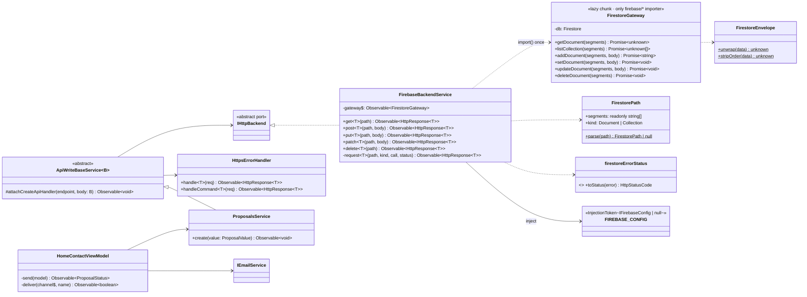
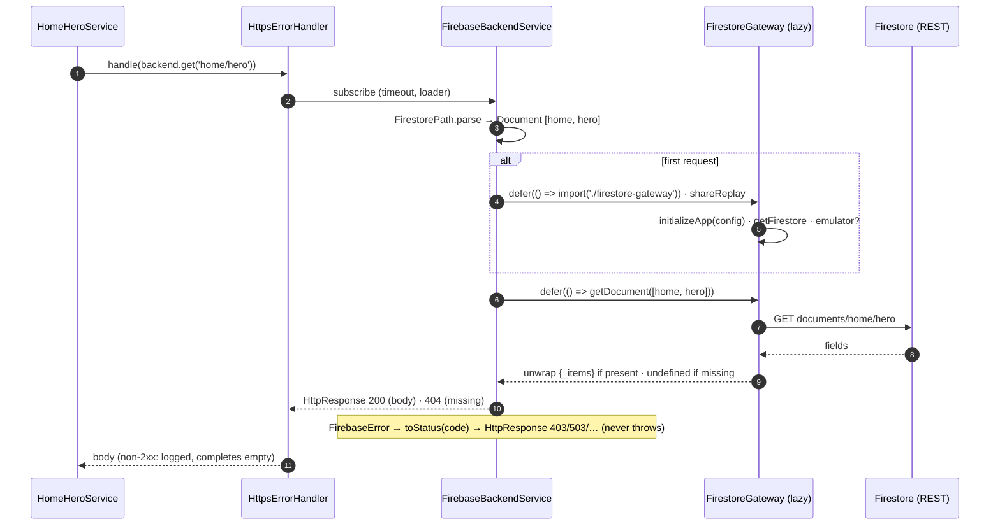
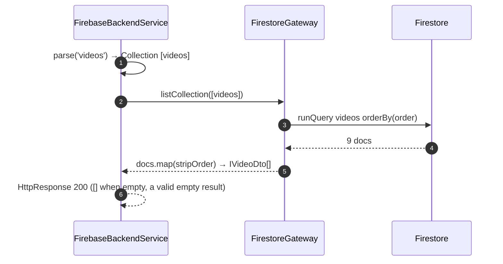
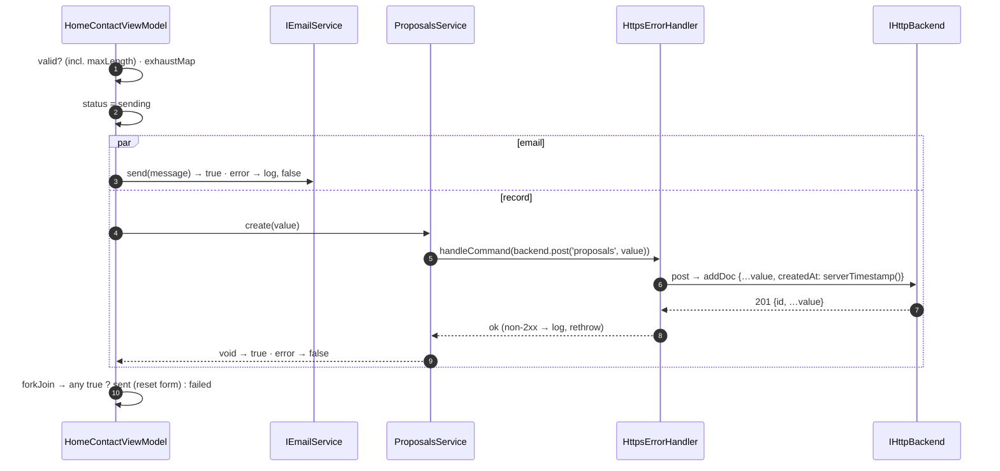
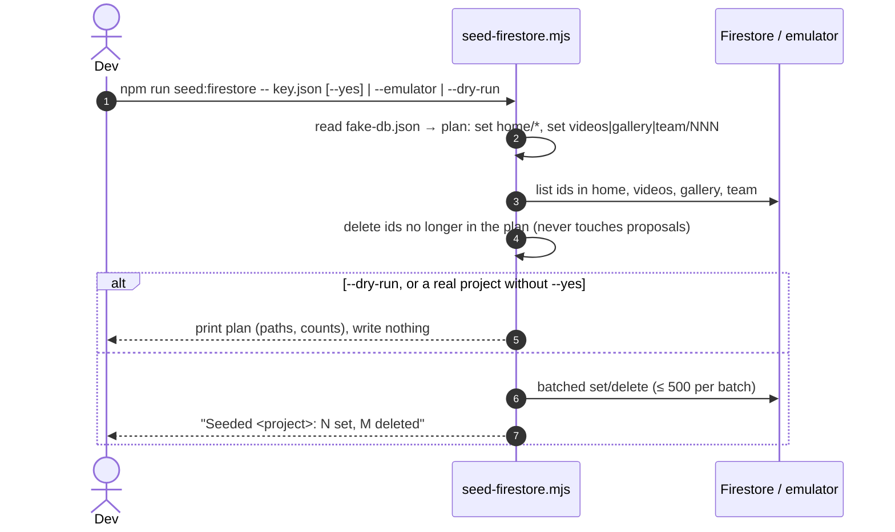
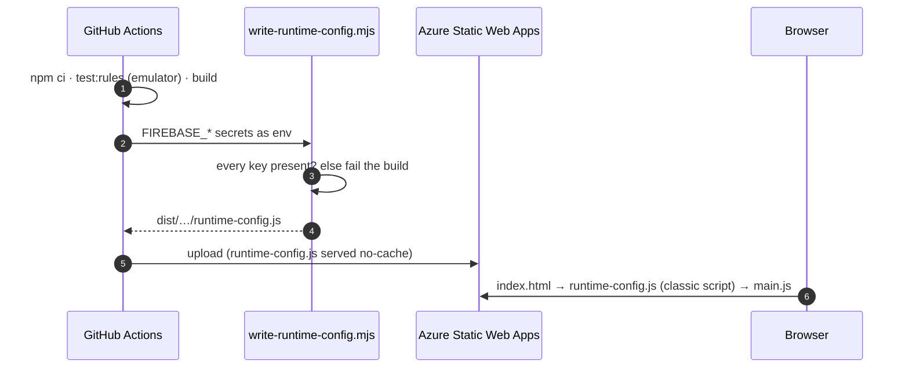
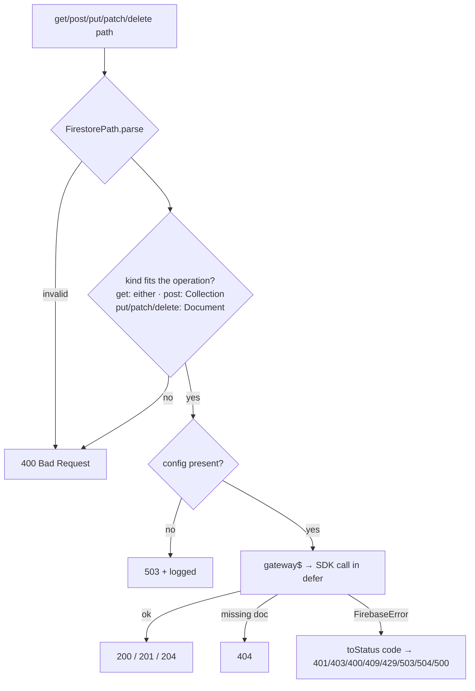

# 02 · Design — Firebase data

Builds on the approved [inception](01-inception.md). The canonical adapter is the Resume3.0
`FirebaseBackendService`, saved with porting notes in
[backend-adapter-example.md](../../architecture/backend-adapter-example.md). The decisions are
recorded in [ADR-0009](../../architecture/adr/0009-firestore-data-adapter.md) and
[ADR-0010](../../architecture/adr/0010-app-check-deferred.md).

## Key decisions

| #   | Decision                                                                                                                                                                                                                                                                                                                                                                               |
| --- | -------------------------------------------------------------------------------------------------------------------------------------------------------------------------------------------------------------------------------------------------------------------------------------------------------------------------------------------------------------------------------------- |
| D1  | **Firestore Lite** (`firebase/firestore/lite`) instead of the full SDK. It uses REST, with no realtime listeners or offline cache, which a content site doesn't need, and is a fraction of the size.                                                                                                                                                                                  |
| D2  | **The SDK loads lazily.** Everything that imports `firebase/*` lives in one module, `firestore-gateway.ts`, which the adapter loads with `defer(() => import(...))` on the first request and then caches (`shareReplay`). The initial bundle doesn't grow.                                                                                                                            |
| D3  | **Paths map to Firestore by segment count.** Two segments (`home/hero`) is a document. One segment (`videos`) is a collection, read sorted by `order` and returned as an array.                                                                                                                                                                                                       |
| D4  | **List sections stored as one document use a reserved envelope key, `{ _items: [...] }`, not `items`.** `home/experiences` and `home/faq` already hold an `items` array next to other fields, so Resume3.0's rule ("unwrap any `items` array") would cut those two sections down to their list.                                                                                     |
| D5  | **List item documents are numbered by position** (`videos/001`, `002`, …) and carry an `order` field. The adapter removes `order` from the body. Names can't serve as IDs because the content is still placeholders (six team members are named `[NAME]`).                                                                                                                         |
| D6  | **The adapter adds `createdAt` with `serverTimestamp()` on every `post`.** Feature code never touches an SDK type, and the rules require `createdAt == request.time`, so clients can't backdate a record.                                                                                                                                                                             |
| D7  | **Errors become responses, never thrown errors** (Liskov). Firebase error codes map to HTTP statuses through a `ReadonlyMap`, with no `switch` (Open/Closed). A path with the wrong shape for the operation returns `400`, and missing config returns `503`.                                                                                                                         |
| D8  | **Config comes from `runtime-config.js`.** It sets `globalThis.__FIREBASE_CONFIG__` and is loaded by a classic `` and
`<link rel="preconnect" href="https://firestore.googleapis.com" crossorigin>`. When the file is
missing in development, the browser logs a harmless 404. The Fake backend doesn't need the file.

## Files

**New**

| File | Purpose |
| --- | --- |
| `core/backends/firebase/firebase-backend.service.ts` | `IHttpBackend` adapter (D3, D6, D7) |
| `core/backends/firebase/firestore-gateway.ts` | the lazy chunk: the only `firebase/*` importer (D1, D2) |
| `core/backends/firebase/firestore-path.ts` | parses and validates paths, decides document or collection |
| `core/backends/firebase/firestore-envelope.ts` | `_items` unwrap, `order` strip (D4, D5) |
| `core/backends/firebase/firestore-error-status.ts` | code-to-status map (D7) |
| `core/backends/firebase/firestore.constants.ts` | `_items`, `order`, `createdAt` |
| `core/interfaces/i-firebase-config.ts` | our own config shape, so no SDK type leaks |
| `core/tokens/firebase-config.token.ts` | `FIREBASE_CONFIG` (D8) |
| `core/config/runtime-firebase-config.ts` | reads and type-guards `globalThis.__FIREBASE_CONFIG__` |
| `shared/base/api-write-base.service.ts` | write base class (D10) |
| `features/home/sections/contact/proposals.service.ts` | `create(value)` → `ApiEndpoint.Proposals` |
| `features/home/sections/contact/proposal-limits.constants.ts` | `PROPOSAL_MAX_LENGTH` (D11) |
| `environments/environment.emulator.ts` | emulator build (D12) |
| `firebase.json`, `.firebaserc`, `firestore.rules`, `firestore.indexes.json` | Firebase project and rules |
| `tests/rules/firestore.rules.spec.ts`, `vitest.rules.config.ts`, `tsconfig.rules.json` | rules tests |
| `scripts/seed-firestore.mjs`, `scripts/write-runtime-config.mjs` | seeding and CI config |
| `public/runtime-config.example.js`, `public/staticwebapp.config.json` | config template, no-cache header |
| `playwright.firebase.config.ts`, `e2e/specs/firebase-smoke.e2e.ts` | smoke suite |

All of these have a co-located `.spec.ts` where CLAUDE.md §9 requires one.

**Changed:** `backend-type.enum.ts` (+`Firebase`), `http-backend.factory.ts`,
`i-app-environment.ts`, both environments, `https-error-handler.service.ts` (+`handleCommand`),
`api-endpoint.enum.ts` (+`Proposals`), `proposal-form.ts` and its template (max lengths),
`home-contact.view-model.ts` (D9), `index.html`, `angular.json` (`emulator` configuration),
`playwright.config.ts` (ignore `firebase-*.e2e.ts`), `package.json` (scripts and dev
dependencies), `eslint.config.mjs` (Node globals for `scripts/`), the CI workflow, CLAUDE.md §2
(new commands), and the architecture docs (overview, class, sequence, data model, deployment).

**New npm scripts:** `seed:firestore`, `test:rules`, `start:emulator`, `e2e:firebase`,
`deploy:rules` (`firebase deploy --only firestore:rules,firestore:indexes`).

## Test plan

- **Unit (Vitest):**
  - **Path:** documents, collections, invalid paths.
  - **Error status:** every code in the table, plus unknown values.
  - **Envelope:** unwrap and strip.
  - **Gateway:** mocks `firebase/app` and `firebase/firestore/lite`. This follows the EmailJS spec
    precedent and is the one place SDK mocking is unavoidable. Checks: the emulator connects once,
    `orderBy('order')`, and `createdAt` is stamped.
  - **Adapter:** mocks the gateway module. Checks: lazy, with no import before subscribe; every
    status path; missing config → 503.
  - **Config:** the token and the runtime reader.
  - **Factory:** the Firebase case.
  - **Error handler:** `handleCommand` logs, rethrows and balances the loader.
  - **Write path:** `ApiWriteBaseService` and `ProposalsService`.
  - **Contact view model:** both channels OK → sent; one fails → sent and logged; both fail →
    failed; over-long input → nothing sent.
- **Rules (emulator, `npm run test:rules`):** every cell of the matrix, plus each proposal field at
  its limit and one over, a missing key, an extra key, wrong types, and a client-supplied
  `createdAt`.
- **E2E:** the main suite stays unchanged on Fake. `npm run e2e:firebase` boots the emulator, seeds
  it, serves the `emulator` build and checks on desktop, tablet and mobile that hero, videos, gallery
  and team render the seeded content. It then submits a proposal and confirms the record exists
  through the emulator's REST API. It also runs axe on the page.
- **Verification:** a production build with a local `runtime-config.js`, checked for: autoCsp lets
  the config script and the lazy chunk run, initial bundle within budget, and Lighthouse targets
  (LCP in particular).

`test:rules` and `e2e:firebase` need Java, so they run in CI and before release, not in
`npm run verify`, which has to work on a machine without Java.

## Risks carried into construction

- **LCP:** above-the-fold copy now waits on a request to `firestore.googleapis.com` instead of a
  same-origin chunk. Mitigations so far: preconnect, and the Lite SDK. If Lighthouse drops below
  95, the next step (behind an ADR) is a `modulepreload` for the gateway chunk, or caching
  stale-while-revalidate in `localStorage`.
- **`npm audit`:** `firebase-tools` pulls in a large dependency tree. If it brings a high or
  critical advisory, run it through `npx firebase-tools@<pinned>` instead of a dev dependency.
- **autoCsp:** ordering of the external classic script against module scripts. To be verified on a
  production build.
- **PR preview environments** get the production config, so a proposal submitted on a preview lands
  in the real `proposals` collection. That's acceptable for now: each record is created once and
  can't be changed.
- **Firestore location:** not yet recorded. It goes in `deployment.md`.

## ADRs raised

- [ADR-0009](../../architecture/adr/0009-firestore-data-adapter.md): Firestore data model and
  adapter (D1 to D8)
- [ADR-0010](../../architecture/adr/0010-app-check-deferred.md): App Check deferred to 1.3.0

---

**Approval:** ☑ Approved by Ravi Akhouri on 2026-10-28
