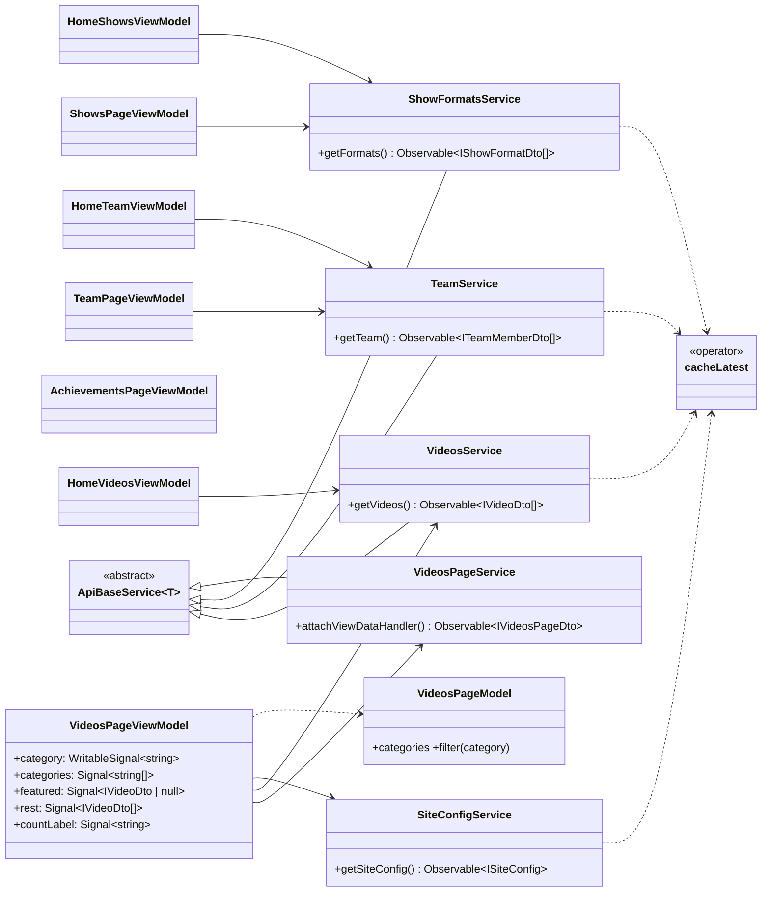
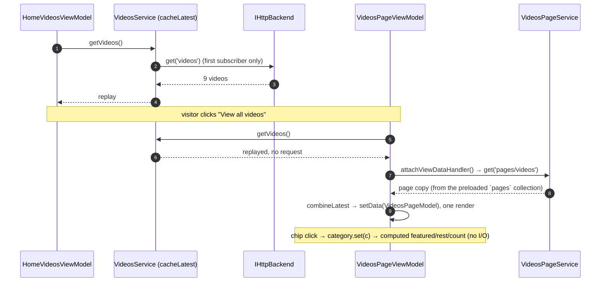
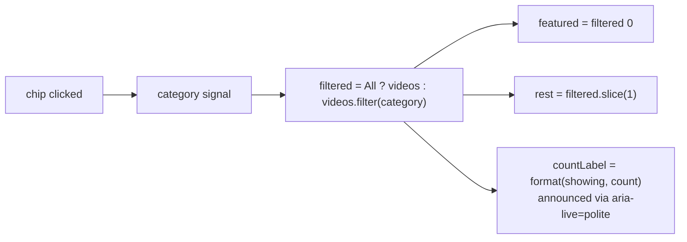
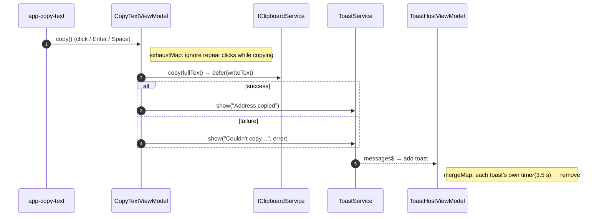

# 02 · Design — Inner pages

Builds on the approved [inception](01-inception.md). Condition of approval: **no duplicated
data**. Shared data is fetched once into a common service and reused.

## Key decisions

| #   | Decision                                                                                                                                                                                                                                                                                                                                                                                                                                                         |
| --- | ---------------------------------------------------------------------------------------------------------------------------------------------------------------------------------------------------------------------------------------------------------------------------------------------------------------------------------------------------------------------------------------------------------------------------------------------------------------- |
| D1  | **One source per entity.** Videos, team members, show formats and contact details are each stored once and reach every page through one cached service (table below).                                                                                                                                                                                                                                                                                            |
| D2  | **Show formats move to a shared `showFormats` collection** (`showFormats/001…`, with `order`) and carry every field: `icon`, `title`, `text`, `ensemble`, `setLength`, `bestFor`. `home/shows.formats` is removed. The home teaser shows icon, title and text; the Shows page adds the specs.                                                                                                                                                                    |
| D3  | **Video categories are derived from the videos**, in first-appearance order: Corporate, Family, Workshops, Behind the scenes. That's the design's order, so no category list is stored. The "All" label is page copy.                                                                                                                                                                                                                                            |
| D4  | **`watchLabel` ("Watch {title} on YouTube") moves from `home/videos` to `site/config.labels.watchVideo`.** It's used by the home teaser and the Videos page, and site config is already read once per visit.                                                                                                                                                                                                                                                     |
| D5  | **A reusable `cacheLatest()` RxJS operator** (`shared/utils/cache-latest.operator.ts`): `throwIfEmpty` + `shareReplay(1)` + `catchError → EMPTY`. A success is replayed to every subscriber; a failure is never cached, so the next subscriber retries. `SiteConfigService` switches to it, and `VideosService`, `TeamService` and the new `ShowFormatsService` adopt it. Going from the home page to Videos or Team re-reads nothing.                           |
| D6  | **Page-specific copy goes in one document per page**: `pages/videos`, `pages/team`, `pages/shows`, `pages/achievements`. Each page is **one smart container with one view model** that combines its page document with any shared list (`combineLatest`), so the whole page renders in one pass (CLS). Sections are presentational children.                                                                                                                     |
| D7  | **Preloaded collections are loaded independently.** Today `site` and `home` are fetched together (`forkJoin`). That made every inner page download all 21 home documents too. Each preloaded collection (`site`, `home`, `pages`) now loads on its own, the first time any of its documents is needed. CLS stays protected by the shell's settle gate (0004-A): `<main>` is hidden until site config arrives, and each page's content still arrives in one pass. |
| D8  | **Shared new component, `app-page-cta`:** an optional title and text plus primary and secondary links. Team, Shows and Achievements use it with a title; Videos uses it with only the two buttons.                                                                                                                                                                                                                                                               |
| D9  | **Footer credit:** "Developed with love by Ravi Akhouri" in the bottom bar of both footer variants (full on home, compact on inner pages). The name links to the developer's LinkedIn profile (new tab, `rel="noopener noreferrer"`). The label, name and URL come from `site/config.credit`, so they change without a release.                                                                                                                                  |
| D10 | **Each feature lives in its own folder** (`features/videos`, `team`, `shows`, `achievements`) with a lazy `<feature>.routes.ts`, following CLAUDE.md §4. Features never import each other; shared services live in `shared/services`.                                                                                                                                                                                                                            |

## Single source of truth

| Data                                                            | Stored once in                                       | Read through (cached)      | Used by                                           |
| --------------------------------------------------------------- | ---------------------------------------------------- | -------------------------- | ------------------------------------------------- |
| Videos                                                          | `videos/*`                                           | `VideosService`            | home teaser (first 4), Videos page (all + filter) |
| Video categories                                                | derived from `videos`                                | `VideosPageModel`          | Videos page chips                                 |
| "Watch {title} on YouTube"                                      | `site/config.labels.watchVideo`                      | `SiteConfigService`        | home teaser, Videos page                          |
| Team members                                                    | `team/*`                                             | `TeamService`              | home teaser (first 4), Team page (all)            |
| Show formats                                                    | `showFormats/*` (new; replaces `home/shows.formats`) | `ShowFormatsService` (new) | home teaser, Shows page                           |
| Contact, WhatsApp, brand, promo, credit                         | `site/config`                                        | `SiteConfigService`        | chrome, CTAs on every page                        |
| Page copy (headings, values, setups, steps, stats, milestones…) | `pages/{page}`                                       | the page's own service     | that page only                                    |

**What isn't treated as duplication:** short section copy that happens to match. For example,
"Shows & performances" is both the home teaser's eyebrow and the Shows page's eyebrow, and
"Request a proposal" is a CTA label on several sections. This is editorial copy owned by each
section, and it can diverge. The home page's existing repeats ("WhatsApp us" in hero and mid-CTA)
predate this feature; consolidating them into `site/config.labels` is a possible follow-up.

## Routes and component trees

```mermaid
flowchart TD
  R[app.routes.ts] -->|/videos| V[videos.routes.ts]
  R -->|/team| T[team.routes.ts]
  R -->|/shows| S[shows.routes.ts]
  R -->|/achievements| A[achievements.routes.ts]
  V --> VP["VideosPageComponent<br/>(VideosPageViewModel)"]
  VP --> PH1[app-page-hero] & FC[app-filter-chips] & FV["app-video-card (featured)"] & VG["app-video-card × n"] & CTA1[app-page-cta]
  T --> TP["TeamPageComponent<br/>(TeamPageViewModel)"]
  TP --> PH2[app-page-hero] & TC["app-team-card × n"] & TV[app-team-values] & CTA2[app-page-cta]
  S --> SP["ShowsPageComponent<br/>(ShowsPageViewModel)"]
  SP --> PH3[app-page-hero] & SF["app-show-format-card × n"] & SU[app-show-setups] & ST[app-steps] & CTA3[app-page-cta]
  A --> AP["AchievementsPageComponent<br/>(AchievementsPageViewModel)"]
  AP --> PH4[app-page-hero] & AS[app-achievement-stats] & AM[app-milestones] & AR[app-recognition] & APR[app-press-performances] & CTA4[app-page-cta]
```



Every route uses `PageLayout.Page` (inner-page chrome: card promo, WhatsApp button) and sets its
own `title`. `app-page-hero`, `app-filter-chips`, `app-video-card` and `app-steps` exist already.
`app-page-cta` is new in `shared/components`. The rest are presentational children inside their
feature.

## Class diagram



`TeamPageService`, `ShowsPageService` and `AchievementsPageService` follow the same pattern as
`VideosPageService`: one `ApiBaseService` subclass per page document.

## Sequence: from the home page to Videos, with no second read



## Videos filter flow



## Data model changes

| Path                  | Change                                                                                                                                                                                           |
| --------------------- | ------------------------------------------------------------------------------------------------------------------------------------------------------------------------------------------------ |
| `pages/videos`        | new: hero (eyebrow, title, highlight, lead), `allLabel`, `showingLabel` ("Showing {count} videos"), `featuredLabel`, CTAs (YouTube channel URL and label, plan-session label)                    |
| `pages/team`          | new: hero, values (title, items: icon, title, text), CTA                                                                                                                                         |
| `pages/shows`         | new: hero (and two CTAs), formats section heading and note, setups (heading, items: icon, title, text), steps (heading, `IStep[]`), CTA                                                          |
| `pages/achievements`  | new: hero, stats (value, label), milestones (year, title, text, plus "Today"), recognition (icon, title, text), press (publication, headline, year, url), performances (event, venue, year), CTA |
| `showFormats/001…006` | new shared collection (D2); `home/shows.formats` removed                                                                                                                                         |
| `site/config`         | adds `labels.watchVideo`, and `credit: { label, name, url }` (D9)                                                                                                                                |
| `home/videos`         | `watchLabel` removed (D4)                                                                                                                                                                        |

`fake-db.json` holds the same data. The seed maps the new top-level object `pages` and list
`showFormats` automatically. **Live data:** the seed deletes `home/shows.formats` and
`home/videos.watchLabel` by rewriting those documents, and adds `pages/*` and `showFormats/*`.
**Deploy order:** rules first (the new `pages` and `showFormats` reads; additive and safe at any
time), then the 1.3.0 app and the seed **together**. _Correction found in construction:_ the
1.2.0 app reads `home/shows.formats`, which this seed removes, so seeding before 1.3.0 is live
would break the 1.2.0 home page. Never seed 0005 data while a 1.2.0 build is serving.

**Rules:** `match /pages/{page}` and `match /showFormats/{item}` allow read only. The rules spec
adds both to the read/write matrix.

## Footer credit

```text
full footer (home):  © 2026 Taal Yatra · … · taalyatra.in    Developed with love by Ravi Akhouri   Admin · Back to top ↑
compact (inner):     © 2026 Taal Yatra · … · taalyatra.in · Developed with love by Ravi Akhouri
```

On phones it wraps under the copyright. The text uses the brand's muted footer colour from
`_tokens.scss`. The name is a link to `https://www.linkedin.com/in/ravi-akhouri-6696071a7/`,
opening in a new tab (`target="_blank"`, `rel="noopener noreferrer"`), and its accessible name
says it opens LinkedIn.

## Test plan

- **Unit:** `cacheLatest` (replay; failure retried); the services with caching (one read for many
  subscribers); `VideosPageModel` (category order, filter, featured/rest, count label); each page
  view model (combined render, empty states); each presentational component; `page-cta`; footer
  credit in both variants; home teasers reading `showFormats` and `labels.watchVideo`.
- **Rules:** `pages/*` and `showFormats/*` readable and not writable.
- **E2E (Fake):** one spec per page:
  - Videos: chips filter, count announced, links have accessible names
  - Team: all members rendered
  - Shows: formats with specs, steps
  - Achievements: all sections
  - Navigation from the home teasers to each page
  - axe per page
  - visual baselines for each page section on desktop, tablet and mobile
- **E2E (Firebase smoke):** the Videos page renders from the emulator, and the chips filter.
- **Verification:** CLS < 0.1 on each page against the live database; Lighthouse; computed-style
  comparison with the prototype at 375, 620, 1000, 1440, 1700 and 2300 px.

## ADRs raised

- ADR-0011: _Shared entity collections and cached services_. Covers D1–D5 and D7: one source per
  entity, the `cacheLatest` operator, and independently preloaded content collections.

---

**Approval:** ☑ Approved by Ravi Akhouri on 2026-10-28 (credit: "Ravi Akhouri", linking to LinkedIn)

---

## Addendum A: copyable address, toasts, Shows spotlight

| #   | Decision                                                                                                                                                                                                                                                                                                                                                                                                            |
| --- | ------------------------------------------------------------------------------------------------------------------------------------------------------------------------------------------------------------------------------------------------------------------------------------------------------------------------------------------------------------------------------------------------------------------- |
| A1  | **Toasts:** `ToastService` (root) only accepts messages (`show(text, tone)` into a `Subject`). `app-toast-host` in the site shell owns the timers in its view model: `mergeMap` gives each toast its own `timer`, so they close independently. It renders a polite live region. No service subscribes (CLAUDE.md §7).                                                                                               |
| A2  | **Clipboard port:** `IClipboardService.copy(text): Observable<void>` (core/interfaces). `BrowserClipboardService` wraps `navigator.clipboard.writeText` in `defer`; it is the only place that touches the API. `FakeClipboardService` serves the specs. A factory provides the adapter (ADR-0002). An unavailable clipboard (insecure context) errors, and the caller shows a failure toast.                        |
| A3  | **`app-copy-text` (shared):** a button that shows the text on one line with an ellipsis. Its tooltip (`role="tooltip"`, `aria-describedby`) shows the full text on hover or focus and closes on Escape (WCAG 1.4.13). The accessible name is "{action}: {full text}". A component-scoped `CopyTextViewModel` copies with `exhaustMap` (repeat clicks ignored while copying) and sends the success or failure toast. |
| A4  | **Labels in `site/config.labels`:** `callUs`, `copyAddress`, `addressCopied`, `copyFailed`. They are shared UI strings, stored once.                                                                                                                                                                                                                                                                                |
| A5  | **Phone row:** "Call us" (`labels.callUs`) links to `tel:`, with the accessible name "Call us, {number}". `contact.phone.display` stays the number, because the utility bar and the contact section show it.                                                                                                                                                                                                        |
| A6  | **Classical concert = one `showFormats` record** with `featured: true` and `spotlight: { eyebrow, primaryCta, secondaryCta }`. Every format gains `image` and `featured`, and other formats have `spotlight: null`. The home teaser and the Shows page render the featured format as a spotlight and the rest as cards.                                                                                             |
| A7  | **`app-show-spotlight` (shared):** used by both pages, since features can't import each other. A large image beside the eyebrow, title, text and two buttons (proposal form; Videos page). It stacks below 1000px. Its image is the LCP candidate, so it loads with `priority` on the Shows page.                                                                                                                   |
| A8  | **Illustrated SVG placeholders** in `public/images/shows/` for the 7 formats, drawn in the brand palette. Each is under 6 kB and served as-is. The paths are data, so real photos replace them from Firestore.                                                                                                                                                                                                      |
| A9  | **The home Shows section moves onto the surface colour**, with a larger heading. Cards get a 16:10 image on top in a 3-column grid (2 on tablet, 1 on phone). This is a deliberate visual change from the 0003 baseline; the home `#shows` screenshots are re-recorded.                                                                                                                                             |



**Approval:** ☑ Approved by Ravi Akhouri on 2026-10-28 (options chosen in chat)
