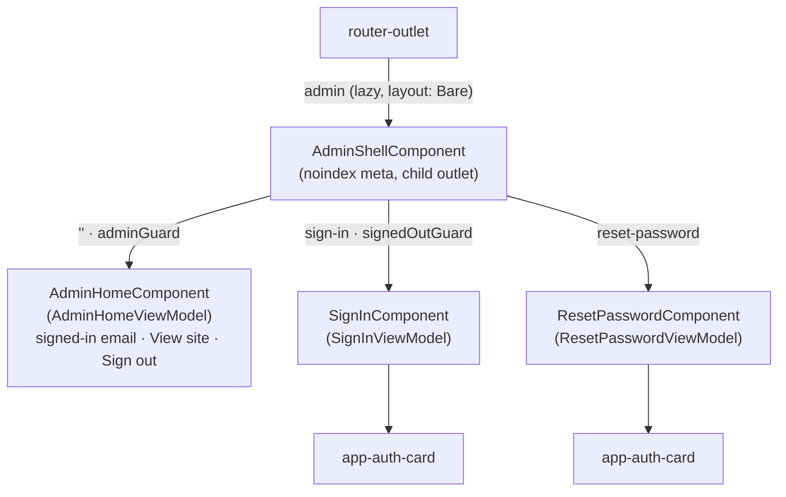
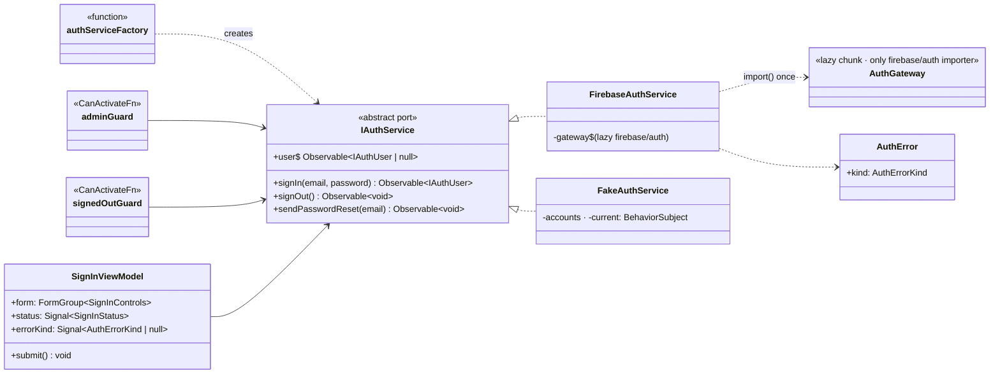
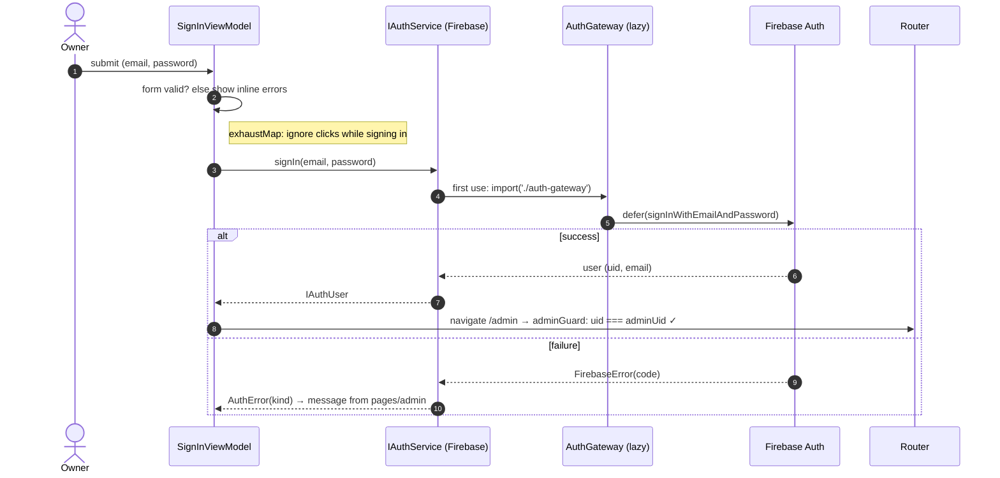
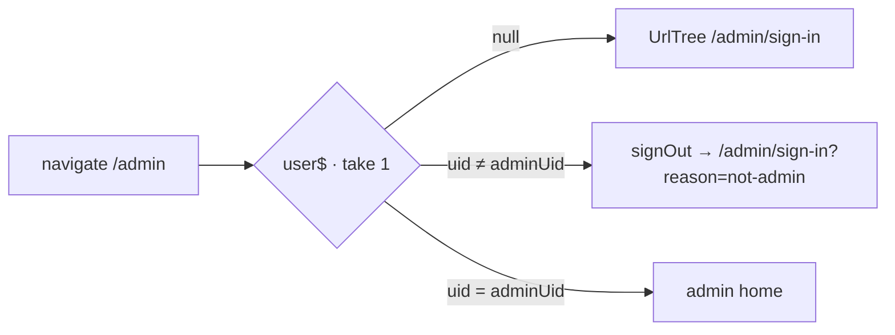

# 02 · Design — Admin sign-in

Builds on the approved [inception](01-inception.md). Decisions to be recorded in ADR-0012.

## Key decisions

| #   | Decision                                                                                                                                                                                                                                                                                                                                                                                                                                                                                                                    |
| --- | --------------------------------------------------------------------------------------------------------------------------------------------------------------------------------------------------------------------------------------------------------------------------------------------------------------------------------------------------------------------------------------------------------------------------------------------------------------------------------------------------------------------------- |
| D1  | **`IAuthService` port** (abstract class, also the DI token), in `core/interfaces`. It exposes `user$: Observable<IAuthUser \| null>` (replays the current user), `signIn(email, password)`, `signOut()` and `sendPasswordReset(email)`, all returning Observables. `IAuthUser` is our own type (`uid`, `email`), so no SDK type leaves `core/backends`.                                                                                                                                                                     |
| D2  | **Errors become our own `AuthError`** with an `AuthErrorKind`, mapped from Firebase codes through a `ReadonlyMap`, never a `switch`. `invalid-credential`, `wrong-password`, `user-not-found`, `invalid-email` → `InvalidCredentials`; `too-many-requests` → `TooManyAttempts`; `network-request-failed` → `Network`; anything else → `Unknown`. One generic message never reveals whether an email exists.                                                                                                                 |
| D3  | **`FirebaseAuthService`** loads `firebase/auth` lazily through `AUTH_GATEWAY_LOADER`, the same pattern as `FIRESTORE_GATEWAY_LOADER` (ADR-0009). The SDK is its own chunk and downloads only when an admin route first uses auth. `user$` wraps `onAuthStateChanged` in an Observable and is shared; the SDK's other Promises are wrapped in `defer`. Persistence is the SDK default (local, IndexedDB): the owner stays signed in until signing out. `connectAuthEmulator` is used when `environment.authEmulator` is set. |
| D4  | **`FakeAuthService`** serves development and the deterministic e2e suite. It knows two accounts: the admin (UID = `environment.adminUid`) and a non-admin, both with test-only passwords in `fake-auth.constants.ts`. These are not real credentials. A factory picks Firebase or Fake by `environment.backend` (ADR-0002).                                                                                                                                                                                                 |
| D5  | **Admin identity:** `IAppEnvironment.adminUid`. Production uses `5zsz2DlUaja2Ss7wbFTrpiMMROk2`; the emulator and Fake builds use test UIDs. A UID isn't a secret. The admin email is never stored in code.                                                                                                                                                                                                                                                                                                                  |
| D6  | **Routes** (`features/admin/admin.routes.ts`, lazy, all on the **bare** layout with no site chrome): `/admin` → admin home (`adminGuard`), `/admin/sign-in` (`signedOutGuard`: an admin who is already signed in goes to `/admin`), `/admin/reset-password`. Both guards are functional `CanActivateFn`s. They read `user$.pipe(take(1))` and return `true` or a `UrlTree`.                                                                                                                                                 |
| D7  | **A non-admin account** that reaches `/admin` is signed out and sent to `/admin/sign-in?reason=not-admin`, which shows "This account can't use the admin area". This is for the interface only; data writes are protected by `firestore.rules` in the next feature.                                                                                                                                                                                                                                                         |
| D8  | **Views:** `SignInComponent`, `ResetPasswordComponent` and `AdminHomeComponent`, each with a component-scoped view model. Forms are typed Reactive Forms with validators in a class. Submits use `exhaustMap`, so repeat clicks are ignored while a request is in flight. Status and errors are signals, announced via `role="alert"` (errors) or `role="status"`. A presentational **`app-auth-card`** holds the shared layout (logo, heading, lead, projected form, "← Back to the website").                             |
| D9  | **Password reset** always shows the same confirmation ("If that email has an account, we've sent a reset link"), except for `TooManyAttempts` and `Network`. The reset email itself comes from Firebase; the owner is moving its sender to `taalyatra.in` (custom email domain, DNS in progress).                                                                                                                                                                                                                           |
| D10 | **Copy lives in `pages/admin`** (Firestore and `fake-db.json`, inside the preloaded `pages` collection): sign-in, reset, home and error messages. The admin home also shows the signed-in email from `user$`.                                                                                                                                                                                                                                                                                                               |
| D11 | **Admin pages aren't indexed:** `AdminShellComponent`, which wraps every admin route, sets `<meta name="robots" content="noindex, nofollow">` with Angular's `Meta` service and removes it when it's destroyed. Each route has its own title ("Admin sign in — Taal Yatra").                                                                                                                                                                                                                                                |
| D12 | **CSP:** email/password sign-in calls `identitytoolkit.googleapis.com` and `securetoken.googleapis.com` with `fetch`. It needs no iframe or popup, so autoCsp needs no changes.                                                                                                                                                                                                                                                                                                                                             |

## Component tree

## Class diagram

## Sequence: sign-in

## Guard flow

## Data and configuration

| Item                         | Change                                                                                                                                                                                                                                                                                                                                     |
| ---------------------------- | ------------------------------------------------------------------------------------------------------------------------------------------------------------------------------------------------------------------------------------------------------------------------------------------------------------------------------------------ |
| `pages/admin`                | new: `signIn` (heading, lead, labels, placeholders, submit / submitting, forgot, single-account note, back), `reset` (heading, lead, submit, sent, back to sign-in), `home` (heading, lead, signed-in label, view site, sign out), `errors` (required, invalid email, invalid credentials, too many attempts, network, not admin, unknown) |
| `IAppEnvironment`            | adds `adminUid: string` and `authEmulator: { host, port } \| null`                                                                                                                                                                                                                                                                         |
| `firebase.json`              | adds the Auth emulator (port 9099)                                                                                                                                                                                                                                                                                                         |
| `scripts/seed-firestore.mjs` | with `--emulator`, also creates the emulator's admin and non-admin test users (Admin SDK `createUser` with fixed UIDs)                                                                                                                                                                                                                     |
| `firestore.rules`            | unchanged in this feature (admin writes come with the editors)                                                                                                                                                                                                                                                                             |

## Test plan

- **Unit:**
  - error mapping (every code; unknown codes)
  - `FirebaseAuthService` with a fake gateway through DI (lazy load; `user$`; each call; error mapping)
  - the auth gateway with the SDK mocked through the shared mock module
  - `FakeAuthService`
  - factory
  - both guards (signed out, non-admin, admin)
  - each view model (validation, submit, statuses, `exhaustMap`)
  - each component
  - `app-auth-card`
- **E2E (Fake):**
  - `/admin` redirects to sign-in
  - missing fields show inline errors
  - a wrong password shows the generic error
  - the non-admin account is refused
  - the admin signs in, sees the home, and signs out
  - reset shows its confirmation
  - axe on every view
  - visual baselines on 3 viewports
- **E2E (Firebase smoke):** the admin signs in against the Auth emulator, and the home shows its
  email.
- **Verification:** no `firebase/auth` code in the initial chunks or on public pages;
  Lighthouse on `/admin/sign-in`.

---

**Approval:** ☑ Approved by Ravi Akhouri on 2026-10-28
