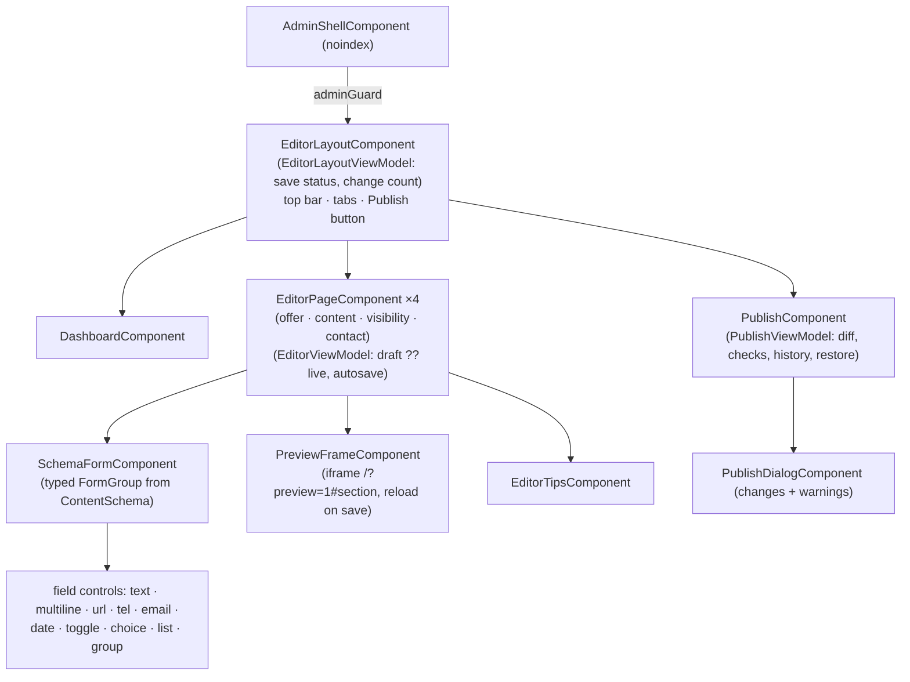
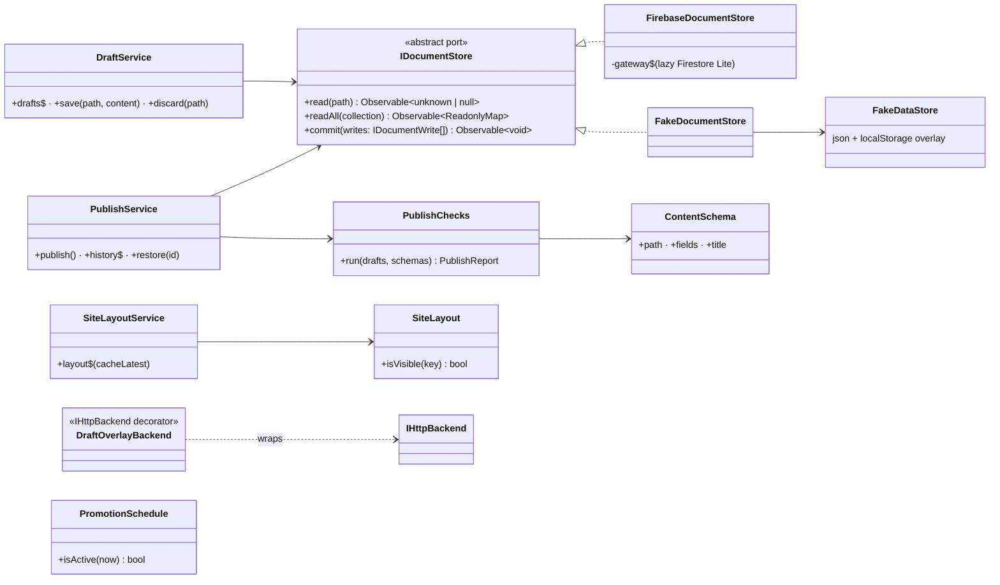
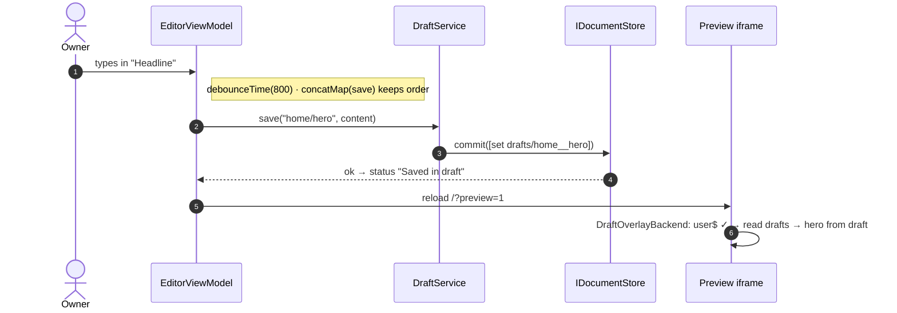
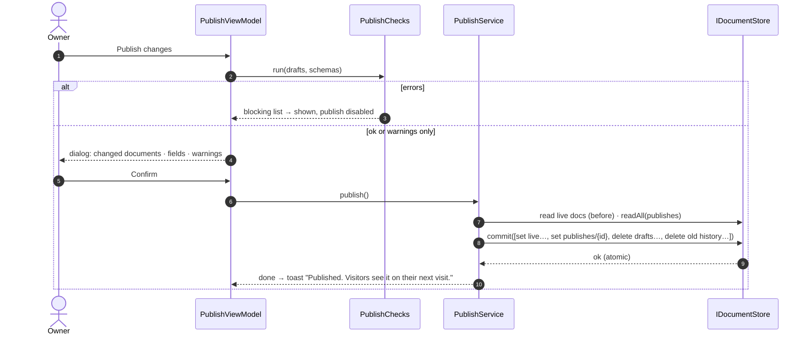
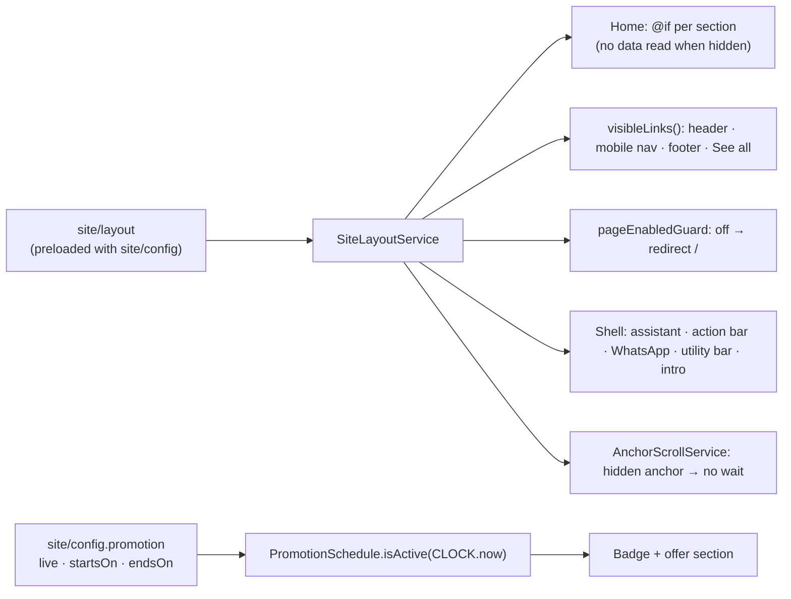

# 02 · Design — Editor foundation (1.6.0)

Builds on the approved [inception](01-inception.md). This design covers release **1.6.0** only:

- drafts, preview and publish (F1–F6);
- the editor shell and dashboard (A1–A11);
- section, page and widget visibility (B1–B5);
- offer, schedule and theme (C1, C3–C7);
- site details, contact and links (D3, E7, E8);
- hero and section headings (D1, D2);
- admin-only write rules (J2).

Releases 1.7.0 to 1.9.0 get their own designs. Decisions go into ADR-0013, ADR-0014 and ADR-0015, plus an update to ADR-0010.

## Key decisions

| #   | Decision                                                                                                                                                                                                                                                                                                                                                                                                                                                                                                                                                                                         |
| --- | ------------------------------------------------------------------------------------------------------------------------------------------------------------------------------------------------------------------------------------------------------------------------------------------------------------------------------------------------------------------------------------------------------------------------------------------------------------------------------------------------------------------------------------------------------------------------------------------------ |
| D1  | **A small `IDocumentStore` port for the editor** (abstract class in `core/interfaces`): `read(path)` and `readAll(collection)` always bypass the public site's preload cache, and `commit(writes)` applies a list of set and delete operations **atomically**. Adapters: `FirebaseDocumentStore` (the Firestore Lite gateway gains `writeBatch`) and `FakeDocumentStore`. `IHttpBackend` stays the public site's read path and doesn't change (ISP, ADR-0002).                                                                                                                                   |
| D2  | **Drafts live in `drafts/{key}`** (admin-only), one document per edited content document. The key is the path with `__` (`home__hero`, `site__config`), because Firestore field paths can't contain `/`. The body is `{ path, content, savedAt }`. The editor shows `draft ?? live`.                                                                                                                                                                                                                                                                                                             |
| D3  | **Autosave:** each editor's form `valueChanges` → `debounceTime(800)` → `concatMap(save)`. `concatMap` writes in order, so a slow earlier save can't overwrite a later one. Invalid values are saved too, so nothing typed is lost; validation blocks **publishing**, not saving. Status signal: Saving… / Saved in draft / Couldn't save (Retry).                                                                                                                                                                                                                                               |
| D4  | **Publish is one atomic `commit`:** set every drafted document live, write a history record, delete the drafts, and prune history beyond 20. The history record is `publishes/{id}`, where `id` is a sortable UTC timestamp. It holds `{ publishedAt, changed: paths[], before: { path: previous content } }`.                                                                                                                                                                                                                                                                                   |
| D5  | **Restore** copies a history record's `before` contents into drafts. The owner reviews them and publishes as usual, with the same checks and confirmation. Nothing goes live without the publish step.                                                                                                                                                                                                                                                                                                                                                                                           |
| D6  | **Preview mode:** `/?preview=1` (read once at startup into an `APP_PREVIEW` token). The backend factory wraps the real backend in `DraftOverlayBackend` (a decorator in `core/backends/preview`). It answers reads from the drafts and delegates everything else. It reads drafts only after `IAuthService.user$` confirms a session: that loads Auth, so Firestore attaches the token, and the rules reject anyone else. Public visits never take this path and never load Auth. A `PreviewBannerComponent` reads "Preview of unpublished changes · Exit preview"; preview pages are `noindex`. |
| D7  | **Live preview in the editor:** an `<iframe>` of `/?preview=1#<section>`, reloaded after each successful autosave. It shows the real components with the draft. Desktop has the preview beside the form; phones have a Form/Preview switch.                                                                                                                                                                                                                                                                                                                                                      |
| D8  | **Labelled forms instead of click-to-edit (deviation from A4).** Text is edited in labelled fields next to the live preview, not by clicking text in the preview. Clicking in the real site's components can't be made accessible without duplicating them; ADR-0008 (accessibility over design parity) is the precedent. The prototype's look is kept: one card per section, tips on the side.                                                                                                                                                                                                  |
| D9  | **Schema-driven editors (ADR-0014).** Each editable document has a `ContentSchema`, listing every field with its label, type (`text`, `multiline`, `url`, `tel`, `email`, `date`, `toggle`, `choice`, `list`, `group`), required flag, length limit, hint and counter target. A generic `SchemaFormComponent` builds a typed `FormGroup` and renders accessible controls; validators are classes. Each later release adds schemas, not forms (open/closed). A spec checks every schema against the matching document in `fake-db.json`, so the two can't drift apart.                            |
| D10 | **Visibility in `site/layout` (ADR-0015):** `{ sections, pages, widgets }`, maps of key → `boolean`. It's in the preloaded `site` collection, so reading it costs no extra round trip. **A missing key, or a value that isn't `false`, means visible.** The hero and contact form have no switch. Keys live in `shared/enums`: `HomeSection` (17), `SitePage` (4) and `SiteWidget` (assistant, mobile action bar, WhatsApp button, utility bar, intro).                                                                                                                                          |
| D11 | **What visibility controls on the site** (one `SiteLayoutService`, cached with `cacheLatest`):  • home sections are wrapped in `@if`, so a hidden section loads no data;  • menu, footer and "See all" links pass through `visibleLinks(links, layout)`, which maps each anchor or route to its key;  • inner routes get a functional `pageEnabledGuard(page)` that redirects to `/`;  • the shell hides switched-off widgets;  • `AnchorScrollService` skips the wait for an anchor whose section is hidden, so the page stays at the top.                                       |
| D12 | **Offer and schedule:** `site/config.promotion` gains `live` (default `true`), `startsOn` and `endsOn` (`YYYY-MM-DD` or `null`). `PromotionSchedule.isActive(now)` compares dates in **Asia/Kolkata**. The badge and the offer section show only while it's active. A new `CLOCK` token provides `now()`, so tests control time. Themes in 1.6.0 are the existing ones (Diwali "sparks", none); the other 10 come in 1.8.0.                                                                                                                                                                      |
| D13 | **Admin identity in rules:** `firestore.rules` checks `request.auth.uid == '5zsz2DlUaja2Ss7wbFTrpiMMROk2'`. 0006 established that a UID isn't a secret, and planned for these rules to use it. The emulator build and its seeded admin user use the same UID, so rules tests and the smoke suite exercise the real check. There are no custom claims to manage.                                                                                                                                                                                                                                  |
| D14 | **Write rules per document:** only the admin may write `site/config`, `site/layout`, `home/hero`, `home/offer` and the six heading documents, and only with the right shape. The top-level keys must match exactly (`hasAll` and `hasOnly`), and edited strings must be within their limits. The limits are shared constants that the rules tests read, as with proposals. `drafts/*` and `publishes/*` are read and written by the admin only.                                                                                                                                                  |
| D15 | **App Check stays deferred (deviation from J3, ADR-0010 updated).** Enforcing it on Firestore would load reCAPTCHA on every public page and cost Lighthouse points. Writes are already protected by Auth plus the UID rules. It will protect the upload function in 1.7.0, which only the admin calls.                                                                                                                                                                                                                                                                                           |
| D16 | **Seed safety:** once the owner edits content, Firestore becomes the source of truth for production. `seed:firestore` will then **create missing documents only**; `--overwrite` replaces them, after listing what it will replace. A new `export:firestore` script saves production content to a dated JSON file before every release. `fake-db.json` stays the fixture for development and e2e.                                                                                                                                                                                                |
| D17 | **The Fake backend gets state:** a `FakeDataStore` (`fake-db.json` plus an overlay saved in `localStorage`) is shared by `FakeHttpsService` and `FakeDocumentStore`. Drafts, publishes and the preview then work in development and in the deterministic e2e suite (each Playwright test gets a fresh context).                                                                                                                                                                                                                                                                                  |
| D18 | **Pre-publish checks** before the confirmation dialog:  • schema errors (required fields, length, formats);  • leftover placeholders (`[…]`);  • an end date before the start date;  • an offer switched on that ends in the past.  Errors block the publish; warnings (placeholders) can be confirmed. The dialog lists every changed document and field by its label.                                                                                                                                                                                                           |
| D19 | **Dashboard cards:** unpublished changes (Review & publish), offer status (Live, Scheduled from…, Ended or Off, with its theme), hidden sections and pages, last published (with history), content warnings. The proposals card arrives in 1.9.0.                                                                                                                                                                                                                                                                                                                                                |
| D20 | **Routes** (lazy, all behind `adminGuard`, inside an `EditorLayoutComponent`): `/admin` dashboard, `/admin/offer`, `/admin/content`, `/admin/visibility`, `/admin/contact`, `/admin/publish` (review, history, restore). The tabs come from a constant array, so later tabs are additions. A functional `canDeactivate` guard plus `beforeunload` warn while a save is pending or failed.                                                                                                                                                                                                        |

## Component tree

## Class diagram

## Sequence: edit, autosave and preview

## Sequence: publish

## Flow: visibility on the public site

## Data and configuration

| Item                    | Change                                                                                              |
| ----------------------- | --------------------------------------------------------------------------------------------------- |
| `site/layout`           | **new:** `{ sections: {…}, pages: {…}, widgets: {…} }`, seeded with every key `true`                |
| `site/config.promotion` | adds `live`, `startsOn`, `endsOn`                                                                   |
| `drafts/{key}`          | **new, admin-only:** `{ path, content, savedAt }`                                                   |
| `publishes/{id}`        | **new, admin-only:** `{ publishedAt, changed, before }`, latest 20                                  |
| `firestore.rules`       | admin UID check; shapes for the documents edited in 1.6.0; `drafts` and `publishes` admin-only      |
| `IAppEnvironment`       | the emulator `adminUid` becomes the production UID (D13)                                            |
| Tokens                  | `APP_PREVIEW` (boolean from the URL at startup), `CLOCK` (`{ now(): Date }`), added to CLAUDE.md §6 |
| Scripts                 | `seed:firestore` creates missing documents unless `--overwrite`; new `export:firestore`             |

## Test plan

- **Unit:**
  - `IDocumentStore` adapters: Firebase with a fake gateway through DI; Fake on `FakeDataStore`
  - `DraftOverlayBackend` (signed out, admin, read failure falls back to live)
  - `DraftService`, `PublishService` (atomic write list, pruning, restore), `PublishChecks`
  - every schema against `fake-db.json`; `SchemaFormComponent` and each control
  - every view model (`concatMap` order, retry, status)
  - `SiteLayout`, `visibleLinks`, `pageEnabledGuard`, `PromotionSchedule` (IST edges: 23:59 and 00:00)
  - the home gating, the shell widgets, the anchor skip
- **Rules (emulator):** the admin may write valid shapes. Anonymous users, other accounts and
  invalid shapes are refused. `drafts` and `publishes` are admin-only. Public reads are unchanged.
- **E2E (Fake):**
  - editing the hero autosaves, the preview shows the draft, and after publishing the site shows it
  - hiding the gallery removes the section and its menu link
  - switching the Team page off makes `/team` redirect home
  - an offer scheduled in the past hides the badge
  - restore puts the old content back into the draft
  - the unsaved-changes guard warns
  - axe on every editor view; editor baselines on 3 viewports
- **E2E (Firebase smoke):** the admin edits the hero on the emulator, publishes, and the public
  page shows the change. This proves the Auth token reaches Firestore.
- **Verification:**
  - no editor or Auth code on public pages, and preview code only in preview mode
  - Lighthouse unchanged on the home page
  - a production export taken before the release

## Risks

- **The Auth token must reach Firestore Lite.** Both use the default app, which should be
  enough. The first construction step proves it on the emulator; if it fails, the gateway passes
  the Auth instance explicitly.
- **Size:** 1.6.0 is the largest release so far. The construction log tracks the increments, and
  each one ends with `npm run verify` passing.
- **The iframe preview** reloads the whole site after each save (about 1 s locally). If that feels
  slow, posting the draft to the frame is a later improvement.

---

**Approval:** ☐ Pending
