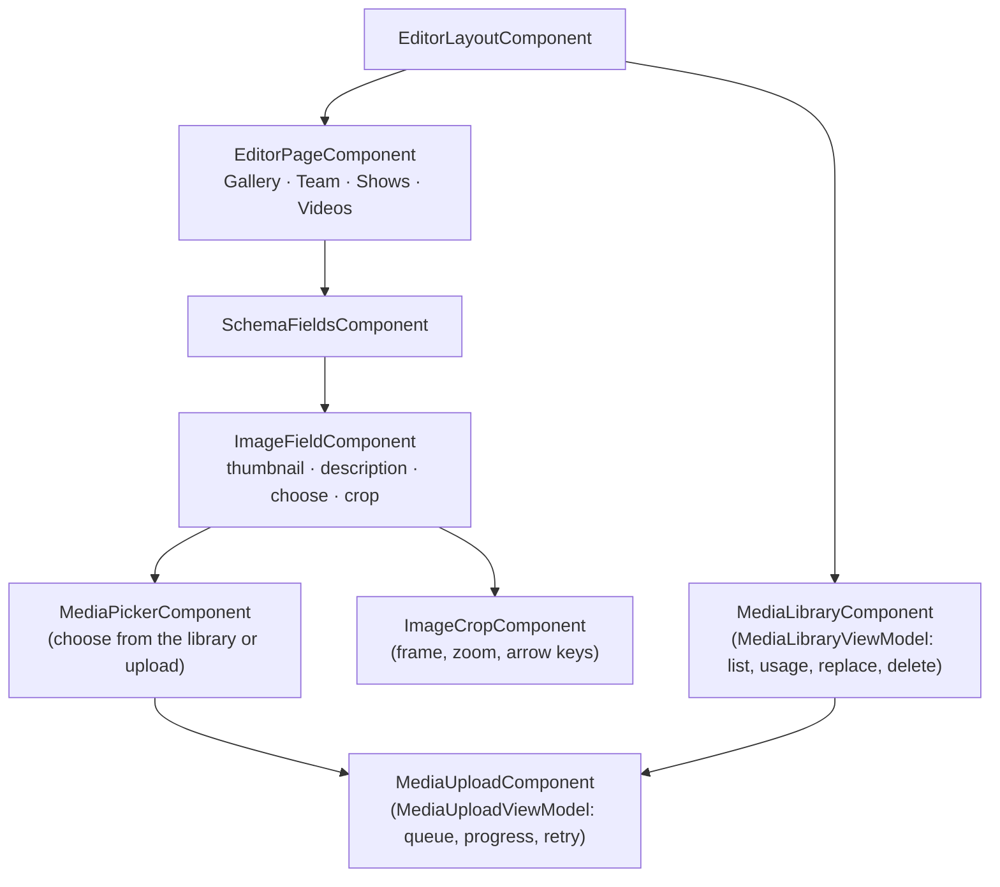
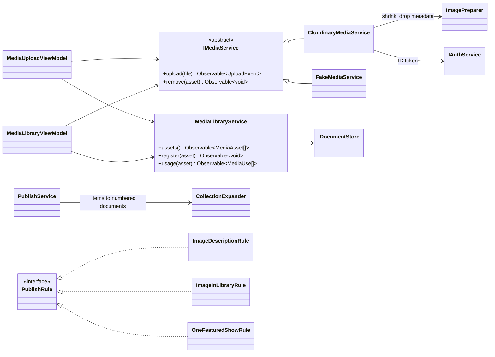
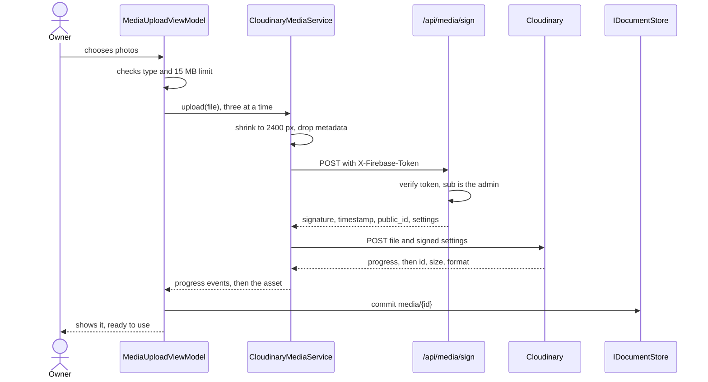
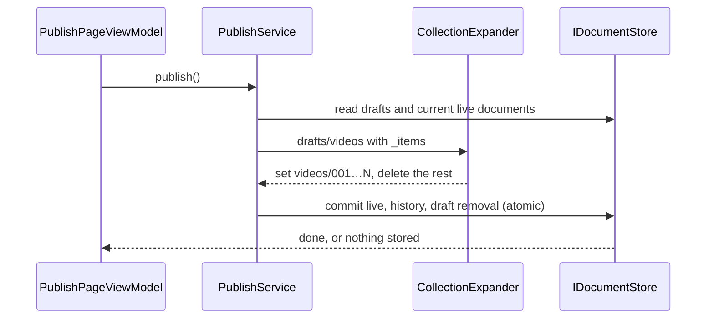

# 02 · Design — Media (1.7.0)

Builds on the [inception](01-inception.md) and the 1.6.0 editor (ADR-0013, ADR-0014). Decisions go into
a new ADR-0017 (upload function and media), plus an update to ADR-0010 (App Check).

## Decisions for the owner

| #   | Question                                               | Recommendation                                                                                                                                                                                                                |
| --- | ------------------------------------------------------ | ----------------------------------------------------------------------------------------------------------------------------------------------------------------------------------------------------------------------------- |
| 1   | **A rule exception: async code in the function (D3).** | Approve. Azure requires the function's handler to return a Promise, and CLAUDE.md §7 allows Promises only in `core/backends` and `main.ts`. The exception covers only the entry point of each function, recorded in ADR-0017. |
| 2   | **App Check on the function (D5).**                    | Keep it deferred. The 1.6.0 design said it would protect this function, but only your verified sign-in can get a signature, so it would add setup with little extra protection.                                               |
| 3   | **PDF brochure or rate card (G11).**                   | Not in 1.7.0. Add it later if you need it; it reuses this upload pipeline.                                                                                                                                                    |
| 4   | **Real-phone speed reports (ADR-0016, step 1).**       | Approve as a separate small change after this release, using the function added here. ADR-0016 stays Proposed until you decide.                                                                                               |

## What the owner has to set up

Nothing here can be done from the repo, and the secret must never be sent to me or committed.

1. Create a Cloudinary account (the free plan is enough). Send me the **cloud name**, which is public.
2. In the Azure portal, under the Static Web App's environment variables, add `CLOUDINARY_CLOUD_NAME`,
   `CLOUDINARY_API_KEY` and `CLOUDINARY_API_SECRET`.

Construction can run without these: unit, rules and e2e tests use a fake. The real-account checks in
Verification need them.

## Key decisions

| #   | Decision                                                                                                                                                                                                                                                                                                                                                                                                                                                                                                                                                                                                                     |
| --- | ---------------------------------------------------------------------------------------------------------------------------------------------------------------------------------------------------------------------------------------------------------------------------------------------------------------------------------------------------------------------------------------------------------------------------------------------------------------------------------------------------------------------------------------------------------------------------------------------------------------------------- |
| D1  | **The browser uploads straight to Cloudinary; a small function only signs.** Files never pass through our server, so the 45 s API limit doesn't apply, and the function stays trivial. The secret lives only in the function's settings (CLAUDE.md §10).                                                                                                                                                                                                                                                                                                                                                                     |
| D2  | **The function is a managed Azure Function in `api/`,** deployed by the existing workflow (`api_location`), available on every Static Web Apps plan, with `apiRuntime: node:22`. Node 22 is the newest version the platform lists; the site's build stays on Node 24. `api/` is its own package with exact versions, its own tests and the 90 % coverage threshold.                                                                                                                                                                                                                                                          |
| D3  | **Rule exception (decision 1):** each function's exported handler is `async`, because the Azure runtime requires it. Inside, the logic stays in small pure functions.                                                                                                                                                                                                                                                                                                                                                                                                                                                        |
| D4  | **Who may call it:** the browser sends the Firebase ID token in an `X-Firebase-Token` header, not `Authorization`, because users report the platform replacing `Authorization` on managed functions. The function verifies the token with `jose` against Google's public keys, with every check Firebase lists: `RS256`, `kid`, `exp`, `iat`, `auth_time`, `aud` and `iss` for the project, and `sub` equal to the admin UID. **It needs no service account**, so no Google credential sits on the server. New dependency: `jose`, because the Admin SDK requires a service account for this.                                |
| D5  | **App Check stays deferred (decision 2).** It would need a reCAPTCHA key and more code in the admin chunk. Signing already requires the admin's verified token. ADR-0010 is updated.                                                                                                                                                                                                                                                                                                                                                                                                                                         |
| D6  | **The function decides what gets signed; the browser can't.** `POST /api/media/sign` takes no upload settings. It returns a random `public_id`, the folder `taal-yatra/media`, `allowed_formats` (`jpg,png,webp,heic`), the incoming transformation below, a timestamp and a SHA-256 signature. A signature lasts an hour, and works only for that random id and those settings.                                                                                                                                                                                                                                             |
| D7  | **Two layers remove GPS data (G8).** (1) The browser redraws each photo it can decode onto a canvas, which drops all metadata before the file leaves the phone. (2) Cloudinary's incoming transformation `a_exif/c_limit,fl_force_strip,w_2400` removes metadata from the stored file. **Changed on 2026-11-03 after the proof on the real account:** the design first used `a_exif/c_limit,w_2400`, relying on a forum reply, and that kept the GPS location of any photo Cloudinary had no need to resize or rotate. `fl_force_strip` removes it in every case (results in the [construction record](03-construction.md)). |
| D8  | **The browser shrinks photos before upload (G2, G9).** Cloudinary's free plan refuses images over **10 MB or 25 megapixels**, and many new phones take larger ones. Decoding, drawing at 2400 px at most and encoding means a 15 MB photo uploads fine, and faster on mobile data. A HEIC file the browser can't decode (Chrome) goes as it is; if it's over Cloudinary's limits, the editor says so and suggests sending it as a JPEG. So G9's "checked again on the server" is Cloudinary's account limit plus `allowed_formats`: the function never sees the bytes.                                                       |
| D9  | **`IMediaService` port** (`core/interfaces`, CLAUDE.md §3). `upload(file)` emits progress and then the stored asset; `remove(asset)` deletes it. Adapters: `CloudinaryMediaService` in `core/backends/cloudinary` (`HttpClient` with `reportProgress`, no SDK; canvas and `createImageBitmap` wrapped with `defer`) and `FakeMediaService` for unit tests, e2e and the emulator. Chosen by a factory; provided only in the admin routes, so public pages never load it.                                                                                                                                                      |
| D10 | **Delivery uses a small custom `IMAGE_LOADER`, not `provideCloudinaryLoader` (a CLAUDE.md §1 deviation, updated in the same change).** The built-in loader rewrites every image, but the site's 44 stored images and its illustrations are local until replaced, and it can't put a crop before the resize. Ours: a `/…` path or a full URL passes through; anything else becomes `res.cloudinary.com/<cloud>/image/upload/<crop>/f_auto,q_auto,w_<w>/<id>`. No template changes, under 1 kB in the public bundle, and `CLOUDINARY_CONFIG` holds the cloud name.                                                             |
| D11 | **Library: `media/{id}`, admin-only** (`{ publicId, width, height, bytes, format, name, description, uploadedAt }`). Uploads go in straight away and aren't drafted: a file is invisible to visitors until a published document uses it.                                                                                                                                                                                                                                                                                                                                                                                     |
| D12 | **New schema field `FieldKind.Image`** (`aspect`, plus the stored `IImage` shape): thumbnail, required description, **Choose or upload**, **Crop**. It works in lists and groups. Later releases reuse it for the other 15 image fields (open/closed, ADR-0014).                                                                                                                                                                                                                                                                                                                                                             |
| D13 | **Upload UI:** drag and drop plus a real file input (keyboard and phone), several files at once with `mergeMap(…, 3)` so a slow phone isn't swamped, per-file progress and retry, announced through `aria-live`.                                                                                                                                                                                                                                                                                                                                                                                                             |
| D14 | **Crop (G4), stored per use, not per image:** `IImage.src` carries it, as `c_crop,x_…,y_…,w_…,h_…/v…/<id>`, so the same photo can be square for the team and 4:3 in the gallery. Aspect ratios match the site's real slots: team 1:1, gallery 4:3, shows 16:10, videos 16:9. A small component of our own: drag the frame, zoom slider, and arrow keys for keyboard users (WCAG 2.2 "dragging movements"). It replaces G4's separate focal point: the crop frame does that job. No new dependency.                                                                                                                           |
| D15 | **Collections are drafted as one document.** `gallery`, `team`, `showFormats` and `videos` are stored as numbered documents. The editor drafts each as `drafts/videos`, with `{ path: 'videos', content: { _items: [...] } }`, so it reuses autosave, `FieldKind.List`, reorder, publish checks, preview and undo unchanged.                                                                                                                                                                                                                                                                                                 |
| D16 | **Publishing a collection expands it** into its numbered documents with `order`, in the same atomic commit as everything else, and deletes the numbers no longer used. History stores the `_items` list, so undo works as usual. `DraftOverlayBackend` answers a collection read from the draft. Item limits keep records small: gallery 60, team 24, shows 20, videos 60.                                                                                                                                                                                                                                                   |
| D17 | **Usage (G5, G7) is worked out when needed,** by walking live documents and drafts for each image, and shown by name ("Team: Asha"). No stored counts to fall out of step.                                                                                                                                                                                                                                                                                                                                                                                                                                                   |
| D18 | **Delete (G7)** is refused while an image is used live or in a draft. `POST /api/media/delete` accepts only ids inside `taal-yatra/media`. It deletes at Cloudinary first, then the `media` document; retrying is safe because "not found" counts as done. Publish history can still mention a deleted image, so a new publish check blocks publishing any image that's no longer in the library.                                                                                                                                                                                                                            |
| D19 | **Replace (G6)** uploads a new file and rewrites each use into drafts, keeping descriptions and warning that crops need checking. It goes through review and publish like any change, and uses a new URL, so no cached old image lingers.                                                                                                                                                                                                                                                                                                                                                                                    |
| D20 | **Videos (E5):** pasting a YouTube link fills in the thumbnail from `i.ytimg.com`, or the owner can upload one. Title and duration are typed, so no YouTube API key is needed. The first video in the list is the featured one, so reordering chooses it.                                                                                                                                                                                                                                                                                                                                                                    |
| D21 | **Team and shows (E2, E3):** a hint says the first four team members appear on the home page. Show icons are a choice from the existing set. A show's spotlight fields appear only when **Featured** is on, and a publish check allows one featured show at most.                                                                                                                                                                                                                                                                                                                                                            |
| D22 | **Write rules:** the admin may write `gallery/*`, `team/*`, `showFormats/*`, `videos/*`, `home/gallery` and `home/shows` with the right shape and limits, and read and write `media/*`. Public reads don't change.                                                                                                                                                                                                                                                                                                                                                                                                           |
| D23 | **New tabs:** Gallery, Team, Shows, Videos and Media library. The first four are schema entries; the library is one new lazy page.                                                                                                                                                                                                                                                                                                                                                                                                                                                                                           |

## Component tree

## Class diagram

## Sequence: upload

## Sequence: publish a collection

## Data and configuration

| Item                              | Change                                                                  |
| --------------------------------- | ----------------------------------------------------------------------- |
| `media/{id}`                      | **new, admin-only** (D11)                                               |
| `IImage.src`                      | may now be `[crop/]v…/<id>` as well as a local path or full URL         |
| `drafts/{gallery,team,…}`         | **new shape** for collections: `{ path, content: { _items }, savedAt }` |
| `firestore.rules`                 | D22                                                                     |
| `api/`                            | **new:** `media/sign` and `media/delete`                                |
| `public/staticwebapp.config.json` | `platform.apiRuntime: node:22`                                          |
| Workflow                          | `api_location: api`; CI builds and tests `api/`                         |
| Azure settings (owner)            | `CLOUDINARY_CLOUD_NAME`, `CLOUDINARY_API_KEY`, `CLOUDINARY_API_SECRET`  |
| Function constants                | admin UID and project ID, which aren't secrets (ADR-0012)               |
| Tokens                            | `CLOUDINARY_CONFIG` (CLAUDE.md §6 already lists it)                     |
| Seed                              | no new content; existing documents and local images stay valid          |

## Test plan

- **Function (Vitest, `api/`):**
  - tokens signed by a local test key: valid admin; wrong UID, expired, wrong audience, wrong issuer,
    wrong `alg`, unknown `kid`, missing header
  - the signature against a known example from Cloudinary's rules
  - the browser can't influence what's signed; delete refuses ids outside the folder
- **Unit:** `IMAGE_LOADER` (local, full URL, plain, cropped); `ImagePreparer` with a fake canvas;
  both media adapters; upload queue (limit of three, retry, one failure doesn't stop the rest); crop
  maths and keyboard; `CollectionExpander` (grow, shrink, reorder); usage; each new publish rule;
  overlay collection reads; every new schema against `fake-db.json`.
- **Rules (emulator):** admin writes with valid shapes; visitors, other accounts and bad shapes
  refused; `media` private; public reads unchanged.
- **E2E (Fake, 3 viewports):** upload and describe a photo; crop it; reorder the gallery, publish, see
  it on the site, undo; add a team member; a blocked delete; add a video from a link; axe on each new
  view.
- **Firebase smoke:** publish a collection on the emulator through the real rules and read it publicly.
- **Verification on the real account (needs the setup above):** a GPS-tagged photo leaves no location in
  the stored file or delivered images (checked with an EXIF tool); a real HEIC from an iPhone; signing
  refused for another account; the `X-Firebase-Token` header arrives; no editor code on public pages.

## Increments

1. **Proof first:** the function plus one real signed upload; GPS, HEIC and header checks. If a check
   fails, I stop and bring it back to you, because it would change this design.
2. Rules, `media`, port, adapters, loader.
3. Upload and library UI.
4. Image field and crop.
5. Collections: drafts, overlay, publish expansion, undo.
6. Gallery, Team, Shows and Videos tabs.
7. Replace and delete with usage.
8. Docs, ADR-0017, CLAUDE.md, diagrams.

## Risks

- **A real iPhone photo isn't proven yet** (D7): the proof used a HEIC made on a Mac, and phones may store
  location differently. Verification repeats it with a real iPhone photo through the finished upload
  screen.
- **The `Authorization` report is anecdotal** (D4): the custom header works whether it's true or not.
- **Free-plan limits:** 25 credits a month, where one credit is 1 GB of storage, 1 GB of bandwidth or
  1,000 transformations. Enough to start, but a popular gallery could use it up; the dashboard is in
  Cloudinary's console.
- **Rollback gets harder.** Once published data points to Cloudinary, a 1.6.0 build can't show those
  images, because it has no loader. Rolling back means restoring content too; the operations record will
  spell this out.
- **Deploy order:** merging deploys the app, so rules and the Azure settings go in **before** the merge
  (the lesson from 1.6.0).
- **Pull request preview sites** won't have the Azure settings, so uploads will fail there with a clear
  message. Production isn't affected.
- **Size:** this release is about as large as 1.6.0, which is why the risky proof comes first.

## References

- [Azure: Static Web Apps API constraints](https://learn.microsoft.com/en-us/azure/static-web-apps/apis-overview) · [supported runtimes](https://learn.microsoft.com/en-us/azure/static-web-apps/languages-runtimes)
- [Report of `Authorization` being replaced](https://community.auth0.com/t/azure-static-website-api-overrides-the-bearer-attribute-in-the-header/48942)
- [Cloudinary: signatures](https://cloudinary.com/documentation/authentication_signatures) · [plan limits](https://cloudinary.com/pricing/compare-plans) · [staff reply on stripping GPS at upload](https://support.cloudinary.com/hc/en-us/community/posts/115003112391-Stripping-out-geo-location-data-on-upload)
- [Firebase: verifying ID tokens](https://firebase.google.com/docs/auth/admin/verify-id-tokens)

---

**Approval:** ☑ Approved by Ravi Akhouri on 2026-11-02, with every recommendation: the async entry-point exception, App Check stays deferred, no PDFs in 1.7.0, real-phone speed reports as a separate change after this release. G10 and the other image fields move to 1.8.0.
