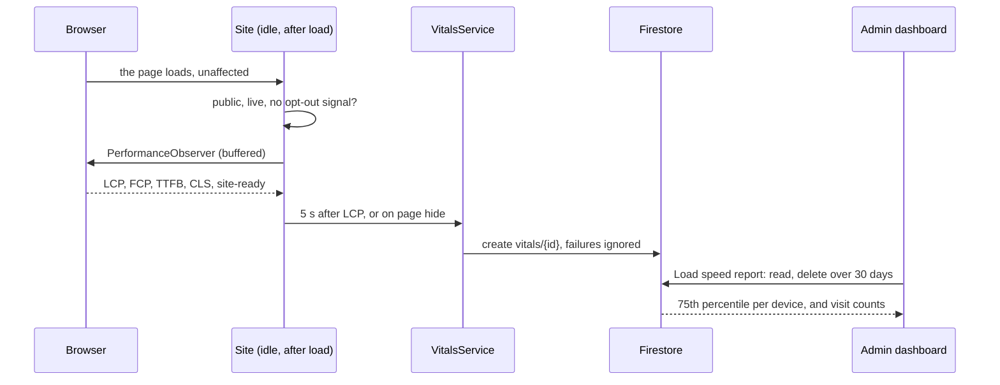

# 02 · Design — Real-phone speed reports

## Decisions for the owner

| #   | Question                                                                                                                          | Recommendation                                                                                                                                                           |
| --- | --------------------------------------------------------------------------------------------------------------------------------- | ------------------------------------------------------------------------------------------------------------------------------------------------------------------------ |
| 1   | **Store anonymous speed reports in Firestore?** This is the first data the site stores about visits that didn't ask for anything. | Yes, with exactly the fields in D5. It reuses what the site already has, needs no new account, and the answer shows in the admin area.                                   |
| 2   | **Privacy wording.** The site has no privacy page, though it already collects names and phone numbers through the proposal form.  | Add a privacy page, separately from this work, and take advice on the wording. The reports hold nothing personal, but the proposal form does. I can't give legal advice. |
| 3   | **Version number.** The rules say a feature bumps the minor version, and 1.8.0 is planned as the remaining content.               | Release this as 1.8.0, and move the plan along: remaining content 1.9.0, proposals and account 1.10.0.                                                                   |

## Key decisions

| #   | Decision                                                                                                                                                                                                                                                                                                                                                                                                                                                                             |
| --- | ------------------------------------------------------------------------------------------------------------------------------------------------------------------------------------------------------------------------------------------------------------------------------------------------------------------------------------------------------------------------------------------------------------------------------------------------------------------------------------ |
| D1  | **The browser's own `PerformanceObserver`, no new dependency** (as ADR-0016 said). It reports the main content's load time (LCP), first paint (FCP), first server response (TTFB) and layout shift (CLS). A mark when the site's data arrives (`site-ready`, one line in the shell) also answers ADR-0016's open question: how much of the wait is the app starting and how much is the data. **INP is left out:** it isn't the question, and measuring it properly needs more code. |
| D2  | **It can't slow the page down.** It starts when the browser is idle after the page has loaded, as its own lazy chunk. `buffered: true` still delivers what happened earlier. **The initial bundle is at 498.63 kB, against a 500 kB warning,** so only a small call may go in it; if this doesn't fit, I'll stop and bring it back.                                                                                                                                                  |
| D3  | **One report per page load,** sent 5 seconds after the main content is known, or when the page is hidden, whichever comes first. Failures are swallowed: no toast, no retry, no log. The `sendBeacon` API would survive a page closing better, but needs a server to receive it. See the risks for the effect on the numbers.                                                                                                                                                        |
| D4  | **Who is counted:** the live public site only. Nothing is sent from `/admin`, `?preview` visits, development or e2e, or when the browser sends Global Privacy Control or Do Not Track.                                                                                                                                                                                                                                                                                               |
| D5  | **What's stored** in `vitals/{autoId}`: `page` (the route, from a fixed list, with no query string), `device` (phone, tablet or desktop, from the screen width), `connection` (the browser's own rough class, such as `4g`, when it gives one), the five numbers, and `createdAt` from the server. **Not stored:** IP address, any ID, cookies, browser string, or where the visitor came from. A report can't be linked to another, or to a proposal.                               |
| D6  | **Rules:** anyone may create a report with exactly those fields and sensible limits, like `proposals`. Only the admin may read or delete them.                                                                                                                                                                                                                                                                                                                                       |
| D7  | **Port and adapter:** `VitalsService` sends through the existing `IHttpBackend.post`, which already loads Firestore on public pages and stamps `createdAt`. The fake backend accepts and forgets reports. No new adapter.                                                                                                                                                                                                                                                            |
| D8  | **The report is a new card on the admin dashboard,** read when the owner presses **Load speed report**, so it costs no reads otherwise. It shows, per device, the 75th percentile of each number over the last 30 days (the same measure Google uses), and how many visits that covers. Loading it also deletes reports older than 30 days, so the collection stays small.                                                                                                           |
| D9  | **Saying what it means:** with at least 200 phone visits, the card says whether phones meet the 2.5 s target. With fewer, it says there isn't enough yet.                                                                                                                                                                                                                                                                                                                            |

## What happens next, by result (from ADR-0016)

| Real phones, 75th percentile                            | Meaning                                      | Next                                                   |
| ------------------------------------------------------- | -------------------------------------------- | ------------------------------------------------------ |
| Under 2.5 s                                             | The simulated test is harsher than real life | Record an exception to the Lighthouse target, and stop |
| Over 2.5 s, and `site-ready` is most of it              | Waiting for data                             | Test a data snapshot in a throwaway build              |
| Over 2.5 s, and the wait is before `site-ready` is near | The app's start-up                           | Look at start-up cost, then decide                     |

## Sequence

## Data and configuration

| Item                             | Change                                                           |
| -------------------------------- | ---------------------------------------------------------------- |
| `vitals/{id}`                    | **new:** create-only for visitors, read and delete for the admin |
| `firestore.rules`                | **must be deployed before the merge**                            |
| Dependencies, accounts, settings | none                                                             |

## Test plan

- **Unit:** each metric from a fake observer; one report per load; the 5-second and page-hide paths; a failed send stays silent; nothing sent in admin, preview or with an opt-out signal; percentiles; too few visits; pruning.
- **Rules:** a valid report is accepted; extra fields, out-of-range numbers and unknown pages are refused; visitors can't read, change or delete.
- **E2E:** the admin card on three viewports, with axe.
- **Firebase smoke:** a real browser's report stored through the real rules.
- **Performance:** initial bundle under 500 kB, and Lighthouse on the live site compared with 1.7.1's numbers.

## Alternatives

| Option                            | Why not                                                                                                                  |
| --------------------------------- | ------------------------------------------------------------------------------------------------------------------------ |
| Azure Application Insights        | Needs portal setup, its script is heavier, and the owner would read results in Azure rather than the admin area          |
| Google's public field data (CrUX) | Free and needs no code, but only covers sites with enough traffic, which a new site probably isn't. Worth checking once. |
| The `web-vitals` library          | About 2 kB and more accurate at the edges, but ADR-0016 said no new dependency, and LCP doesn't need it                  |
| A beacon to the Azure Function    | Survives closing the page better, but the function has no Google credential to store anything with                       |

## Risks

- **The numbers lean slightly fast.** A visitor who leaves before the report is sent, or before the content appears at all, isn't counted, and those are often the slowest visits. So "over target" is reliable, and "just under" should be read with care.
- **Fake reports are possible,** as with `proposals`, because App Check is deferred (ADR-0010). They could skew the numbers, and rules limit their shape but not their count.
- **Shared daily quota.** On Firestore's free plan, a flood of fake reports could use up the day's writes, about 20,000, which would also stop proposals being stored until it resets. Real traffic is nowhere near this.
- **Low traffic:** 200 phone visits may take a while, which is why the card says so plainly.
- **Deploy order:** the last two releases went out with the rules late. The pull request for this one will say so at the top.

---

**Approval:** ☑ Approved by Ravi Akhouri on 2026-11-05, with all three recommendations: store the reports in Firestore, add a privacy page separately, and release as 1.8.0.
