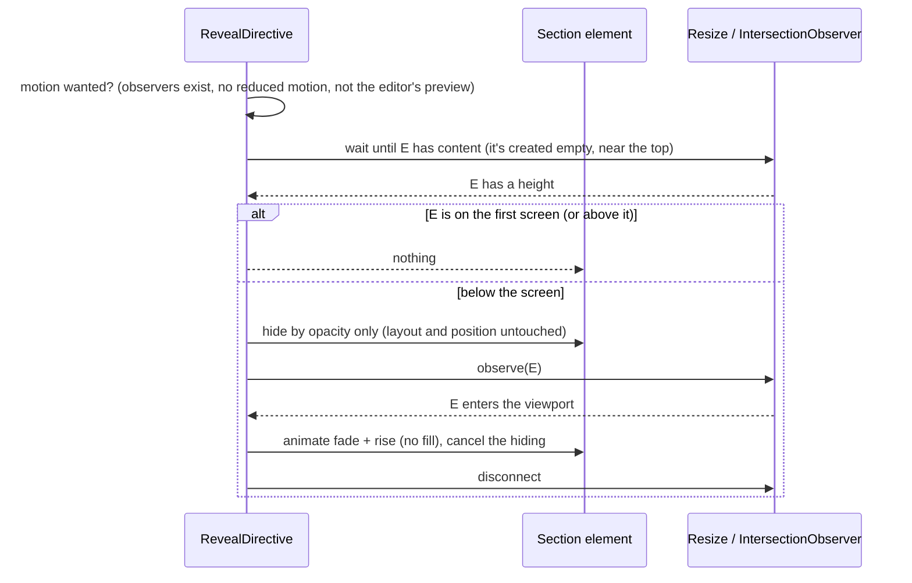

# 02 · Design — Drum circle editor and gentle reveal (1.9.0)

## Part 1 · Drum circle editor

No new mechanism. One more schema section, built with the existing field kinds (ADR-0014), so the editor, preview,
autosave, publish, undo, image crop and "in use" checks all work unchanged.

### Where it goes

**Music & creativity** tab, after the experiences, as **Drum circle details**. The preview opens at `#drum-circle-details`.

### Fields (`home/drumCircle`, shape unchanged)

| Field                           | Kind                         | Limits                                    |
| ------------------------------- | ---------------------------- | ----------------------------------------- |
| Small heading, Title            | text                         | 60, 120 (existing limits)                 |
| Facts                           | list of {label, value}       | exactly 4 (the strip has 4 columns)       |
| About heading                   | text                         | 60                                        |
| About paragraphs                | list of multiline            | 1–4, 600 each                             |
| Objectives / Occasions headings | text                         | 60                                        |
| Objectives, Occasions           | lists of text                | 1–10 each, 40 each                        |
| Button label                    | button label                 | default "Request proposal"                |
| Pictures                        | list of images               | exactly 3 (the gallery's 3-column layout) |
| Similar experiences heading     | text                         | 60                                        |
| Similar experiences             | list of text                 | 0–6, 40 each; each links to Experiences   |
| Session flow heading, unit      | text                         | 60, 10                                    |
| Session flow                    | list of {step name, minutes} | 2–8 steps, 40 characters, 1–240 minutes   |

New limits go in `CONTENT_MAX_LENGTH`. Pictures use one crop shape, **16:10**, like experiences. The gallery's frames vary by
screen width (about 2:1 for the wide one, 1.4:1 for the others), and the site already fills them with `object-fit: cover`, so
one shape keeps the editor simple and still frames well everywhere.

### Rules

`home/{section}` adds `drumCircle` to the sections the admin may update. `isValidHomeSection` already keeps the stored key set
fixed and checks the headings. No other rule changes. **The rules must be deployed before this is merged**, because the new
editor writes a section the live rules refuse.

## Part 2 · Gentle reveal

### Behaviour

- Each home section **below the first screen** fades from transparent to visible and rises 40 px, over 1 s with a soft ease-out (slowed from 600 ms and 24 px at the owner's request), the first
  time it comes into view. It never animates again.
- Sections on the first screen (hero, marquee, trust bar, and anything already in view when the page opens) never animate,
  so the first screen and its load time are unchanged.
- **Reduced motion:** when the device asks for it, nothing is hidden or animated.
- **Inside the editor's preview** nothing is hidden: the preview moves to sections itself (Part 3).

### Decisions (recommendations)

| #   | Decision                 | Recommendation                                                                                                         |
| --- | ------------------------ | ---------------------------------------------------------------------------------------------------------------------- |
| 1   | Pages                    | Home page only for now. The inner pages are short. Add them later if the owner wants it there too.                     |
| 2   | Pictures inside sections | No separate picture fade. The section's fade covers most of it. A per-picture fade touches every image component.      |
| 3   | Smooth-scrolling library | No. Libraries such as Lenis take over wheel and touch scrolling, often feel worse on phones, and fight assistive tech. |
| 4   | The assistant            | Not wrapped. It has `position: fixed` parts, which a transform on its host would break.                                |

### How it works

A standalone `RevealDirective` (`shared/directives/reveal.directive.ts`, selector `[appReveal]`), put on each deferred section
in `home-page.component.html`.

- **Found while building:** sections are created before their data arrives, empty and near the top, so deciding at
  creation saw them all as "in view". The directive now waits until the section has content.
- **Found while building:** hiding with the rise applied moved the section down by the rise while hidden, so a link to it landed
  that far off. Hidden sections are now transparent only; the rise happens only while revealing.
- **No CSS and no inline styles.** It uses the Web Animations API (`element.animate`), so nothing is added to the global
  stylesheet, and the directive loads only with the home page's deferred sections.
- **Browser APIs:** the global observers and `inject(DOCUMENT).defaultView`, as the rest of the code does. (CLAUDE.md lists
  a `WINDOW` token, but the code has never had one.)
- **Timings and offset** are constants in `shared/constants/reveal.constants.ts`.

### Risk: content that never reveals

If the observer never fires, the section stays invisible. Guards: nothing is hidden without both observers, with reduced
motion, or in the editor; a section on the first screen isn't hidden; nothing is hidden before it has content.

## Part 3 · Links that land, and an editor preview that follows (added 2026-11-17)

The owner reported three more problems while this design waited for approval, and asked for them to be fixed with the
reveal: scrolling "so fast that it irritates the eyes"; the editor's preview not following the section scrolled to; and
the preview not coming back to the section after a save.

### Public site: links to a section

- **Measured bug (since 1.1.0):** with motion on, `/#contact` scrolled smoothly to where the contact form was when it first
  existed (about 1,300 px), but the sections above it were still empty. They filled in during the scroll and the page
  stopped at "Who it's for", 11,000 px short. The long smooth scroll was also the "too fast" blur.
- **Fix:** no site-wide `scroll-behavior: smooth`. A link jumps straight to its section, which then fades in (Part 2).
  `SectionHoldService` (home page only, so not in the initial download) keeps the section at the top while the page above it
  grows, for up to 3 s, and lets go the moment the visitor scrolls, presses a key or touches the screen.
  `HomePageViewModel` starts it for every fragment (`switchMap`: a new link lets go of the old one).

### Editor preview

- **Follows scrolling:** `InViewDirective` on each card says when it reaches a line 30 % down the screen. `EditorPageViewModel`
  moves the preview there once scrolling pauses for 250 ms (`debounceTime`), so a quick scroll past several cards moves it
  once. Clicking into a field still moves it at once.
- **No racing scroll:** `PreviewScroller` fades the preview out (150 ms), jumps, and fades it back in (250 ms). With reduced
  motion it just jumps.
- **Comes back after a save:** the reload no longer carries `#section` (the site would race to it itself). The frame is
  hidden while it reloads, then jumps to the section and stays there while the live data arrives (the same 4 s hold, using
  the frame's own `ResizeObserver`), unless the owner scrolls the preview.

## Testing

- **Unit:** the schema section (fields, limits, list sizes); the directive: hides then reveals below the fold, leaves
  in-view and reduced-motion sections alone, disconnects on destroy, does nothing without an observer.
- **Rules:** the admin can update `home/drumCircle` with the existing keys; a visitor can't; extra keys are refused.
- **E2E:** edit a drum circle picture's description and title, publish, and see them on the home page. The suite runs with
  reduced motion, so screenshots don't change. `home-reveal.e2e.ts` runs with motion on: a lower section starts hidden and
  ends visible, `/#contact` lands exactly, and reduced motion leaves everything visible. `admin-editor.e2e.ts`: scrolling the
  editor to a card moves the preview to its section.
- **Speed:** initial download size and Lighthouse on mobile and desktop, compared with 1.8.0.

## Diagrams and docs to update

Component tree (directive on the home sections), class diagram (directive), data model (`drumCircle` editable), rules note
in the data model, editor docs (ADR-0014 list of editable sections), CHANGELOG.

---

**Approval:** ☐ Pending. Parts 2 and 3 were built on the owner's request of 2026-11-17 ("please check and update the
code"), ahead of approving this record, for the owner to try locally. Part 1 waits for approval.
