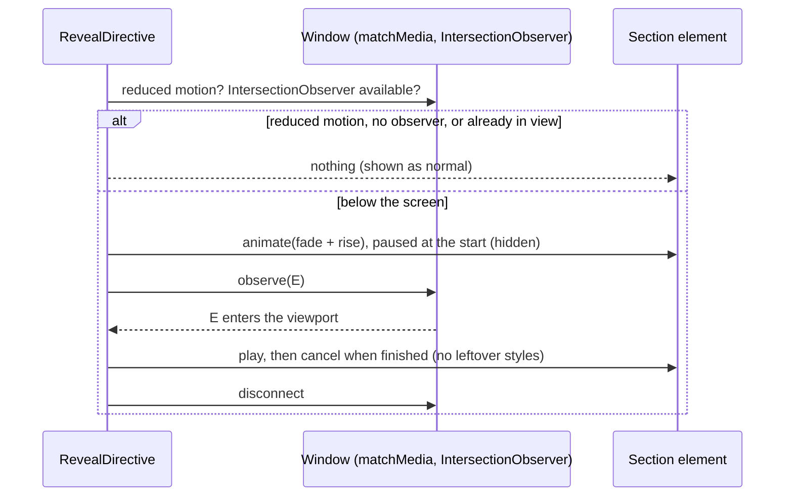

# 02 · Design — Drum circle editor and gentle reveal (1.9.0)

## Part 1 · Drum circle editor

No new mechanism. One more schema section, built with the existing field kinds (ADR-0014), so the editor, preview,
autosave, publish, undo, image crop and "in use" checks all work unchanged.

### Where it goes

**Music & creativity** tab, after the experiences, as **Drum circle details**. The preview opens at `#drum-circle-details`.

### Fields (`home/drumCircle`, shape unchanged)

| Field                           | Kind                         | Limits                                    |
| ------------------------------- | ---------------------------- | ----------------------------------------- |
| Small heading, Title            | text                         | 60, 120 (existing limits)                 |
| Facts                           | list of {label, value}       | exactly 4 (the strip has 4 columns)       |
| About heading                   | text                         | 60                                        |
| About paragraphs                | list of multiline            | 1–4, 600 each                             |
| Objectives / Occasions headings | text                         | 60                                        |
| Objectives, Occasions           | lists of text                | 1–10 each, 40 each                        |
| Button label                    | button label                 | default "Request proposal"                |
| Pictures                        | list of images               | exactly 3 (the gallery's 3-column layout) |
| Similar experiences heading     | text                         | 60                                        |
| Similar experiences             | list of text                 | 0–6, 40 each; each links to Experiences   |
| Session flow heading, unit      | text                         | 60, 10                                    |
| Session flow                    | list of {step name, minutes} | 2–8 steps, 40 characters, 1–240 minutes   |

New limits go in `CONTENT_MAX_LENGTH`. Pictures use one crop shape, **16:10**, like experiences. The gallery's frames vary by
screen width (about 2:1 for the wide one, 1.4:1 for the others), and the site already fills them with `object-fit: cover`, so
one shape keeps the editor simple and still frames well everywhere.

### Rules

`home/{section}` adds `drumCircle` to the sections the admin may update. `isValidHomeSection` already keeps the stored key set
fixed and checks the headings. No other rule changes. **The rules must be deployed before this is merged**, because the new
editor writes a section the live rules refuse.

## Part 2 · Gentle reveal

### Behaviour

- Each home section **below the first screen** fades from transparent to visible and rises 24 px, over 600 ms, the first
  time it comes into view. It never animates again.
- Sections on the first screen (hero, marquee, trust bar, and anything already in view when the page opens) never animate,
  so the first screen and its load time are unchanged.
- **Reduced motion:** when the device asks for it, nothing is hidden or animated.
- **Links to a section** (such as `/#contact`) scroll there as now. The section reveals as it arrives. A transform doesn't
  change layout, so the scroll position is exact and there is no layout shift (CLS ignores transforms).

### Decisions (recommendations)

| #   | Decision                 | Recommendation                                                                                                                                                                                               |
| --- | ------------------------ | ------------------------------------------------------------------------------------------------------------------------------------------------------------------------------------------------------------ |
| 1   | Pages                    | Home page only for now. The inner pages are short. Add them later if the owner wants it there too.                                                                                                           |
| 2   | Pictures inside sections | No separate picture fade. The section's fade covers most of it. A per-picture fade touches every image component.                                                                                            |
| 3   | Smooth-scrolling library | No. Libraries such as Lenis take over wheel and touch scrolling, often feel worse on phones, and fight assistive tech. Link scrolling is already smooth (`scroll-behavior: smooth`, off for reduced motion). |
| 4   | The assistant            | Not wrapped. It has `position: fixed` parts, which a transform on its host would break.                                                                                                                      |

### How it works

A standalone `RevealDirective` (`shared/directives/reveal.directive.ts`, selector `[appReveal]`), put on each deferred section
in `home-page.component.html`.

- **No CSS and no inline styles.** It uses the Web Animations API (`element.animate`), so nothing is added to the global
  stylesheet. The initial download stays as it is, because the directive only loads with the home page's deferred sections.
- **Browser APIs through `inject(DOCUMENT).defaultView`**, as `LocalStoreService` and the vitals reporter do, so unit tests
  give it a fake observer and a fake `matchMedia`. (CLAUDE.md lists a `WINDOW` token, but the code has never had one; this
  follows the existing code rather than adding it.)
- **Timings and offset** are constants in `shared/constants/reveal.constants.ts`.
- **Clean-up:** the observer disconnects on reveal or when the section is destroyed (`DestroyRef`).

### Risk: content that never reveals

If the observer never fires, the section stays invisible. Guards: no hiding without `IntersectionObserver`; no hiding with
reduced motion; and a section already in view at start isn't hidden. The "in view" margin is generous (the section counts as in
view 10 % before its top reaches the screen's bottom edge), so a fast scroll can't skip it.

## Testing

- **Unit:** the schema section (fields, limits, list sizes); the directive: hides then reveals below the fold, leaves
  in-view and reduced-motion sections alone, disconnects on destroy, does nothing without an observer.
- **Rules:** the admin can update `home/drumCircle` with the existing keys; a visitor can't; extra keys are refused.
- **E2E:** edit a drum circle picture's description and title, publish, and see them on the home page. The suite runs with
  reduced motion, so screenshots don't change. One extra desktop test runs with motion on and checks a lower section ends
  fully visible after scrolling to it.
- **Speed:** initial download size and Lighthouse on mobile and desktop, compared with 1.8.0.

## Diagrams and docs to update

Component tree (directive on the home sections), class diagram (directive), data model (`drumCircle` editable), rules note
in the data model, editor docs (ADR-0014 list of editable sections), CHANGELOG.

---

**Approval:** ☐ Pending
