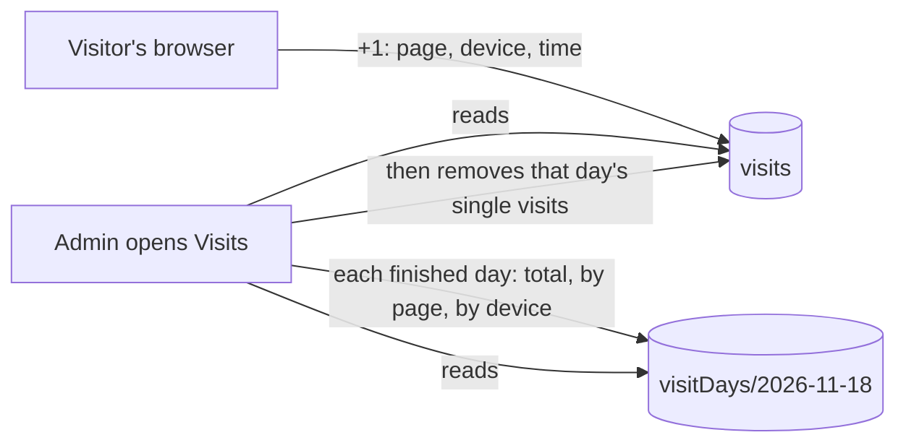

# 02 · Design — Visits and leads (1.13.0)

Everything the owner sees is in the admin area, which is lazy-loaded. The only public change is the visit counter, which
rides on the speed reports' code (0012): it loads after the page, in its own chunk.

## V11 · Counting visits

### What counts as a visit

- **One per opening of the site in a tab:** the page a visitor arrives on is counted once, a few seconds after it has loaded.
  Moving between pages in the site isn't another visit, and neither is a reload in the same tab: the tab remembers "counted"
  (`sessionStorage`, a plain yes, never an id) until it's closed.
- **Not counted**, by the same checks as the speed reports: search robots, speed tools (Lighthouse, PageSpeed), test
  browsers, previews of drafts, and browsers that ask not to be tracked ("do not track", Global Privacy Control).
- **Not counted either:** the owner's own devices. Signing in to the admin area marks that browser, so testing the site
  from it doesn't inflate the numbers.
- **What one visit stores:** the page arrived on (one of the five public pages), phone / tablet / desktop, and the server's
  time. No cookie, no id, no address, nothing about the visitor. A visitor who leaves within the first seconds isn't counted:
  the count starts only after the page has loaded, like the speed reports, so it can't slow the visit.

### How it's stored

- **Visitors only add** a well-formed visit to `visits`, exactly as they add speed reports. The rules check the page and
  device against fixed lists, and stamp the time on the server, so a visit can't be backdated.
- **The admin area tidies up:** when the owner opens Visits or the dashboard, each finished day's visits are added up into
  one small `visitDays/{date}` document (total, by page, by device) and the single visits are removed. Today's visits are
  counted live. So the database holds one document per day, not one per visit, and reading a year costs about 365 reads,
  well inside the free plan.
- **Safe if two devices tidy at once:** a day's document can only be created, never changed, so a second device can't
  overwrite it with a different total; it just skips that day.
- **Days are India time** (Asia/Kolkata), so a visit at 1 a.m. counts for that day, not the day before.
- **The first download doesn't grow:** the counting code sits in the speed reports' chunk, which the reporter already loads
  after the page. The reporter in the first download only learns to send what the chunk gives it (speed report, visit, or
  both). That's measured in verification against the 500 kB budget (0.52 kB to spare today).

### The Visits page

- **A new "Business" group in the side panel** with **Visits** and **Leads**.
- **One graph for visits and one for proposals**, simple bars drawn by the page itself (no chart library, so nothing
  heavy to download), with a switch: **By day** (last 30 days), **By week** (last 12 weeks), **By month** (last 12 months),
  **By year**. Each bar shows its number on hover or tap, and the same numbers are in a table for screen readers.
- Under the graphs: the **total** for the period and the one before ("324 visits, up from 290"), the **pages visitors arrive
  on**, and **phone / tablet / desktop**.
- **Before counting began**, the graph says "Visits are counted from 18 Nov 2026" instead of showing empty bars as zeros.

## V12 · Leads

### The Leads page

- **Every proposal, newest first**, as a card: name, phone (tap to call, or open WhatsApp), email (tap to write), event type,
  experience, group size, date wanted, message, and when it arrived.
- **Status** on each: **New** (the default, also for proposals from before this release), **Contacted**, **Won**, **Lost**.
  Changing it saves at once, with the time.
- **Filters:** status, event type, group size and month received, plus a search by name, phone or email. The page says how
  many match.
- **Export CSV:** the leads shown (with the filters applied) download as a spreadsheet file, through the backups' file port.
  Cells that a spreadsheet could run as a formula (starting with `=`, `+`, `-` or `@`) are written as plain text, so a
  visitor's message can't run anything on the owner's computer.
- **Delete** a lead, after a warning ("This removes Priya's details for good"). For a customer who asks to be forgotten.
- **"New" count:** on the Leads link in the menu, and a dashboard card: "3 new leads" with the newest one's name and date.

### Graph of proposals

From the same leads the page reads, grouped by the day they arrived: no extra storage.

## D6 · Leads in backups

- The backups card gets a tick box, **Include leads**, off by default. Ticked, the file holds every lead and the card says:
  "This file has customers' names, phone numbers and emails. Keep it somewhere safe."
- **A backup with leads isn't kept in this browser**, only downloaded: personal details shouldn't sit in the browser's
  storage. The browser copy stays the last backup without leads.
- **Restoring doesn't touch leads.** Restore puts content into the drafts for review; leads aren't content, and the rules
  only let visitors add them. A deleted lead can be read back from the file (or a CSV export).

## Rules changes

Tested on the emulator, deployed before merging, as in 0016.

| Collection         | Visitors                                                   | Admin                                                           |
| ------------------ | ---------------------------------------------------------- | --------------------------------------------------------------- |
| `visits/{id}`      | Create only: page and device from fixed lists, server time | Read, delete                                                    |
| `visitDays/{date}` | Nothing                                                    | Read; create only (a date id, whole numbers only); never change |
| `proposals/{id}`   | Create only (unchanged)                                    | Read, delete; change only `status` (one of four) and `statusAt` |

## Ports and code

- **Counting:** the speed reports' chunk (`core/backends/browser`) gains a small visit source; the reporter sends whatever
  it emits through `IHttpBackend.post`, as today. No new port in the first download.
- **Reading and tidying:** the admin's `IDocumentStore` (read all, atomic commit), as the speed report does; a
  `VisitsService` and `LeadsService` in `features/admin/services`, with their view models and pages.
- **CSV:** `IFileService.download` (0016).
- **Graph:** one presentational `BarChartComponent` (SVG bars, a table for screen readers), used for both graphs.

## Testing

- **Unit:** what counts and what doesn't (robots, do-not-track, preview, admin device, reload in the same tab); adding up a
  day; skipping a day another device already did; India-time days; week, month and year grouping; the before-counting
  message; lead filters, status change, delete; CSV escaping, including formula-like cells; the "New" count.
- **Rules:** visitors can add only a well-formed visit or proposal and read nothing; the admin's day documents can't be
  changed; only `status` and `statusAt` of a lead can change; everyone but the admin is refused.
- **E2E (three screen sizes, fake backend):** open Visits and switch between day, week, month and year; open Leads, filter,
  change a status, export a CSV, delete a lead; the "New" count; the backups tick box; axe on both pages.
- **Firebase smoke:** a visit is counted on the emulator and appears on Visits.
- **Speed:** the public first download within budget.

## Decisions (recommendations)

| #   | Decision                          | Recommendation                                                                                            |
| --- | --------------------------------- | --------------------------------------------------------------------------------------------------------- |
| 1   | What a visit is                   | One per opening of the site in a tab; moving between pages and reloading don't count again                |
| 2   | Visitors asking not to be tracked | Not counted, like the speed reports (a small undercount; matches what the privacy page will say)          |
| 3   | The owner's own visits            | Not counted on browsers where the admin area has been signed in to                                        |
| 4   | Where the days are                | India time                                                                                                |
| 5   | Storage                           | Single visits, added up into one document per day when the admin area opens                               |
| 6   | Lead statuses                     | New, Contacted, Won, Lost                                                                                 |
| 7   | Deleting leads                    | Allowed, after a warning (for customers who ask to be forgotten)                                          |
| 8   | Leads in a backup                 | Only when ticked; such a backup is downloaded only, never kept in the browser; restore leaves leads alone |

## Notes for the owner

- **Counting starts the day 1.13.0 goes live.** Earlier visits can't be recovered (programme point 4).
- **The privacy page** should say that visits are counted anonymously; that wording is yours, and is already on your list.

---

**Approval:** ☑ Approved by Ravi Akhouri on 2026-11-18, with decisions 1–8 as recommended.
