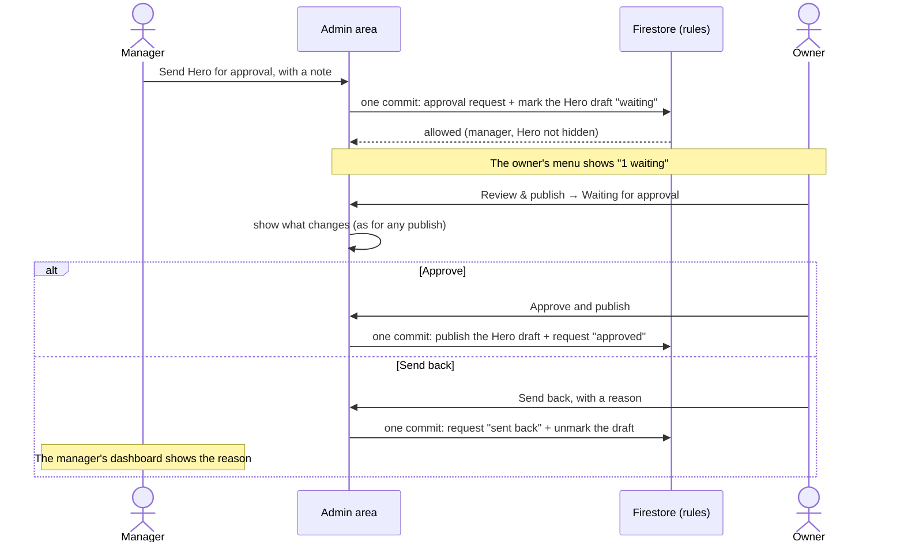
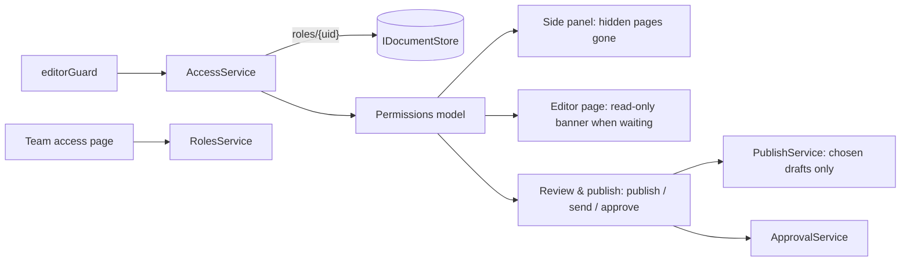

# 02 · Design — Roles and approvals (2.0.0)

Everything here is in the admin area, which is lazy-loaded: the public site and its first download don't change. The real
protection is in `firestore.rules` and the upload function; the screens only follow what they allow.

## Who is who

- **The owner** (you): as today, fixed in the rules by account id. Nothing on the access page can change or remove the
  owner, so a mistake there can't lock you out (decision 1).
- **A manager:** any account you add on a new **Team access** page. Today that's `content-manager@taalyatra.in`; the same
  page takes more managers later, each with their own permissions.
- **Anyone else** who signs in is told the account has no access, as today.

### Adding the manager

1. In the Firebase console, **Authentication → Users → Add user**: their email and a password you give them directly. No
   password ever passes through the site's code or me.
2. Copy that user's **User UID** from the same list (one click on the copy icon).
3. In the admin, **Team access → Add a manager**: paste the UID, type their email (shown in the list, so you know who it
   is), set their permissions, save. They can sign in at once.

Removing a manager, or changing a permission, takes effect on their next click: the rules read the permissions on every
request.

## Permissions

One row per editor page (the 14 pages in the side panel, from Hero to Show or hide sections), each with one of:

| Setting            | The manager can                                                            |
| ------------------ | -------------------------------------------------------------------------- |
| **Hidden**         | Not see the page at all                                                    |
| **Needs approval** | Edit the page's draft, preview it, and **Send for approval** (the default) |
| **Can publish**    | Edit, preview and publish the page's changes themselves                    |

Plus one switch: **Can upload photos** (on by default). With it on, the manager can upload to the photo library and use
any library photo; deleting photos from the library stays with the owner, since a deleted photo disappears from the live
site.

**Always the owner's only** (decision 6): Leads (customers' personal details), Visits, Backups, Going back to an earlier
publish, Team access and the speed report. The manager's dashboard shows their own pages, their waiting changes and anything
sent back.

### Pages that share a stored document

Offer, Business details and Contact & social links all edit parts of one document (`site/config`). The rules check which **parts**
change: a manager allowed to publish Offer can change the offer in it and nothing else, even when publishing the whole
document.

## Drafts: one shared working copy

Drafts stay as they are: one per document, shared by everyone, so the preview always shows "the site as it will be". What's
new is that each draft remembers **who** last saved it.

- **Review & publish lists every change with its author** ("Hero · changed by the content manager, 10 minutes ago"), with a
  tick box on each. **Your own changes are ticked**; someone else's start unticked, so you never publish a colleague's
  half-finished work by accident (decision 4).
- **The manager's Review & publish** shows only the pages they can see. Ticked changes on "Can publish" pages are
  published; ticked changes on "Needs approval" pages are **sent for approval**, with an optional note ("New festival
  dates"). One button does both, and says which is which before confirming.

## Approvals

- **A waiting change is locked for the manager** until it's approved or sent back, so you approve exactly what you
  reviewed. The manager can **withdraw** it to keep editing (decision 5).
- **You can still adjust it** before approving: your edit simply becomes part of what you publish.
- **Your normal "Publish changes" leaves waiting changes alone**; they're published only by approving them.
- **The badge** on Review & publish counts waiting requests for you, and sent-back ones for the manager (programme D5).
- **History** records who published, so "Approved: Hero, from the content manager" and "Published by the content manager"
  are both visible in Review & publish's history.

## Uploads

The upload function (Azure) today accepts only the owner's sign-in. It will also accept a manager whose permissions say
**Can upload photos**. It reads those permissions from Firestore **with the person's own sign-in**, which the rules let each
person do for their own record only, so the function needs no new key or password (decision 8). Deleting photos stays
owner-only in the function as well as the rules.

## Stored data and rules

| Collection           | Owner                    | Manager                                                                          | Others   |
| -------------------- | ------------------------ | -------------------------------------------------------------------------------- | -------- |
| `roles/{uid}` (new)  | Create, change, delete   | Read their own                                                                   | Nothing  |
| `approvals/{id}`     | Read, approve, send back | Create their own; read their own; withdraw a waiting one                         | Nothing  |
| `drafts/{key}`       | As today                 | Read and write drafts of pages not hidden; never change one waiting for approval | Nothing  |
| Live content         | As today                 | Only pages set to **Can publish**; for `site/config`, only those pages' parts    | Read     |
| `publishes/{id}`     | As today                 | Add a record listing only their **Can publish** pages; never delete history      | Nothing  |
| `media/{id}`         | As today                 | Add and describe photos when uploads are on; never delete                        | Nothing  |
| Leads, visits, speed | As today                 | Nothing                                                                          | As today |

`roles/{uid}` holds `{ email, pages: { hero: 'approval' | 'publish' | 'hidden', … }, uploads: true | false, addedAt }`. The
rules keep the owner's id as today (decision 1), so **the new rules work with the current 1.13.0 app**: they can be
deployed first, and the old ruleset (tag `v1.13.0`) is the rollback.

History trimming (keeping 20) happens on the owner's publishes, which remove any extras the manager's publishes added.

## Code

- **`Permissions`** (a model class, no Angular): built from the signed-in account and its role; answers "can see", "can
  publish", "needs approval", "can upload", "is owner". Every screen asks it; nothing else checks ids.
- **`AccessService`** reads the signed-in account's role once per sign-in; **`adminGuard`** becomes **`editorGuard`**
  (owner or a manager) plus a small **`ownerGuard`** for the owner-only pages.
- **`PublishService.publish`** takes the chosen drafts instead of all of them, and records `by`. **`DraftService.save`**
  records `savedBy`. Drafts and history without them are treated as the owner's.
- **`ApprovalService`**: send, withdraw, approve (publish + mark, in one commit), send back.
- **`RolesService`** and the **Team access** page: list, add, change, remove managers.
- **Upload function:** `verifyAdmin` becomes `verifyUploader` (owner, or a manager with uploads on); delete stays
  owner-only.
- **Fake backend** (unit and e2e): a fake manager account beside the fake owner, with a role in the fake data.

## Testing

- **Rules (emulator), every permission allowed and refused:** each page's three settings for drafts and for live content;
  `site/config` parts; history records; approvals (create, withdraw, approve, send back, someone else's); the waiting lock;
  photos; owner-only collections; a removed manager; an account with no role.
- **Unit:** the permissions model for every setting; the guards; who-changed-what and the default ticks; send, withdraw,
  approve and send back; the Team access form; the function's uploader check (owner, manager on, manager off, no role).
- **E2E (three sizes, fake backend):** the manager sees only allowed pages; sends a change for approval; the owner sees the
  badge, approves it and sends another back; the manager sees the reason; "Can publish" goes live; Team access adds and
  removes a manager; axe on the new pages.
- **Firebase smoke (emulator):** a manager's send for approval and the owner's approval through the real rules; a manager
  refused on a hidden page.

## Release plan

1. **Backup first** (`npm run export:firestore`), as the programme's risk list asks.
2. **Deploy the rules** (`npm run deploy:rules`). They accept everything the current app does for the owner.
3. **Merge**: the existing workflow deploys the app and the upload function together (ADR-0017).
4. **Add the manager** (above) and try one change for approval together.
5. Rollback: redeploy the `v1.13.0` rules and revert the merge; the owner keeps working throughout.

## Decisions (recommendations)

| #   | Decision                          | Recommendation                                                                                                                                                                                       |
| --- | --------------------------------- | ---------------------------------------------------------------------------------------------------------------------------------------------------------------------------------------------------- |
| 1   | How the owner is identified       | **Stays fixed in the rules** (as today); only managers live in `roles`. Can't be locked out, and the new rules work with the current app. This replaces the programme's "admin no longer hard-coded" |
| 2   | How a manager is added            | The owner creates the account in Firebase, then pastes its User UID on Team access. No invitation emails, and no stranger can ask for access                                                         |
| 3   | What a permission covers          | One setting per editor page (hidden / needs approval / can publish) plus uploads on/off; defaults: needs approval everywhere, uploads on                                                             |
| 4   | Shared drafts                     | One shared draft per document, each remembering who saved it; on publish, only your own changes are ticked by default                                                                                |
| 5   | Waiting changes                   | Locked for the manager until approved or sent back; the manager can withdraw; the owner can adjust before approving                                                                                  |
| 6   | Owner-only areas                  | Leads, Visits, Backups, Going back, Team access, speed report, deleting photos. Leads for a manager can be a later switch                                                                            |
| 7   | History                           | Records who published; trimmed to 20 by the owner's publishes                                                                                                                                        |
| 8   | Upload permission in the function | Read with the person's own sign-in; no new key in Azure                                                                                                                                              |

## Notes for the owner

- **You create the manager's account and password** in the Firebase console, and give the password to them yourself.
- **Before the rules deploy, take a backup** (Backups card, or `npm run export:firestore`).
- **You deploy the rules, then merge**, in the order above; I'll give the exact steps with verification.

---

**Approval:** ☑ Approved by Ravi Akhouri on 2026-11-19, with decisions 1–8 as recommended.
