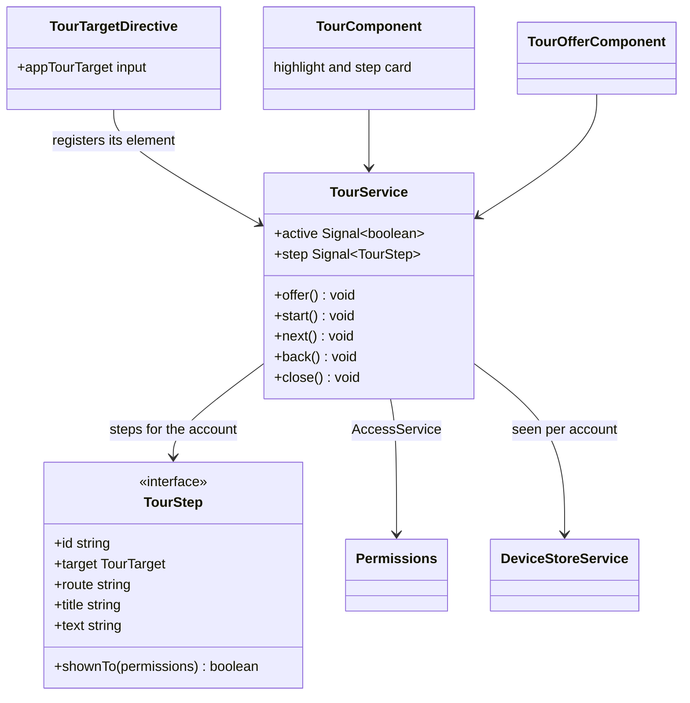
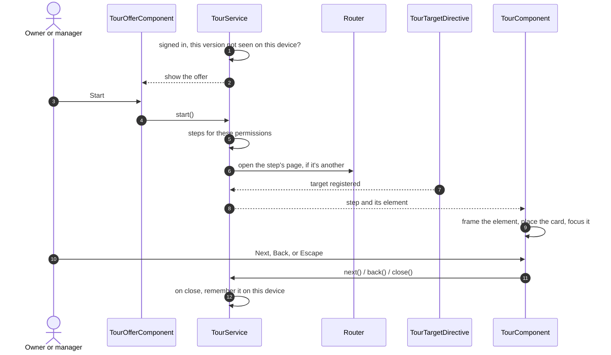
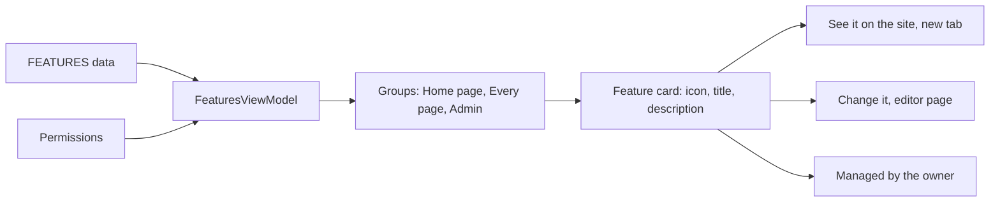

# 02 · Design — Guided tour, features showcase and an easier admin (2.1.0)

Everything here is in the admin area, which is lazy-loaded: the public site and its first download don't change. No new
dependency (decision D1). The tour and the Features page follow the same `Permissions` model as the menu, so each account
is shown only what it can use.

## Who sees what

| Part                    | Owner                                                    | Manager                                                                                                  |
| ----------------------- | -------------------------------------------------------- | -------------------------------------------------------------------------------------------------------- |
| Tour                    | 9 steps, including approvals, Team access, Leads, Visits | 7 steps: their pages, drafts and preview, publishing or sending for approval, a locked page, the library |
| Features page           | Every feature, each with **Change it**                   | Every site feature; **Change it** only for their pages, else "Managed by the owner"; no owner-only areas |
| Help menu               | Take the tour · Features · What's new                    | The same                                                                                                 |
| Easier admin fixes (V6) | Everywhere                                               | Everywhere they go                                                                                       |

## Guided tour

### Steps

Each step is data: a target, a title, one or two sentences, the page it's on, and who it's for. A step whose page the account
can't open is left out, so a manager never meets the owner's areas.

| #   | Target (page)                       | Says                                                                                                           | For   |
| --- | ----------------------------------- | -------------------------------------------------------------------------------------------------------------- | ----- |
| 1   | (none) dashboard                    | What the admin is for, and that nothing goes live until it's published                                         | All   |
| 2   | Menu (dashboard)                    | Pages are grouped as on the site; the menu shows only the pages this account can change                        | All   |
| 3   | Find (dashboard)                    | Type a word ("phone", "Diwali") to jump to the field that holds it                                             | All   |
| 4   | Cards (first page the account sees) | Each card changes one part of the page; changes save as a draft by themselves                                  | All   |
| 5   | Preview (same page)                 | The site as it will look, with the draft; it follows the card being edited                                     | All   |
| 6   | Publish bar (same page)             | Publish your own changes, or undo them. A manager: changes needing approval are sent from Review & publish     | All   |
| 7   | Review & publish link               | Owner: every change with its author, approvals, history and backups. Manager: send for approval, your requests | All   |
| 8   | Leads, Visits, Team access links    | Proposals from the site, visits, and who may change what                                                       | Owner |
| 9   | Help button                         | Replay this tour, see every feature, read what's new                                                           | All   |

On phones the menu is a drawer: steps 2, 7 and 8 open it first and close it after. A step's target that isn't on the screen
is scrolled into view.

### Behaviour

- **The offer (decision D2):** after sign-in, if this device hasn't seen this version of the tour for this account, a small card
  asks "Take a one-minute tour?" with **Start** and **Not now**. Either answer is remembered (`DeviceStoreService`, key per
  account and `TOUR_VERSION`), so it never asks twice. A release that changes the steps raises `TOUR_VERSION`.
- **The step card** is a dialog (`role="dialog"`, labelled by its title) beside the highlighted area, with **Back**, **Next**
  (**Done** on the last) and **Close**, and "Step 3 of 7". Focus moves into it and stays there; **Escape** closes; closing
  returns focus to where it was. The rest of the page is dimmed and can't be clicked while the tour runs.
- **The highlight** is a frame over the target's box, with the rest of the screen dimmed by the frame's shadow. It follows
  scrolling and resizing. With "reduce motion" it moves without animating.
- Steps that change page navigate there first and wait for the target to exist (at most 3 seconds, else the step is skipped:
  the tour never hangs).

### Code

- **`TourTargetDirective`** (`appTourTarget="menu"`) marks an area and registers its element with the service while it's on
  the page, so nothing searches the DOM by selector.
- **`TourService`** (provided on the editor layout) holds the state as signals, builds the account's steps from `Permissions`,
  navigates with the `Router`, and remembers the offer's answer.
- **`TourComponent`** (in the editor layout) draws the highlight and the card. It is the only part that reads element
  positions, so the view model never touches the DOM.

## Features page

`/admin/features`, in the top group of the menu after Review & publish, for every account (decision D3: icons and live links,
no screenshots).

### The list (to approve)

| Group      | Feature                               | See it on the site        | Change it              | Owner only |
| ---------- | ------------------------------------- | ------------------------- | ---------------------- | ---------- |
| Home page  | Hero with buttons and audience tags   | `/#top`                   | Hero                   |            |
| Home page  | Festival offer, on a schedule         | `/#diwali`                | Offer                  |            |
| Home page  | Who it's for                          | `/#for-everyone`          | Who it's for           |            |
| Home page  | Experiences, one featured             | `/#experiences`           | Experiences            |            |
| Home page  | Shows, one in the spotlight           | `/#shows`                 | Shows                  |            |
| Home page  | Drum circle details                   | `/#drum-circle-details`   | Drum circle            |            |
| Home page  | Rhythm game                           | `/#play`                  | Rhythm game            |            |
| Home page  | Videos, filtered by category          | `/#watch` and `/videos`   | Videos                 |            |
| Home page  | Photo gallery with a lightbox         | `/#gallery`               | Gallery                |            |
| Home page  | Team                                  | `/#team` and `/team`      | Team                   |            |
| Home page  | Proposal form, emailed and stored     | `/#contact`               | Proposal form          |            |
| Every page | WhatsApp and Call buttons             | `/`                       | Contact & social links |            |
| Every page | Chat assistant                        | `/`                       | Show or hide sections  |            |
| Every page | Business name, tagline, description   | `/`                       | Business details       |            |
| Every page | Sections, pages and buttons on or off | `/`                       | Show or hide sections  |            |
| Admin      | Drafts, preview and publishing        |                           | Review & publish       |            |
| Admin      | Approvals                             |                           | Review & publish       |            |
| Admin      | Photo library                         |                           | Photo library          |            |
| Admin      | Find                                  |                           | (the Find box)         |            |
| Admin      | History and going back                |                           | Review & publish       | ✔          |
| Admin      | Backups                               |                           | Review & publish       | ✔          |
| Admin      | Leads                                 |                           | Leads                  | ✔          |
| Admin      | Visits                                | `/` (counted anonymously) | Visits                 | ✔          |
| Admin      | Team access                           |                           | Team access            | ✔          |

Each row has a one-sentence description in the app. The list is data (`FEATURES`), and a test fails if a row points at an
editor page that doesn't exist or a site section that's gone.

### Code

`FeaturesPageComponent` (route `features`) with `FeaturesViewModel`, which turns `FEATURES` and the account's `Permissions`
into groups: an owner-only row is left out for a manager; a row whose page is hidden for them keeps its description and
**See it on the site**, with "Managed by the owner" instead of **Change it**.

## Help menu

A **Help** button in the top bar, between Preview and View site, opening a small menu (a button with `aria-expanded`, a list
of links, Escape and outside clicks close it): **Take the tour**, **Features**, **What's new**. On phones it sits in the Menu
drawer with the account details.

## Easier admin pass (V6, decision D4)

A walkthrough of every page with the owner, then a list the owner approves before any change. Found so far, to confirm in
the walkthrough:

1. **Review & publish has no intro line**, unlike every other page: one sentence on what it's for.
2. **"Publish 2 changed documents?"**: "document" is a technical word; "Publish 2 changes?" reads better.
3. **Empty lists** (shows, experiences, team, videos, gallery): check each says what to add and how.
4. **The dashboard's "Still to fill in"**: check the wording of each item is plain.
5. Anything the walkthrough finds that is a fix within an existing page; new features go to the plan for later.

## Tests

- **Unit:** steps per account (owner, manager, manager with hidden pages); the service (offer once, start, next, back, close,
  skips a missing target, remembers per account and version); the directive; the Features view model (owner, manager,
  hidden page); the Help menu.
- **E2E (three sizes, fake backend):** the offer on first sign-in and not again; the whole tour by keyboard for the owner and
  a manager; every step's target exists; the Features page links (site and editor) for both; axe on the tour, the offer,
  the Help menu and the Features page.
- **Visual:** the Features page, after approval of its look.

## Decisions for the owner

| #   | Decision                        | Recommendation                                                                                       |
| --- | ------------------------------- | ---------------------------------------------------------------------------------------------------- |
| 1   | The Features list               | As above; add, remove or reword rows here before it's built                                          |
| 2   | Where Features sits in the menu | In the top group, after Review & publish; and in the Help menu                                       |
| 3   | The tour's length               | 9 steps for the owner, 7 for a manager, about a minute; anything longer belongs on the Features page |
| 4   | The walkthrough (D4)            | Notes on each page are enough; or a 20-minute call if you prefer                                     |

---

**Approval:** ☑ Approved by Ravi Akhouri on 2026-11-20, with decisions 1–4 as recommended.
