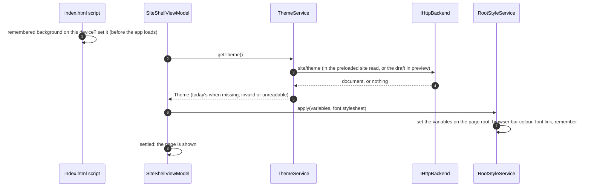
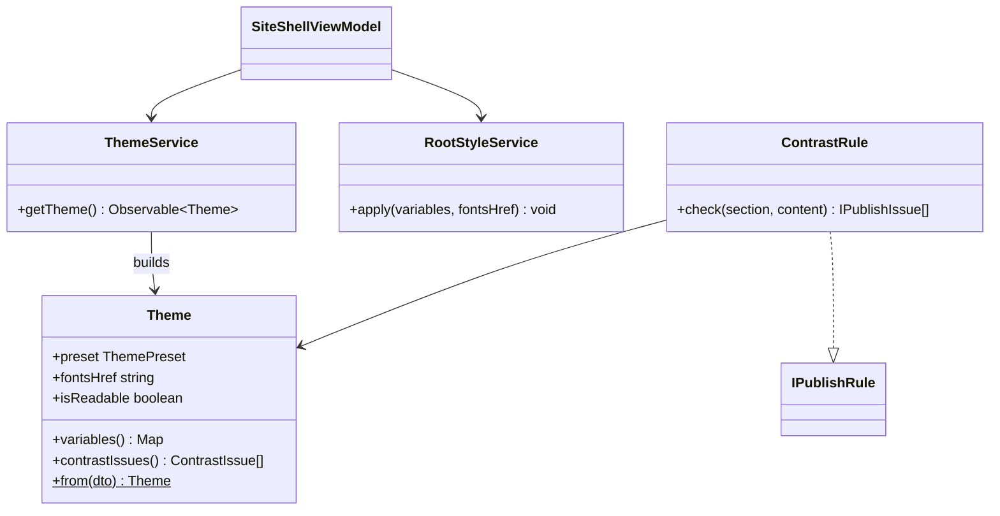
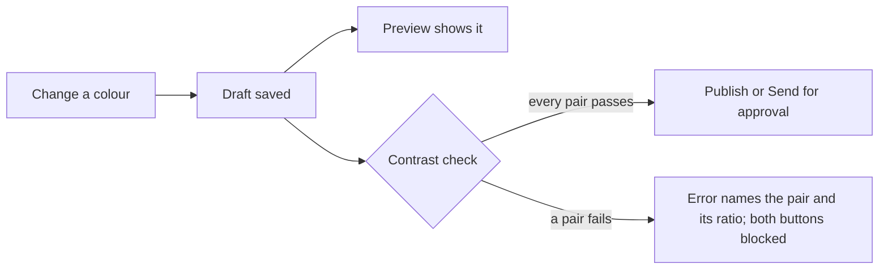

# 02 · Design — Editable theme (2.2.0)

Built on the approved [inception](01-inception.md) (D1–D8) and [ADR-0019](../../architecture/adr/0019-editable-theme.md).
The theme is one more site document, `site/theme`, edited on one more editor page, **Theme**. Drafts, preview, approval,
history and backups work for it as for any document, with nothing new to learn.

## What changes for whom

| Who       | What                                                                                                                                                        |
| --------- | ----------------------------------------------------------------------------------------------------------------------------------------------------------- |
| Visitor   | The published theme on every page. Today's look until a theme is published. No extra request: the theme comes in the `site` read the page already waits for |
| Owner     | A **Theme** page next to Show or hide sections: ready-made themes, six colours, background, text size, heading weight, fonts, and Reset                     |
| Manager   | The Theme page on Team access like any other page: hidden, needs approval (the default, 0019 decision 3) or publishes                                       |
| The admin | Follows the published theme (D8). Its preview shows the draft theme across the whole site; the admin itself changes only when the theme is published        |

## The theme document

`site/theme`, in the preloaded `site` collection. Flat, so the rules can check every field:

| Field           | Values                                                                                  | Missing means |
| --------------- | --------------------------------------------------------------------------------------- | ------------- |
| `preset`        | `warm-night`, `daylight`, `festival`, `high-contrast`, `custom`                         | `warm-night`  |
| `background`    | `#rrggbb`                                                                               | today's       |
| `cards`         | `#rrggbb`                                                                               | today's       |
| `text`          | `#rrggbb`                                                                               | today's       |
| `quietText`     | `#rrggbb`                                                                               | today's       |
| `accent`        | `#rrggbb`                                                                               | today's       |
| `secondAccent`  | `#rrggbb`                                                                               | today's       |
| `backdrop`      | `plain`, `gradient` (from the background at the top to the cards' colour at the bottom) | `plain`       |
| `textSize`      | `smaller` (94 %), `standard`, `larger` (110 %)                                          | `standard`    |
| `headingWeight` | `bold` (700), `extra-bold` (800, today's)                                               | `extra-bold`  |
| `fonts`         | a key from the font list below                                                          | today's pair  |

**Safe default, twice** (as ADR-0015): a missing, unreadable or malformed document shows today's look; and a theme that fails
the contrast check **when the site loads it** is ignored too. The rules can check the shape but can't work out contrast, so
the site checks again rather than trusting that the admin did.

## Six colours, 29 tokens (D1)

Every colour token becomes `var(--ty-…, today's value)`, so with no theme the site is exactly as today. A theme sets the six
colours; the other tokens are **worked out from them**, in code (`Theme.variables()`):

| Token(s)                                                 | Worked out as                                                                                          |
| -------------------------------------------------------- | ------------------------------------------------------------------------------------------------------ |
| `ink` · `ink-deep` · `header-glass`                      | background · background, 22 % darker · background at 94 %                                              |
| `surface` · `surface-raised`                             | cards · halfway between background and cards                                                           |
| `cream` · `ivory`                                        | text · text, a step further from the background                                                        |
| `muted` · `muted-strong` · `muted-faint` · `placeholder` | quiet text · quiet text moved 25 / 30 / 40 % toward the background                                     |
| `amber` · `amber-soft` · `amber-pale`                    | accent · accent moved 45 / 80 % away from the background (lighter on dark, darker on light)            |
| text on the accent (`promo-ink`, button labels)          | background or text, whichever contrasts more with the accent                                           |
| `clay` · `promo-gradient`                                | second accent · accent to second accent                                                                |
| `sage` · `sage-pale`                                     | second accent mixed 30 / 65 % with text                                                                |
| `line` · `field-border` · `bronze`                       | cards mixed with text (12 %) · and with quiet text, at the least mix that reaches 3:1                  |
| `fab-ring`                                               | text at 55 %                                                                                           |
| fixed                                                    | `overlay`, `whatsapp` (WhatsApp's own green), `logo-ground` (the logo's own ground), the error colours |

A worked-out token is set **only when one of the colours it comes from differs from today's**, so choosing Warm night gives
exactly today's hand-picked values, and changing only the accent leaves every other token as it was.

The 15 colours written straight into components move into tokens first, each mapped to one of the above: the chat panel
(panel, bubble, edge, status, its light text), the offer's drawing (flame, core, bowl, rim), the footer map, the video play
button, and the preview's pick outline. The browser bar's colour (`theme-color`) follows the background.

### The error colours (refines D8)

They stay fixed so they always look like warnings, but one fixed set can't be readable on both a dark and a light page:
today's set is kept for dark backgrounds, and a fixed dark-red set is used on light ones (chosen by the background's
lightness). Both sets are in the contrast check.

## The contrast check

`contrastIssues()` checks each pair the design actually puts together, with WCAG 2.2 AA's thresholds:

| Pair                                                                 | Needs    | Today                        |
| -------------------------------------------------------------------- | -------- | ---------------------------- |
| Text on the background, and on cards                                 | 4.5:1    | 15.0 · 13.6                  |
| Quiet text (and its three shades) on the background, and on cards    | 4.5:1    | 9.6 · 8.6 (shades 5.1–6.6)   |
| Accent and its soft shade on the background, and on cards (links)    | 4.5:1    | 8.8 · 8.0 (soft 13.7 · 12.3) |
| Button labels on the accent, and on the second accent                | 4.5:1    | 8.8 · 5.0                    |
| Second accent on the background                                      | 4.5:1    | 5.0                          |
| Error text on its tint, on the background and on cards               | 4.5:1    | 10.1 · 9.1                   |
| Placeholder text in fields                                           | 4.5:1    | **3.4**                      |
| Field edges and the outline button's border, on cards and background | 3:1      | **1.5 · 2.9**                |
| With a gradient: every text pair against both ends                   | as above | —                            |

A failing pair is a publish **error** through a new `ContrastRule` (one more `IPublishRule`, nothing else changes), so it
blocks **Publish** and **Send for approval** exactly as a missing required field does, and names the pair: "Quiet text on
cards is 3.8:1; it needs 4.5:1. Make it lighter."

**Today's look fails three of these** (in bold). See decision 1.

## Ready-made themes (D5)

| Theme         | Background | Cards     | Text      | Quiet text | Accent    | Second accent | Lowest ratio  |
| ------------- | ---------- | --------- | --------- | ---------- | --------- | ------------- | ------------- |
| Warm night    | `#171210`  | `#241c17` | `#efe6d9` | `#c6b8a6`  | `#e9a552` | `#c96b3c`     | 5.0 (second)  |
| Daylight      | `#faf6f0`  | `#ffffff` | `#1f1915` | `#5a4e45`  | `#974912` | `#2e6b57`     | 5.8 (accent)  |
| Festival      | `#2b0d12`  | `#3b141b` | `#fff3e0` | `#ecccb4`  | `#ffb21e` | `#ff6f91`     | 6.8 (second)  |
| High contrast | `#000000`  | `#121212` | `#ffffff` | `#e0e0e0`  | `#ffd500` | `#7fd4ff`     | 12.8 (second) |

Choosing one fills the six colours and the background style; text and fonts stay as they are (decision 4). Changing any
colour afterwards marks the theme `custom`, shown as "Daylight, adjusted".

## Text and fonts (D2, D3)

- **Text size:** all 390 font sizes go through one Sass function, `t.size(14px)` → `calc(14px * var(--ty-text-scale, 1))`, a
  mechanical change with no visible effect at the standard size.
- **Heading weight:** the 38 extra-bold headings use `var(--ty-heading-weight, 800)`.
- **Fonts:** `--ty-font-display` and `--ty-font-body`. Only a pair other than today's loads anything: one Google Fonts
  stylesheet, added when the theme applies. Each family gets a fallback sized to match it (measured as in 0007), so the swap
  doesn't move the page.

| Key               | Headings            | Body text     | Feel                                                         |
| ----------------- | ------------------- | ------------- | ------------------------------------------------------------ |
| `bricolage-dm`    | Bricolage Grotesque | DM Sans       | Today's: warm and modern                                     |
| `fraunces-inter`  | Fraunces            | Inter         | Classic, with a serif                                        |
| `playfair-source` | Playfair Display    | Source Sans 3 | Elegant, for formal events                                   |
| `poppins-nunito`  | Poppins             | Nunito Sans   | Rounded and friendly, for families                           |
| `space-work`      | Space Grotesk       | Work Sans     | Clean, for corporate sessions                                |
| `yatra-mukta`     | Yatra One           | Mukta         | Indian display lettering, for festivals (one heading weight) |

## Applying the theme

- **`Theme`** (`shared/models`): built from the document; `variables()`, `fontsHref`, `contrastIssues()`. Pure, no Angular.
  `contrast.ts` and `colour-mix.ts` (`shared/utils`) do the arithmetic. The presets and font list are `shared/constants`.
- **`ThemeService`** (`shared/services`, root): one read, `defaultIfEmpty`, replayed, as `SiteVisibilityService`.
- **`RootStyleService`** (`core/services`): the only code that touches the page's style. It takes plain names and values, so
  `core` knows nothing about themes: it sets and clears CSS variables on `<html>`, the `theme-color` meta, and one font
  `<link>`, and remembers the background with `LocalStoreService`.
- **`SiteShellViewModel`** adds the theme to the reads it already waits for before showing `<main>` (`settled`). The theme
  arrives in the same read as the site's settings, so the page doesn't wait longer and never shows the old colours first
  (better than D7 expected). Before the app loads, only the page's background is visible: a few lines in `index.html` set
  the remembered one (a strict-CSP-hashed inline script, checking it's `#rrggbb`).
- **Preview** needs nothing new: `DraftOverlayBackend` already reads `site/theme` from the drafts on a preview visit.

## The Theme page

`/admin/theme`, in the menu after **Show or hide sections**, with the palette icon. Schema-driven like every page
(ADR-0014), with two additions that other pages may reuse:

- **`FieldKind.Colour`:** the browser's colour picker beside a `#rrggbb` text box (the picker alone isn't usable with every
  screen reader), validated like any field.
- **Section extras:** an `IEditorSection` may name a small panel the editor page shows in its card: the **ready-made themes**
  (a radio group of four swatches; choosing one fills the form) and the **contrast results** (each pair with its ratio, ✔ or
  the fix, updating as the colours change).

| Card              | Holds                                                                                             |
| ----------------- | ------------------------------------------------------------------------------------------------- |
| Ready-made themes | The four swatches                                                                                 |
| Colours           | The six colour fields, then the contrast results                                                  |
| Background        | Plain or gradient                                                                                 |
| Text              | Text size, heading weight, fonts (each font shown in its own lettering; loaded on this page only) |

**Reset to the default theme** sits under the cards and fills the form with Warm night and today's text and fonts, as a draft.
The preview beside the form shows the draft theme on the home page, as every page's preview does.

## Permissions and rules

- `EditorTab.Theme = 'theme'`, `ContentPath.SiteTheme = 'site/theme'`, `ApiEndpoint.SiteTheme`.
- `firestore.rules`: `site/{document}` allows `theme` for the owner or `canPublish('theme')`; `isValidSiteDocument` adds
  `isValidTheme` (every key from the list above, colours matching `^#[0-9a-f]{6}$`, the rest from fixed lists);
  `draftPages`, `publishablePaths` and `isValidRole`'s page keys add `theme`.
- Team access, the Features page (a row under **Every page**), the Find box ("colour theme font background dark light") and
  the dashboard pick the page up from `EDITOR_TABS`. The tour is unchanged.

## Increments (03-construction)

1. **Colours to variables, no visible change**, plus decision 1's fix; the 15 written-in colours into tokens. Every baseline
   passes, except those decision 1 changes.
2. **Theme model:** presets, worked-out tokens, contrast check, font list. Pure classes, fully tested.
3. **Storage and rules:** paths, fake data, rules and their tests.
4. **Applying it:** `ThemeService`, `RootStyleService`, the shell, the `index.html` script.
5. **Text size, heading weight and fonts**, with the measured fallbacks (if 2.2.0 grows, this moves to 2.2.1).
6. **The Theme page:** the colour field, the two extras, `ContrastRule`, menu, Team access, Features, Find.
7. **Tests and records:** e2e on three sizes (pick a theme, a blocked publish, preview, Reset, a manager's approval), a
   screenshot and axe per ready-made theme on the home page and one admin page, the larger text size, rules tests,
   `e2e:firebase`, Lighthouse on Daylight, diagrams and the data model, CHANGELOG, release 2.2.0.

The public site's first download grows only by the theme model and its arithmetic (a few kB); the Theme page and the
presets' extras are in the admin's lazy chunks.

## Decisions for the owner

| #   | Decision                                 | Recommendation                                                                                                                                                                                                                                                                                                                                                                                             |
| --- | ---------------------------------------- | ---------------------------------------------------------------------------------------------------------------------------------------------------------------------------------------------------------------------------------------------------------------------------------------------------------------------------------------------------------------------------------------------------------- |
| 1   | **Today's look fails three checks**      | **Fix them in this release** (ADR-0008, accessibility first): field edges `#4a3a2c` → `#776758` (3.1:1), the outline button's border `#6e5b49` → `#725f4d` (3.1:1), placeholder text `#7c6e5e` → `#928474` (4.6:1). Slightly lighter field edges and placeholders; the screenshots showing fields are re-recorded. The alternative, checking only text and buttons, would let a theme hide its form fields |
| 2   | **The four ready-made themes**           | **As in the table** (each passes every check). Rename or recolour any of them here                                                                                                                                                                                                                                                                                                                         |
| 3   | **The six font pairs**                   | **As in the table**; swap any you don't like                                                                                                                                                                                                                                                                                                                                                               |
| 4   | **What a ready-made theme changes**      | **Colours and background only**, so picking one never undoes your text size or fonts                                                                                                                                                                                                                                                                                                                       |
| 5   | **The error colours**                    | **Two fixed sets**, one for dark backgrounds (today's) and one for light, so warnings stay readable and recognisable on Daylight (refines D8)                                                                                                                                                                                                                                                              |
| 6   | **The Theme page for existing managers** | **Needs approval**, like every page without a setting (0019 decision 3); hide it on Team access if you'd rather they didn't see it                                                                                                                                                                                                                                                                         |

---

**Approval:** ☑ Approved by Ravi Akhouri on 2026-11-20, with decisions 1–6 as recommended.
