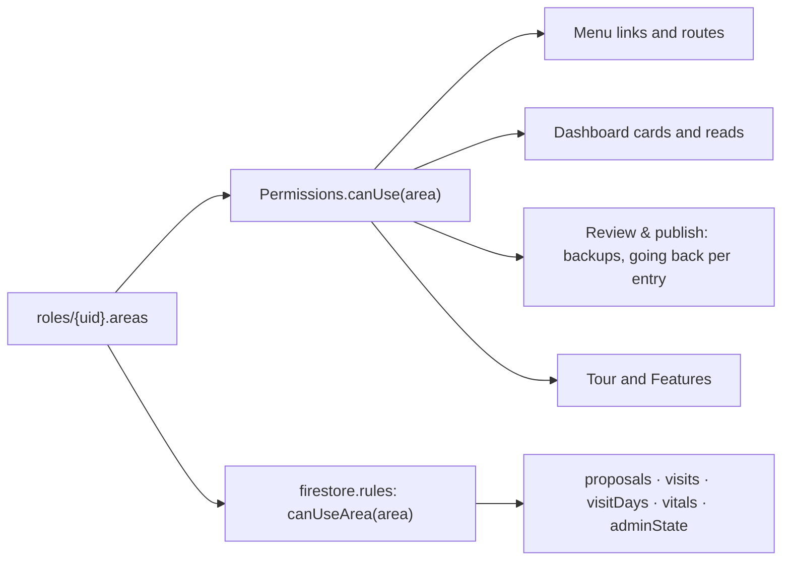

# 02 · Design — The owner's areas for chosen managers (2.3.0)

Built on the approved [inception](01-inception.md) (D1–D6). It extends the roles of
[ADR-0018](../../architecture/adr/0018-roles-and-approvals.md), which gains a section for 2.3.0; no new ADR, since the
pattern (a switch in the role, checked by the rules as uploads are) is the one ADR-0018 set.

## What each switch allows

| Area (switch)        | The manager may                                                                                             | Still the owner's                 | Rules                                                                                                                                                           |
| -------------------- | ----------------------------------------------------------------------------------------------------------- | --------------------------------- | --------------------------------------------------------------------------------------------------------------------------------------------------------------- |
| **Leads**            | Open Leads, see each lead, change its status (their email is stored with it), see the new-leads count       | Deleting a lead                   | `proposals`: read, and update of `status`, `statusAt`, `statusBy` only                                                                                          |
| **Visits and speed** | Open Visits and the speed report; their visit adds up past days and clears old reports, as the owner's does | —                                 | `visits`: read, delete · `visitDays`: read, create · `vitals`: read, delete                                                                                     |
| **Backups**          | Download a backup (with the leads only when they also have Leads), see and reset the reminder               | Restoring a backup                | `adminState/backups`: read, create, update (as the owner's)                                                                                                     |
| **Going back**       | Go back to a publish whose every changed page they may publish                                              | Going back over any other publish | none new: going back writes each page, which the page rules already check, and a history record naming only their pages, which ADR-0018's rules already require |

History stays visible to every manager (D1). Team access, the owner's account, deleting photos and answering the approval
queue stay the owner's.

## The role

`roles/{uid}` gains an optional `areas` map; a missing map or switch is off (D6), so existing managers change nothing:

```json
{ "email": "…", "pages": { … }, "uploads": true, "addedAt": "…",
  "areas": { "leads": false, "visits": true, "backups": true, "goingBack": false } }
```

- `ManagerArea` enum (`leads`, `visits`, `backups`, `goingBack`) mirrors the keys; `IRole.areas: ReadonlySet<ManagerArea>`,
  read by `toRole` from explicit `true`s only, as `uploads` is.
- `Permissions.canUse(area)`: the owner always; a manager when their role has it. Every screen that asks `isOwner` for one
  of these areas asks `canUse(area)` instead; `isOwner` stays for Team access and restoring.

## Rules

```text
function canUseArea(area) {
  return isOwner() || (isManager() && role().get('areas', {}).get(area, false) == true);
}
```

`isValidRole` accepts `areas` (optional: existing roles have none), with only the four keys and booleans. Per collection, as
in the table: `isOwner()` becomes `canUseArea('…')` where the area allows it, and stays `isOwner()` for deleting leads.
The lead update requires `statusBy == request.auth.token.email`, so nobody can sign a change with someone else's name
(the owner's changes are signed too). `isValidProposal` (visitors' create) is unchanged: `statusBy` isn't allowed on
create.

## The app

| Where                         | Change                                                                                                                                             |
| ----------------------------- | -------------------------------------------------------------------------------------------------------------------------------------------------- |
| Menu (`editor-nav.constants`) | Visits and Leads links carry their `area`; a link shows when `canUse(area)`. Team access stays `ownerOnly`                                         |
| Routes                        | `areaGuard(area)` replaces `ownerGuard` on Visits and Leads; Team access keeps `ownerGuard`                                                        |
| Dashboard                     | Backups, Leads and Visits cards, and the speed report, show by area; their reads are made only by area (as now for the owner)                      |
| Top bar count                 | New leads counted with Leads                                                                                                                       |
| Review & publish              | The backup panel with Backups, its Restore with `isOwner` only; each history entry says whether this account may go back over it (`canGoBackOver`) |
| Backup panel                  | "Include leads" only with Leads                                                                                                                    |
| Leads                         | A status change stores `statusBy`; the card says "Contacted by priya@…, 21 Nov", or "by you" (D5)                                                  |
| Tour, Features                | Steps and rows tied to an area follow `canUse`; a manager with any area gets the "Only yours" step reworded as "Given to you" for their areas      |
| Team access                   | Four switches under **The owner's areas**, each with its line (below); the manager's card lists the areas they have                                |



### Team access: the switches

> **The owner's areas** (off unless you turn them on)
>
> - **Leads**: sees the proposals people send from the site, with their **names, phone numbers and emails**, and marks
>   them contacted, won or lost. Deleting a lead stays yours.
> - **Visits and speed**: sees how many people visit, from which devices, and how fast the site is for them. Nothing in
>   them identifies anyone.
> - **Backups**: downloads a copy of the website's content. Restoring one stays yours.
> - **Going back**: undoes a publish, when every page it changed is one they may publish.

### Going back, per entry

`canGoBackOver(record)` is true for the owner, and for a manager with Going back when every path in `record.changed` is one
they may publish (`Permissions.canPublishPath`, from the pages that edit it, as `publishablePaths` does in the rules).
Otherwise the entry shows "Ask the owner" instead of **Go back to this**.

## Tests

- **Unit:** `toRole` and `Permissions.canUse` (owner, manager with and without each area, a malformed map); the menu,
  dashboard, tour and Features per area; `canGoBackOver`; the lead's `statusBy` and its line; Team access's switches.
- **Rules:** each area on and off for its collections; deleting a lead refused with Leads; `statusBy` must be the signer's
  email; `isValidRole` with and without `areas`, and unknown keys refused.
- **E2E (three sizes, fake backend):** the owner gives a manager Leads and Visits; the manager sees them, changes a lead's
  status and the owner sees who did; a manager without them sees neither; going back offered only over their pages; axe on
  Team access, Leads and Visits as a manager.
- **Firebase smoke:** the manager's areas on the emulator.

## Decisions for the owner

| #   | Decision                              | Recommendation                                                                                                    |
| --- | ------------------------------------- | ----------------------------------------------------------------------------------------------------------------- |
| 1   | **The switches' wording**             | **As above**; change any line here before it's built                                                              |
| 2   | **Signing your own lead changes**     | **Yes, yours are signed too**, so a lead always says who last changed it; you see "by you"                        |
| 3   | **The tour for a manager with areas** | **One reworded step**, "Given to you", pointing at their areas in the menu; nothing new for a manager without any |

---

**Approval:** ☑ Approved by Ravi Akhouri on 2026-11-21, with decisions 1–3 as recommended.
