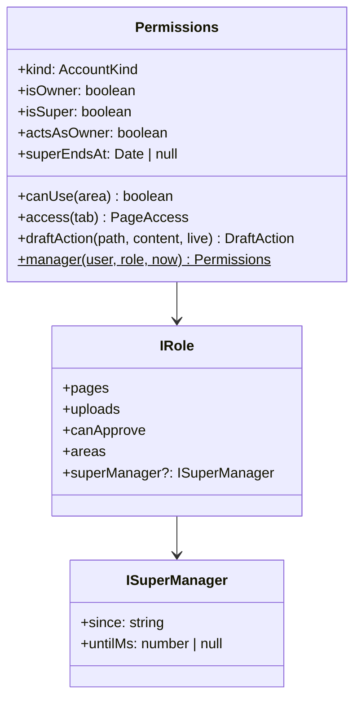
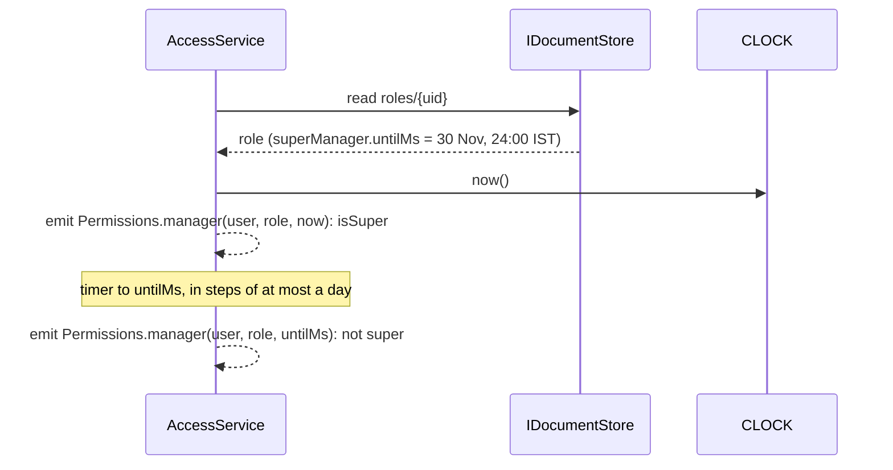

# 02 · Design — A super manager (2.5.0)

Built on the approved [inception](01-inception.md) (D1–D8 as recommended). It extends
[ADR-0018](../../architecture/adr/0018-roles-and-approvals.md) (roles and approvals), which gains a 2.5.0 section. No new
port, adapter or dependency: the role, the rules and the screens that already ask `Permissions` change.

## The role

`roles/{uid}` gains an optional `superManager` map; missing is off, so every existing manager is unchanged (inception
AC 1):

| Field     | Type             | Meaning                                                                                  |
| --------- | ---------------- | ---------------------------------------------------------------------------------------- |
| `since`   | string, ISO 8601 | When the owner turned it on, for Team access                                             |
| `untilMs` | number or `null` | The end, in milliseconds since 1970 (UTC); `null` is for good (D3). The rules compare it |

- **Milliseconds, not an ISO string**, because the rules can compare a number with `request.time.toMillis()` but can't
  parse a date string. `isMsOrNull` already exists for the speed reports.
- **The end of the chosen day, India time** (D3): `untilMs` is midnight at the start of the next day in India,
  `Date.UTC(y, m, d + 1) − 330 minutes`. India has no daylight saving, so the offset is one constant,
  `INDIA_UTC_OFFSET_MINUTES = 330` (`shared/constants/time.constants.ts`). The date picker offers today or later.
- **Nothing else in the role changes** (D4): `pages`, `uploads`, `canApprove` and `areas` stay stored as the owner set
  them, and apply again when it ends.

`IRole` gains `superManager?: ISuperManager { since: string; untilMs: number | null }`; `toRole` reads it only when
`untilMs` is a number or `null` and `since` a string, and `roleFields` writes it only when set.

## Permissions



- `Permissions.manager(user, role, now)` takes the time, from `CLOCK`, and works out **`isSuper`** once: the role has
  `superManager` and `untilMs` is `null` or later than `now`. The class stays a plain value.
- **`actsAsOwner`** = `isOwner || isSuper`. `access(tab)` returns `Publish` and `canUse(area)`, `canUpload`,
  `canPublishPath` and `draftAction` follow it, so a super manager publishes every page with no approval (D7) and has
  every area (D2).
- **`isOwner` stays the owner alone** (D1). The screens' checks split in two:

| Check                                                                                    | Becomes       | Why                  |
| ---------------------------------------------------------------------------------------- | ------------- | -------------------- |
| Team access: `ownerGuard`, its menu link (`ownerOnly`), its Features row                 | `isOwner`     | D1: stays yours      |
| Trimming the history (`PublishService`)                                                  | `isOwner`     | D1: stays yours      |
| The queue: approvals panel, dashboard's Waiting card, menu badge, `waitingNotice`        | `actsAsOwner` | They answer it       |
| Delete a photo (`media-manage`), delete a lead (`leads-page`), restore a backup, go back | `actsAsOwner` | D2                   |
| Editing anyone's draft on Review & publish (`change.mine \|\| …`), the review's checks   | `actsAsOwner` | They approve others' |
| Tour steps and Features rows for the areas (`tour.model`, `features-page.model`)         | `actsAsOwner` | They have every area |

## The end date, without a reload (inception AC 4)

`AccessService` reads the role once per sign-in, as now. When the super manager has an end still ahead, the stream
emits again at that moment with permissions worked out for then, so the menu, dashboard and queue drop to the manager's
own settings:



- **Steps of at most a day**, because a browser timer longer than about 24.8 days fires at once. Each step re-reads
  `CLOCK`, so a laptop that slept still switches on waking.
- `switchMap` from the user, as now, so signing out cancels the timer. The guards read the latest permissions, so a
  super manager on Leads without the Leads switch is sent to the dashboard at the end, as any refused area is.
- The rules don't depend on this: they check `request.time` on every request.

## Answering the queue (D6)

`ApprovalService.approve` and `sendBack` are unchanged in shape; whoever acts as the owner calls them.

- Every answer stores **`answeredBy`**: the answerer's email, the owner's too from 2.5.0. `IApproval.answeredBy` is
  empty for older answers, which read as the owner's.
- An approved publish's history record already has `by`, `byEmail` and `approvedFrom`. A record by a manager with
  `approvedFrom` is one a super manager approved: the history reads **"Approved by priya@… for the owner, sent by
  asha@…"**. A manager's own sent-back request reads "Sent back by priya@… for the owner".
- **The owner's dashboard** counts both kinds since they last looked, from the same history records and the same
  per-device "last seen" as 2.4.0: "2 changes self-approved and 1 approved for you since you last looked."
- **A super manager's own waiting request** (D7) shows in the queue like anyone's; approving it is an ordinary approval.

## Team access

The manager form (`manager-form`) gains, below **Can approve their own changes**:

- **Super manager** switch, with its line: _"Approves everyone's changes for you, publishes every page and uses every
  area. Team access, your account and deleting the history stay yours."_
- When on: **For good** / **Until** (radio), and a date field when Until, today or later (`superUntilValidator`,
  beside the other validators in `role.validators.ts`). While on, the page settings and switches below stay
  editable, with the line _"These apply again when it ends."_
- The card (`manager-card`) shows **"Super manager"**, **"Super manager until 30 Nov"** or **"Super manager ended
  30 Nov"** (the role keeps the date until the owner turns the switch off). Active super managers sort first (D5).

`team-access.model` builds these lines; dates use `formatDay` in `editor-dates` as the rest of the admin does.

## The super manager's dashboard (D8)

A notice at the top of the dashboard: _"You're a super manager: you approve changes for the owner."_ From three days
before the end it reads _"Your super manager access ends on 30 Nov."_ (`SUPER_ENDING_NOTICE_DAYS = 3`). No email.

## Rules

```text
// A manager the owner made a super manager (0024), until their end, checked on every request (D3).
function isSuper() {
  return isManager() && role().get('superManager', null) is map
    && (role().superManager.untilMs == null
        || request.time.toMillis() < role().superManager.untilMs);
}

// The owner, or a super manager standing in for them. Not for the D1 list.
function actsAsOwner() {
  return isOwner() || isSuper();
}
```

| Where                                                    | Now                  | 2.5.0                                                                   |
| -------------------------------------------------------- | -------------------- | ----------------------------------------------------------------------- |
| `canPublish`, `canSee`, `canUseArea`                     | `isOwner() \|\| …`   | `actsAsOwner() \|\| …`: every page and area                             |
| `site/{document}` create, update's owner branch          | `isOwner()`          | `actsAsOwner()`                                                         |
| `media` create and delete, `proposals` delete            | `isOwner()`          | `actsAsOwner()` (D2)                                                    |
| `drafts` write, `locks` write                            | `isOwner()`          | `actsAsOwner()`: editing a request's drafts and unlocking them          |
| `approvals` update                                       | `isOwner()`          | `actsAsOwner()`, keys add `answeredBy`, which must be their email       |
| `approvals` delete                                       | owner or own         | `actsAsOwner()` or own                                                  |
| `publishes` create by a manager                          | their pages only     | adds `\|\| isSuper()`: any pages, still signed with their own `by`      |
| `publishes` update and delete (trimming), `roles` writes | `isOwner()`          | **unchanged** (D1)                                                      |
| `isValidRole`                                            | four optional fields | accepts `superManager` with `since` (text) and `untilMs` (`isMsOrNull`) |

- **Lookups.** `isSuper()` reads the same role document `isManager()` and `role()` already read; no new document is
  looked up, as with 2.3.0's switches; the rules tests check a large super-manager publish stays within the limits.
- **A super manager can't extend themselves**: `roles` keeps `isOwner()`. A rules test tries it, and tries deleting a
  history record.
- **The owner's answer** must carry `answeredBy` from 2.5.0. Deploy the rules and the app together, as with every
  release: an older app sending an answer without it would be refused, and the owner reloads.

## Data model changes

| Document         | Field                               | Notes                                                |
| ---------------- | ----------------------------------- | ---------------------------------------------------- |
| `roles/{uid}`    | `superManager?: { since, untilMs }` | missing means not a super manager                    |
| `approvals/{id}` | `answeredBy?: string`               | the answerer's email; set on every answer from 2.5.0 |

`docs/architecture/data-model.md`, `class-diagram.md` (Permissions) and `sequence-diagrams.md` (a super manager
approves) are updated in the same change. The fake backend's seed gains a super manager with an end date, for e2e.

## Tests

**Unit:** `toRole` / `roleFields` with and without `superManager`; the end of a day in India; `Permissions` before, at
and after the end, and `actsAsOwner` on every check in the table above; `AccessService` emitting again at the end, and
in steps for a far end (`TestScheduler`); `answeredBy` on approve and send back; the history lines; the dashboard count
and the two notices; Team access's switch, radios, date validator, card lines and order.

**Rules (emulator):** a super manager, for good and before their end, on every collection the table changes (allowed);
the same manager after their end (refused, as an ordinary manager with their own settings); a super manager changing any
role, their own included, deleting or changing a history record (refused); `answeredBy` missing or someone else's
(refused); `isValidRole` with a bad `superManager`; a large publish by a super manager within the lookup limits.

**E2E (fake backend, three sizes, axe):** the owner makes a manager super until a date; the super manager approves
another manager's request and the site shows it; the owner sees "for the owner" in the history and the count on the
dashboard; with the browser clock set past the end (`page.clock`), the super manager's menu drops the extra items and
the queue is gone. Axe on Team access with the switch on, the dashboard notice and the queue.

## Increments

1. Role and `Permissions` (`superManager`, the day's end, `isSuper`, `actsAsOwner`) and the checks table.
2. `AccessService`'s timer.
3. Rules, `isValidRole`, rules tests.
4. `answeredBy`, history lines, the owner's dashboard count.
5. Team access: switch, dates, card, order.
6. The super manager's dashboard notice; tour and Features rows.
7. Fake seed, e2e, docs and diagrams, ADR-0018's 2.5.0 section, CHANGELOG, release 2.5.0.

---

**Approval:** ☑ Approved by Ravi Akhouri on 2026-11-21.
