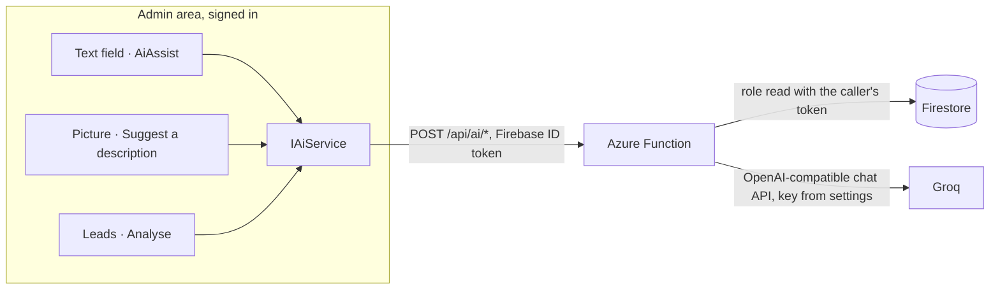
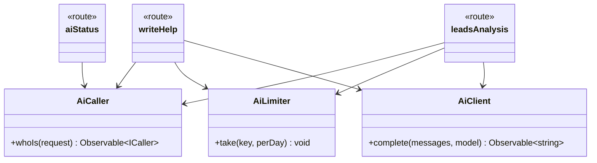
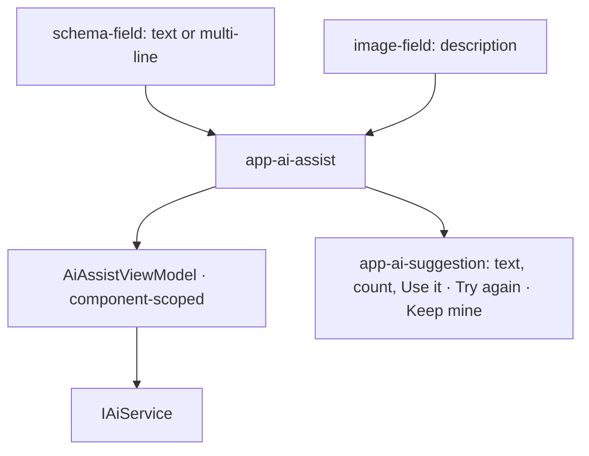

# 02 · Design — AI help in the admin and on Leads (2.6.0)

Built on the approved [inception](01-inception.md) (D1–D8 as recommended). This design covers **2.6.0**: the AI endpoint,
V8 (help writing in the admin) and V12 (Analyse on Leads). V7, the public chat, gets its own design before 2.7.0, reusing
the endpoint built here. A new ADR, **ADR-0020 · AI through the Azure Function**, records the provider-neutral approach.

## Overview



- **No new dependency**, in the app or the function: the function calls the provider with `fetch`, as it already calls
  Cloudinary and Firestore.
- **No SDK types leave `core/backends`**: the app's port is `IAiService`, with a Fake (development, unit tests, e2e) and
  an HTTP adapter, picked by `aiServiceFactory` like the media one.
- **Nothing public changes**: everything is on the admin's lazy routes.

## The function (`api/`)

### Settings (D2)

| Setting           | Example                          | Required                                               |
| ----------------- | -------------------------------- | ------------------------------------------------------ |
| `AI_API_URL`      | `https://api.groq.com/openai/v1` | yes                                                    |
| `AI_MODEL`        | a text model from Groq's list    | yes                                                    |
| `AI_API_KEY`      | (the owner's key)                | yes                                                    |
| `AI_VISION_MODEL` | a model that reads pictures      | no: without it, Suggest a description isn't shown (D5) |

Missing settings are **"not available"**, never an error page: the site works as today until they're set.

### Routes

| Route                | Who                                         | Body (checked, everything else refused)                                                                                                                  | Answer                                   |
| -------------------- | ------------------------------------------- | -------------------------------------------------------------------------------------------------------------------------------------------------------- | ---------------------------------------- |
| `GET /api/ai/status` | signed in, on Team access or the owner      | none                                                                                                                                                     | `{ text, vision }`: which help is set up |
| `POST /api/ai/write` | the same                                    | `{ task: rewrite \| suggest \| describe, style?, text?, label, hint?, page, context?, maxLength?, imageUrl? }`: text ≤ 2,000 characters, context ≤ 3,000 | `{ text }`                               |
| `POST /api/ai/leads` | the owner, a super manager, or Leads (0022) | `{ summary }`: only the counts below                                                                                                                     | `{ text }`                               |

- **Who** is checked as the rules do: the owner by id; anyone else by reading their own `roles/{uid}` with their own
  token (as uploads do, 0019 decision 8). A signed-in account not on Team access is refused. For Analyse, the role must
  have `areas.leads`, or a `superManager` whose `untilMs` hasn't passed (0024).
- **`imageUrl`** must be a picture in this site's Cloudinary folder (`res.cloudinary.com/<cloud>/…/taal-yatra/media/…`),
  so the picture model can't be pointed at anything else.
- **The leads summary** has a fixed shape:
  `{ total, byStatus, byEventType, byExperience, byGroupSize, byEventMonth, byReceivedMonth }`, each `by…` a map of at
  most 40 labels (≤ 60 characters) to whole numbers. No other key is accepted, so a record can't slip through (D3).

### The parts



- **`AiClient`**: one `POST {AI_API_URL}/chat/completions` with `{ model, messages, max_tokens, temperature }` and the key
  as a bearer token, 20 s timeout. Any failure, an empty answer or a provider limit (429) becomes **503 "AI help isn't
  available right now."**; the provider's message is logged, never returned. `IApiDependencies` gains `post(url, headers,
body)` so tests supply answers.
- **`AiLimiter`** (D4): **50 requests a day per account**, counted by India day in the function's memory. Past it:
  **429 "You've used today's AI help. It's back tomorrow."** Approximate across instances, as approved; the provider's
  own free limits are the ceiling.
- **Prompts** live in `ai-prompts.ts`, one per task, in plain words: who the business is, what the field is (label, help
  line, page), the style, the character limit, and **"answer with the text only"**. The answer is trimmed and cut at
  `maxLength` on a word boundary. Every route treats what comes back as plain text.

## The app

### The port

```ts
export abstract class IAiService {
  /** Which help is set up; `{ text: false, vision: false }` when unknown or unreachable. */
  public abstract status(): Observable<IAiStatus>;
  /** A rewrite, a first version, or a picture's description. Fails with `AiError`. */
  public abstract write(request: IAiWriteRequest): Observable<string>;
  /** A short analysis of the anonymous summary. Fails with `AiError`. */
  public abstract analyseLeads(summary: ILeadsSummary): Observable<string>;
}
```

- `AiError` carries `AiErrorKind.Unavailable | Limit | SignIn`, each with its sentence, as `MediaError` does.
- `HttpAiService` (`core/backends/ai/`) adds the `x-firebase-token` header from `IAuthService.idToken()`, as uploads do;
  `status()` is read once per session and cached (`shareReplay(1)`), and a failure there means "not set up".
- `FakeAiService` answers predictably ("Clearer: …", a fixed analysis) after a short delay, and can be told to fail, for
  tests.
- `provideAi()` (`core/config/`) registers the port next to `provideMedia()` on the admin routes, which already provide
  `HttpClient`.

### Help writing (V8)



- **`app-ai-assist`** sits under each **text and multi-line** field (D7) and beside a picture's description. It shows
  nothing until `status()` says the help is set up, so nothing appears before Groq is set up.
- With text: **Rewrite with AI** opens a small group of buttons, **Clearer, Shorter, Warmer, More formal, Fix spelling
  and grammar** (D6). Empty: **Suggest**. A picture with `vision`: **Suggest a description**.
- While it writes: "Writing…" in a polite live region, and the buttons are disabled.
- **The suggestion** (`app-ai-suggestion`) shows under the field: the text, its length against the field's limit, and
  **Use it** (sets the field, which autosaves as typing does), **Try again** and **Keep mine**. Nothing changes until
  Use it (inception AC 1). Focus moves to the suggestion, and back to the field after a choice.
- **Context:** the field's label and help line, the page's name, and the other text and multi-line fields of the same
  card (`schema-fields` passes them), cut to 3,000 characters. Never another page's draft (D3).
- A failure shows its sentence where the suggestion would be; the field is untouched.

### Analyse (V12)

- **`app-leads-analysis`**, a card at the top of Leads, with its own view model. **Analyse these 24 leads** works on the
  leads the filters show.
- `leadsSummary(leads)` (a pure function in `models/`) counts by status, event type, experience, group size, event
  month and received month. It reads only those fields: never the name, phone, email, what they need, or their
  message (D3). Its spec checks that a summary never contains any of them.
- The answer shows as plain text, keeping its line breaks, with "Analysed 21 Nov 2026, 3:30 pm, from 24 leads". It isn't
  stored: Analyse again for a fresh one.

### Who sees the buttons (D8)

| Account                       | Rewrite and Suggest | Suggest a description       | Analyse    |
| ----------------------------- | ------------------- | --------------------------- | ---------- |
| Owner, super manager          | every page          | every picture               | yes        |
| Manager                       | the pages they see  | the pictures on those pages | with Leads |
| Help not set up (no settings) | none                | none                        | none       |

## Docs and records

- **ADR-0020 · AI through the Azure Function**: provider-neutral (OpenAI-compatible), key in settings, the limits, what
  may be sent, plain-text answers only.
- `CLAUDE.md` §1 and §3 list `IAiService` with the other ports; `deployment.md` lists the four settings and how to set
  them; overview, component tree, class and sequence diagrams gain the AI parts.
- The Features page gains **Help writing with AI** and **Analyse leads**, shown when the help is set up.

## Tests

**Function (≥ 90 %):** the client (an answer, a timeout, a 429, an empty answer, missing settings); the limiter (50 then
refused, a new day resets); `write` (each task and style, the length limits, an outside picture address refused, a caller
not on Team access refused); `leads` (owner, Leads, super manager running and ended, no Leads refused, an extra key such
as `name` refused); `status`.

**Unit:** `HttpAiService` (headers, errors, cached status), `FakeAiService`, `leadsSummary` (counts, and no personal
field), `AiAssistViewModel` (rewrite, suggest, describe, use, try again, keep mine, each failure), the two components,
the analysis card, the Features rows.

**E2E (Fake, three sizes, axe):** rewrite a hero line and use it, then see it in the preview; suggest a description;
Analyse the leads; with the Fake told to fail, the field stays as it was and the message shows. Axe with a suggestion
open and with the analysis shown.

## Increments

1. Function: client, limiter, caller, `status`, `write`, `leads`, prompts, tests.
2. App: `IAiService`, Fake and HTTP adapters, factory, `provideAi()`.
3. `app-ai-assist` and `app-ai-suggestion` on text fields; Suggest a description on pictures.
4. `leadsSummary` and the analysis card.
5. Features rows, e2e, ADR-0020, CLAUDE.md, diagrams, deployment notes, CHANGELOG.

---

**Approval:** ☑ Approved by Ravi Akhouri on 2026-11-21.
