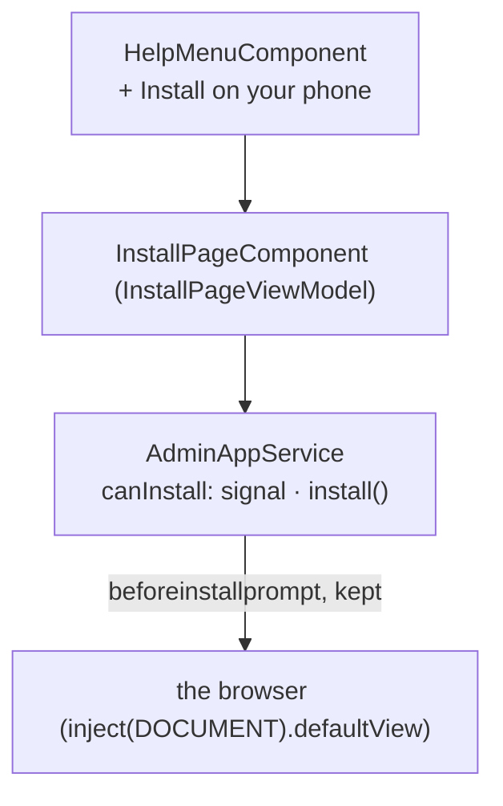

# 02 · Design — The admin on your phone (2.8.0)

Built on the approved [inception](01-inception.md) (D1–D6 as recommended). No service worker, no dependency, no new
port: a manifest, a few tags while the admin is open, safe-area padding, a Help page, and a hosting rule.

## While the admin is open (D2)

`AdminShellComponent` already adds a `robots` tag when the admin opens and removes it when the visitor leaves. A new
**`AdminAppService`** (`features/admin/services`, a root `@Service()`) does the same for the app's tags, called from
the shell:

| Tag                                                                               | Why                                                                      |
| --------------------------------------------------------------------------------- | ------------------------------------------------------------------------ |
| `<link rel="manifest" href="/admin.webmanifest">`                                 | Chrome's **Install app**; only on admin pages, so the site offers none   |
| `<meta name="apple-mobile-web-app-capable" content="yes">`                        | iPhone opens it full screen from the home screen                         |
| `<meta name="apple-mobile-web-app-title" content="TY Admin">`                     | the name under the icon on iPhone (D3)                                   |
| `<meta name="apple-mobile-web-app-status-bar-style" content="black-translucent">` | the page runs under a see-through status bar, padded below it            |
| `<link rel="apple-touch-icon" href="/icons/admin-180.png">`                       | the app's icon on iPhone, in place of the site's while the admin is open |
| viewport gains `viewport-fit=cover`                                               | lets the safe-area padding apply; restored when the admin closes         |

Tags go through Angular's `Meta` and `inject(DOCUMENT)` (CLAUDE.md §6); nothing touches `window` directly. The public
site's `index.html` is unchanged, so its first download is too (inception AC 5).

## The manifest (`public/admin.webmanifest`)

```json
{
  "name": "Taal Yatra admin",
  "short_name": "TY Admin",
  "id": "/admin",
  "start_url": "/admin",
  "scope": "/admin",
  "display": "standalone",
  "background_color": "#171210",
  "theme_color": "#171210",
  "icons": [
    { "src": "/icons/admin-192.png", "sizes": "192x192", "type": "image/png" },
    { "src": "/icons/admin-512.png", "sizes": "512x512", "type": "image/png" },
    {
      "src": "/icons/admin-maskable-512.png",
      "sizes": "512x512",
      "type": "image/png",
      "purpose": "maskable"
    }
  ]
}
```

- **Colours** are the theme's default ink (`#171210`), already the site's `theme-color`. A manifest is a fixed file,
  so it doesn't follow the editable theme (0021); the splash screen and status bar stay dark.
- **Icons (D4):** made from your logo once you send it (SVG, or PNG ≥ 1024 px): the logo centred on the dark
  background, the maskable one with the 20 % safe margin Android crops to. Until then, placeholders made from the
  156 px logo, clearly a stand-in; replacing them is swapping four files.
- **`scope` `/admin`:** admin links stay in the app; **View site** already opens a new tab (`target="_blank"`), which
  the installed app hands to the browser (inception AC 3).

## Always online (D1)

No service worker: every open loads the latest `index.html` and its hashed scripts, so a release shows on the next
open with nothing to update (inception AC 4). Offline, the app shows what the admin shows in a browser offline today:
saves fail with a Retry, and the local safety copy (0016) keeps unsaved changes.

## iPhone: under the status bar

Full screen puts the page under the status bar and the notch. The admin's top bar (`.ed-top`) and the sign-in card get
`padding-top: env(safe-area-inset-top)`, and the side drawer `padding-bottom: env(safe-area-inset-bottom)`. `env()` is
0 everywhere else, so browsers and desktops look as now.

## Install help (D6)



- A route **`/admin/install`**, "Install on your phone", in the Help menu beside Features and What's new, for the owner
  and managers.
- The page shows **On Android** (Chrome → ⋮ → Install app) and **On iPhone** (Safari → Share → Add to Home Screen),
  each in three short steps, and that an iPhone app asks for a sign-in once (inception risk).
- **On Android**, Chrome fires `beforeinstallprompt` once the manifest is in place. `AdminAppService` listens for it
  from when the admin opens (`fromEvent`, in the service's stream, ended with the admin), keeps it, and exposes
  `canInstall`; the page then shows an **Install** button that calls `prompt()`. When the app is installed, or the
  browser offers nothing (iPhone, desktop Firefox, already installed), the button isn't shown and the steps are.
- When already running as the app (`display-mode: standalone`), the page says so instead.

## Hosting

`public/staticwebapp.config.json` gains:

- `mimeTypes`: `".webmanifest": "application/manifest+json"`;
- a route for `/admin.webmanifest` with `cache-control: no-cache`, as `runtime-config.js` has, so a changed name or icon
  reaches the phones;
- `.webmanifest` in the navigation fallback's exclusions, so a missing file is a 404, never the app's HTML.

`deployment.md` notes the file and the check on the phones.

## Tests

**Unit:** `AdminAppService` (adds and removes every tag, restores the viewport, keeps the install event, `canInstall`,
`install()` and after it, standalone), the shell calling it, the Install page and its view model (Android with an
offer, without, standalone), the Help menu link.

**E2E (three sizes, axe):** an admin page has the manifest link and iPhone tags and the home page has none; the
manifest loads as JSON with every field above and its icons load; the Install page shows the steps; with a
`beforeinstallprompt` dispatched in the page, the Install button appears and calls `prompt()`; axe on the Install page.

**On the phones (operations record):** install on Android and on iPhone; icon and name; opens full screen at `/admin`;
the top bar below the status bar; View site opens the browser; after the next release, the app shows it.

## Increments

1. `AdminAppService` and the shell; the safe-area padding.
2. The manifest, placeholder icons, the hosting rule.
3. The Install page, its route and the Help link.
4. E2E, deployment notes, component tree, CHANGELOG; the real icons when the logo arrives.

---

**Approval:** ☑ Approved by Ravi Akhouri on 2026-11-22.
