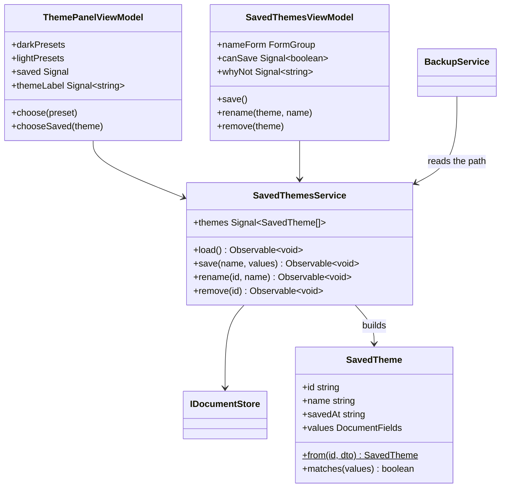
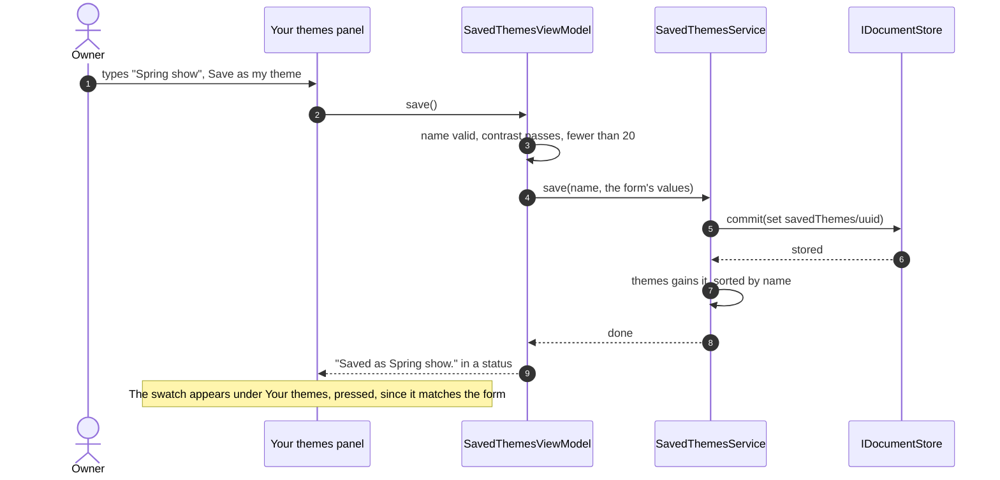
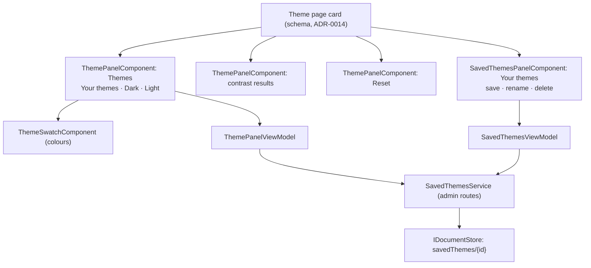

# 02 · Design — More themes, and your own saved (2.9.0)

Built on the approved [inception](01-inception.md) (D1–D6 as recommended) and the Theme page of 0021
([design](../0021-editable-theme/02-design.md), [ADR-0019](../../architecture/adr/0019-editable-theme.md)). No new
port, no dependency. The changes are 12 more themes, a saved-themes collection behind the existing `IDocumentStore`, one
more panel on the Theme page, and the backup.

## Two refinements to the inception (for approval with this design)

Both come from what `IDocumentStore` can do. It reads, and commits several writes at once, but has no
read-then-write transaction. That's enough for 0027 if each saved theme is its own document:

| Inception                                            | Design                                                                                                                       | Why                                                                                                                                       |
| ---------------------------------------------------- | ---------------------------------------------------------------------------------------------------------------------------- | ----------------------------------------------------------------------------------------------------------------------------------------- |
| D4: the rules check the limits too                   | The rules check each theme's **shape and name length**. **The page** enforces the **20-theme limit** and **different names** | Rules can't count a collection's documents or compare one document with another. Neither limit protects anything: both keep the list tidy |
| D6: restoring replaces the list                      | Restoring **puts the backup's saved themes back**, and keeps any saved since                                                 | A backup from before 2.9.0 has no saved themes, so replacing the list would silently empty it. Keeping both loses nothing                 |
| Risk: one library document, written in a transaction | One **document per saved theme**, with a random id                                                                           | Two people saving at once write different documents, so neither save is lost, with no transaction needed                                  |

## The 12 new ready-made themes (D1)

Each set of colours was run through the site's own contrast check (`SiteTheme.contrast()`, every pair in the 0021
table, both ends of a gradient). All pass, and a unit test keeps checking every ready-made theme. Marigold's accent was
darkened once to pass the admin's current-page pair.

| Theme        | Key            | Background | Cards     | Text      | Quiet text | Accent    | Second accent | Page background |
| ------------ | -------------- | ---------- | --------- | --------- | ---------- | --------- | ------------- | --------------- |
| Indigo night | `indigo-night` | `#12132b`  | `#1d1f3f` | `#eceaf7` | `#b9b8d6`  | `#f2b84b` | `#8fa2ff`     | plain           |
| Monsoon      | `monsoon`      | `#0d2226`  | `#15323a` | `#e6f2f0` | `#a9c9c4`  | `#5fd3b8` | `#f0a868`     | gradient        |
| Forest       | `forest`       | `#121c14`  | `#1b2a1e` | `#ecf0e4` | `#b5c2a8`  | `#c9d66a` | `#e09a5a`     | plain           |
| Diwali       | `diwali`       | `#1f0f2b`  | `#2e1940` | `#fbefe0` | `#d9c2d6`  | `#ffc247` | `#ff8a5c`     | gradient        |
| Ocean        | `ocean`        | `#0b1a2e`  | `#13263f` | `#e8f0f8` | `#aec2d8`  | `#ff8a6b` | `#5cc8e0`     | plain           |
| Charcoal     | `charcoal`     | `#18191b`  | `#232528` | `#ededed` | `#b8bcc2`  | `#6cb4ff` | `#c9a46a`     | plain           |
| Marigold     | `marigold`     | `#fff8ec`  | `#ffffff` | `#2a1a0c` | `#5e4a36`  | `#8f3f00` | `#8a2b52`     | plain           |
| Sandstone    | `sandstone`    | `#f6efe4`  | `#fffaf2` | `#2b1f17` | `#5f4f42`  | `#9c3d1c` | `#2f5a3b`     | gradient        |
| Holi         | `holi`         | `#ffffff`  | `#faf5fb` | `#1e1424` | `#574a5e`  | `#b0186a` | `#00706b`     | plain           |
| Mint         | `mint`         | `#f1f8f4`  | `#ffffff` | `#10261c` | `#45594f`  | `#146b4a` | `#8a4a12`     | plain           |
| Rose         | `rose`         | `#fdf3f3`  | `#ffffff` | `#2b1216` | `#5f4448`  | `#9e2340` | `#6b4a8a`     | plain           |
| Slate        | `slate`        | `#f3f5f8`  | `#ffffff` | `#141a24` | `#4a5465`  | `#1f4f99` | `#8a3b12`     | plain           |

They join `THEME_PRESETS` (`shared/constants/theme.constants.ts`) and the `ThemePreset` enum. Choosing one fills the six
colours and the page background, as the four of 2.2.0 do.

## Saved themes (D2, D3, D4)

### The documents

`savedThemes/{id}`, one per theme. The id is a random UUID (`crypto.randomUUID()` from `inject(DOCUMENT).defaultView`,
the same shape as `media/{id}`). It's outside `site`, so the public site never reads it, and outside `drafts`, because
saving a theme doesn't change the site.

| Field     | Holds                                                                                                       |
| --------- | ----------------------------------------------------------------------------------------------------------- |
| `name`    | 1–40 characters, trimmed                                                                                    |
| `savedAt` | ISO time, from `CLOCK`, so the list can show "saved 3 days ago" and the backup keeps it                     |
| `theme`   | everything on the page (D2): the six colours, `backdrop`, `textSize`, `headingWeight`, `fonts`. No `preset` |

### The rules

```
match /savedThemes/{id} {
  allow read: if canSee('theme') || canUseArea('backups');
  allow create, update: if (canSee('theme') || canUseArea('backups'))
    && id.matches('^[0-9a-f-]{36}$') && isValidSavedTheme(request.resource.data);
  allow delete: if canSee('theme');
}
```

- **`canSee('theme')`** (D3): the owner, a super manager, and any manager whose Theme page isn't hidden. "Needs
  approval" still lets them save and pick, since only publishing changes the site, and publishing keeps the page's
  approval.
- **`canUseArea('backups')`**: someone given Backups can read the themes into a backup and write them back on restore,
  even without the Theme page. They can't delete them.
- **`isValidSavedTheme`**: only `name`, `savedAt` and `theme`. `name` and `savedAt` are checked with `isText` as
  elsewhere, and `theme` with the existing `isValidTheme`, so a saved theme has exactly a published theme's shape.
- `isValidTheme`'s `preset` list gains the 12 keys.
- The rules can't work out contrast (0021). The page refuses to save a theme that fails it, and the check runs again at
  publish and when the site loads the theme, as today.

### The code



- **`SavedTheme`** (`features/admin/models/saved-theme.model.ts`): built from a document, with a malformed one left out
  rather than breaking the list. `values` are form values, so choosing one is the same `patchValue` as choosing a
  ready-made theme. `matches(values)` compares every field, for the label.
- **`SavedThemesService`** (`features/admin/services`, `@Injectable()`, provided on the admin routes beside
  `BackupService`, since `IDocumentStore` lives there): holds the list as a read-only signal, sorted by name. `load()`
  is a fresh `readAll`. Each write is one `commit`, and the list is updated once it's stored, never before.
- **`ThemePanelViewModel`** (extended): `darkPresets` and `lightPresets` are the ready-made themes split by `isDark()`
  of their background, the helper the error colours already use. `themeLabel` is the ready-made theme's name, "Your
  theme: Spring show" when a saved one matches the form, or "Your own colours" when neither does.
- **`SavedThemesViewModel`** (new, for the new panel): the name field with `SavedThemeNameValidators` (required, at most
  40 characters, not a name already used, with case and spaces ignored), and `canSave`, false with a reason when the
  theme fails the contrast check or 20 are saved.

### Saving



- `save()` and the row buttons go through a `Subject` and `exhaustMap`, as the Install button does (0026), so a double
  press saves once.
- A failed write says "Couldn't save the theme. Try again." in an alert, and the list stays as it was.
- **Rename** re-saves the same document with the new name and keeps `savedAt`. **Delete** asks first, in place, as a
  lead's Remove does: "Delete Spring show? The site keeps its theme; only this saved copy goes." Neither changes the
  form or the site.

## The Theme page (D5)

The **Ready-made themes** panel becomes **Themes**, with up to three groups, each a `fieldset` with a `legend`:

| Group           | Holds                                                              | Shown    |
| --------------- | ------------------------------------------------------------------ | -------- |
| **Your themes** | the saved themes, by name, each with its swatch                    | when any |
| **Dark**        | Warm night, Festival, High contrast, and the 6 new dark themes (9) | always   |
| **Light**       | Daylight and the 6 new light themes (7)                            | always   |

- The swatch component takes **colours** instead of a ready-made theme, so saved and ready-made themes look alike.
- Each swatch is a button with `aria-pressed`, as now. The one matching the form is pressed, and `themeLabel` is shown
  above the groups in a polite live region, so "Daylight, adjusted" becomes "Your own colours".
- Choosing a saved theme fills **everything** (D2). A ready-made one fills the colours and background only, and its
  note says so, as today.

A new panel, **Your themes** (`SectionPanel.ThemeSaved`), sits after **Reset to the default theme**:

- **Save as my theme**: a name field and a button. When it can't save, the button stays enabled and says why on press
  (WCAG: a disabled button explains nothing): "Fix the 2 hard-to-read pairs first" or "You have 20 saved themes.
  Delete one to save another."
- The saved themes as a list, each row with its name, "saved 22 Nov", **Rename** (the name field in place, with Save
  and Cancel) and **Delete** (asks first).
- It is its own component, `SavedThemesPanelComponent`, with its own stylesheet. `ThemePanelComponent`'s is close to
  the 4 kB budget.



## Backups (D6, refined)

- **Making one:** `BackupService.build()` adds `store.readAll('savedThemes')`, as it does `media`, and writes each as
  `savedThemes/{id}` in `documents`. The backup format stays the same: it's one more kind of path.
- **The file check:** `backup-file.ts` accepts `savedThemes/{uuid}` paths, as it does `media/{uuid}`. A file with a
  malformed saved theme is refused like any malformed backup.
- **Restoring:** after the drafts and the photo descriptions, each saved theme in the backup is set back by its id, in
  one commit. Ones saved since stay. Restoring an older backup, with none, leaves the list as it is.

## The public site's download

`SiteTheme` checks `preset` against the `ThemePreset` enum, which puts the whole enum into the first download. The
public site doesn't use `preset` to show anything, so:

- `SiteTheme` keeps `preset` as the stored string, checked only to be a short string, with `'warm-night'` as the
  default from `theme-default.constants.ts`.
- `ThemePreset` is then used only by admin code, so the 12 new keys never reach visitors.

The first download should then shrink slightly, not grow. The build's budgets are the check (509.36 kB at 2.8.0, warning at
510 kB).

## Tests

**Unit:**

- Every ready-made theme passes every contrast pair, and dark and light are split by background.
- `SavedTheme`: built from a document; a malformed one is refused; `matches`.
- `SavedThemesService`: load, save, rename and delete, a failed commit leaving the list unchanged, the id's shape.
- `SavedThemeNameValidators`.
- The two view models: `themeLabel` for ready-made, saved and own colours; choosing a saved theme fills everything;
  `canSave` with its reasons; one save on a double press.
- Both panels' templates, the swatch taking colours.
- The backup: made with saved themes, its file check, restore keeping newer ones.
- `SiteTheme` without the enum.

**Rules (emulator):**

- Who may read, save, rename and delete: the owner, a super manager, a manager with the Theme page visible, a manager
  with it hidden, a manager with Backups only, a visitor.
- A bad id, an extra field, a 41-character name, a bad colour inside `theme`.
- `site/theme` accepting the 12 new keys.

**E2E (three sizes, axe):**

- Choose Monsoon and see it in the preview.
- Save it as a theme, see it under Your themes, change a colour, then choose it again and get Monsoon's colours back.
- Rename it, then delete it.
- The 20-theme and contrast messages.
- Axe on the Theme page with saved themes showing.

## Increments

1. The 12 themes, the contrast test, `SiteTheme` without the enum, the rules' list, the build size checked.
2. `SavedTheme`, `SavedThemesService`, the rules and their emulator tests.
3. The Themes panel grouped, the swatch on colours, `themeLabel`.
4. The Your themes panel: save, rename, delete.
5. Backups. E2E, the component tree, the data model, CHANGELOG.

---

**Approval:** ☑ Approved by Ravi Akhouri on 2026-11-22, with both refinements.
