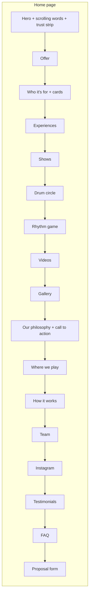
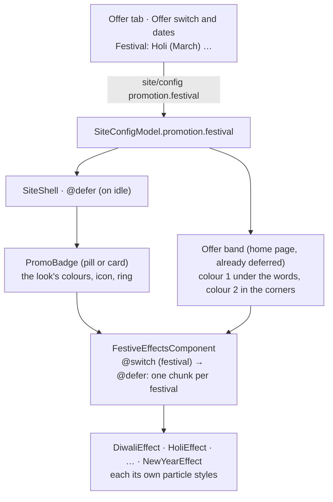

# 02 · Design — The home sections (2.10.0)

The first release of the approved [content programme](01-inception.md) (D1–D6 as recommended): every home section still
without an editor gets one. Schema-driven like every page ([ADR-0014](../../architecture/adr/0014-schema-driven-editors.md)):
the site's components already read these documents, so **the public site's code doesn't change**. No new port, no
dependency.

## What becomes editable

One menu page per site section (0017 U1), in the order the home page shows them. Two small sections join the page of
the section they sit beside.

| Menu page (new in **bold**) | Document(s)                      | Cards and fields                                                                                                                                                                                                                                 | Preview scrolls to |
| --------------------------- | -------------------------------- | ------------------------------------------------------------------------------------------------------------------------------------------------------------------------------------------------------------------------------------------------ | ------------------ |
| Hero (extended)             | `home/marquee`, `home/trust`     | **Scrolling words** (a list of words, up to 12) · **Trust strip** (up to 4 items: icon, title, text)                                                                                                                                             | top                |
| Who it's for (extended)     | `home/audiences`                 | heading, now with the **cards** (up to 6: icon, title, text, tags)                                                                                                                                                                               | for-everyone       |
| **Our philosophy**          | `home/philosophy`, `home/midCta` | heading · **Pillars** (up to 4: title, text) · **Goals** (eyebrow, title, up to 6 items: number, title, text) · **Journey** (eyebrow, title, up to 8 items: when, title, text) · **Call to action below it** (eyebrow, title, two button labels) | philosophy         |
| **Where we play**           | `home/cities`                    | eyebrow, title, introduction · **Cities** (up to 12: name, "Highlighted")                                                                                                                                                                        | cities (new)       |
| **How it works**            | `home/how`                       | eyebrow, title · **Steps** (up to 6: number, title, text)                                                                                                                                                                                        | how                |
| **Instagram**               | `home/instagram`                 | eyebrow, title, follow label, profile link, post label · **Posts** (up to 8: photo from the library, caption, link)                                                                                                                              | insta              |
| **Testimonials**            | `home/proof`                     | eyebrow, title, link label · **Numbers** (up to 4: value, label) · **Testimonials** (up to 6: quote, name, detail, letter) · **Clients** (label, up to 12 names, note)                                                                           | proof              |
| **FAQ**                     | `home/faq`                       | eyebrow, title · **Questions** (up to 12: question, answer, "Open at first")                                                                                                                                                                     | faq                |

- **Icons** are a choice from the icons the site has (as the show formats' are); an unknown one already falls back to
  the sparkle on the site.
- **Limits** go in `CONTENT_MAX_LENGTH` and `COLLECTION_MAX_ITEMS`, as every page's do, sized from today's content
  with room to grow; the writing tips (recommended lengths) follow 0008 D8.
- **Placeholders** such as `[Add a short testimonial…]`, `[YEAR]` or `Logo` stay a **warning** at publish, as now: the
  owner can publish a section before every slot is filled.
- **AI help, drafts, preview, approval, history, backups, Find and the tour** need nothing new: they follow the schema.

## The menu

Six new pages: `EditorTab` gains `philosophy`, `cities`, `how`, `instagram`, `testimonials` and `faq`. Each is added to
the menu (with an icon: procession, map-pin, check, instagram, chat-bubble, document), Find's keywords, the Features
page, and Team access, where a manager's new pages start at **Needs approval**, the default (0019 decision 3).

## The preview anchor

Where we play has no anchor on the site today, so its preview couldn't scroll to it. `PageAnchor.Cities`, the section's
`anchor` (as How it works has) and its entry in `visibility.constants.ts` (so a link to a hidden section lands at the
top) add one. It's the only change to public code: a few bytes, some in the first download, which the build's budget
checks (0.64 kB left).

## The rules

Every new page is one more entry in the lists the rules already keep, nothing new in kind:

| Rule list                                 | Gains                                                                                                                             |
| ----------------------------------------- | --------------------------------------------------------------------------------------------------------------------------------- |
| `homePages()` (who may publish a section) | `marquee`, `trust` → `hero`; `philosophy`, `midCta` → `philosophy`; `cities`; `how`; `instagram`; `proof` → `testimonials`; `faq` |
| `draftPages()` (who may draft it)         | the same nine documents                                                                                                           |
| `approvablePaths()`, `publishablePaths()` | the same, per page                                                                                                                |
| a role's `pages` keys                     | the six new pages                                                                                                                 |

- **Shape:** `isValidHomeSection` already holds a section to its current keys, with limits on eyebrow, title and lead;
  the new documents get the same check. Lists inside are checked by the editor and the site, as for every section
  today (rules can't loop over a list).
- **Rules size:** the two path lists grow by a third. Firestore limits how much one request may evaluate; the rules
  tests cover a manager publishing on a new page and self-approving one, which evaluate the longest paths.

## Tests

- **Unit:** each new section's schema (fields, limits, the list maxima), the menu, Find and Features entries, Team
  access listing the new pages, the role's page keys.
- **Rules (emulator):** the owner publishes each new document; a manager publishes on a page set to publish, is
  refused on one that's hidden, drafts and self-approves on a new page; a document with an extra field is refused.
- **E2E (three sizes, axe):** change a FAQ question and see it in the preview, then published on the site; add a city
  and highlight it; pick an Instagram post's photo from the library; edit a trust strip item; axe on each new page.

## Increments

1. Constants and schemas for the nine documents; the six `EditorTab`s, menu, Find, Features.
2. The cities anchor.
3. Rules and their emulator tests; Team access's page keys.
4. E2E, component tree and data model docs, CHANGELOG.

## Correction to what was said in chat

On 2026-11-22 I suggested making the admin ask for the AI status on every page load. It already does: the status is
asked once per load of the admin, and a full reload asks again. Nothing to change; the live `{"text":false}` came from
the function not seeing its settings.

---

**Approval:** ☑ Approved by Ravi Akhouri on 2026-11-22.

# 2.11.0 · The inner pages, and search titles and descriptions

The second release of the programme: the Videos, Team, Shows and Achievements pages' own text, and each page's title
and search description. Schema-driven like 2.10.0; two small additions to the editor (the preview opening an inner
page, and a settings page), and one small one to the site (using a stored title and description).

## The inner pages

Each page's document (`pages/videos`, `pages/team`, `pages/shows`, `pages/achievements`) gets editor cards. Three go on
the menu page that already edits that page's list; Achievements, which has no list, gets a page of its own.

| Menu page              | New card(s)                                                                                                         | Fields                                                                                                                                                                                                                                           |
| ---------------------- | ------------------------------------------------------------------------------------------------------------------- | ------------------------------------------------------------------------------------------------------------------------------------------------------------------------------------------------------------------------------------------------ |
| Videos                 | **Videos page**                                                                                                     | the page's heading (eyebrow, title, highlighted line, introduction); the filter's labels; "Showing {count} videos" and "Featured · {category}" (the words in braces are filled in by the site, said in the hint); the two buttons                |
| Team                   | **Team page**                                                                                                       | heading; "Fun fact:" label; **values** (eyebrow, title, up to 6: title, text); the closing call to action (title, text, two buttons)                                                                                                             |
| Shows                  | **Shows page**                                                                                                      | heading and its two buttons; **formats** (eyebrow, title, note, the three detail labels); **setups** (eyebrow, title, up to 8: title, text, note); **how a show comes together** (eyebrow, title, up to 6 steps, two buttons)                    |
| **Achievements** (new) | **Page heading and numbers** · **Milestones** · **Recognition** · **Press** · **Performances** · **Call to action** | numbers (up to 6: value, label); milestones (up to 12: year, title, text); recognition (up to 8: icon, title, text); press (up to 8: publication, headline, year, link); performances (up to 12: event, venue, year); the closing call to action |

Each card's preview shows **its own page**: a section gains an optional `page` (an `AppRoute`, the home page when
missing), and the preview frame loads `<page>?preview=1#top` instead of always the home page. Picking a part of the
preview to jump to its card stays on the home page, as today.

## Titles and search descriptions

| Today                                                            | 2.11.0                                                                                                         |
| ---------------------------------------------------------------- | -------------------------------------------------------------------------------------------------------------- |
| Each page's title and description are written in `app.routes.ts` | They move to `PAGE_META` (`shared/constants`), as the defaults, so the routes and the admin read the same text |
| Only a developer can change them                                 | A settings page, **Search and sharing**, edits a title and a description for each of the five pages            |

- **Stored in `site/config`**, as `seo: { home, videos, team, shows, achievements }`, each `{ title, description }`.
  The site already reads `site/config` before showing any page, so it costs no extra read or wait; Offer, Business
  details and Contact already share that document the same way, each with its own keys.
- **An empty field keeps the default**, shown under the field ("Leave empty to keep: …").
- **The site:** `SeoService.describe()` takes the stored title and description over the defaults, for the description,
  the sharing tags and the browser tab's title. A few bytes in the first download (0.62 kB left); the budget checks.
- **Writing tips:** titles up to 70 characters (60 recommended, what Google shows), descriptions up to 200
  (155 recommended).

## The rules

| Rule                                                      | Change                                                                                                                                                                                     |
| --------------------------------------------------------- | ------------------------------------------------------------------------------------------------------------------------------------------------------------------------------------------ |
| `match /pages/{page}`                                     | `allow update` for `videos`, `team`, `shows` and `achievements` (never `admin`, inception D3), by who may publish that page, keeping the document's keys, with the heading's title checked |
| `draftPages()`, `approvablePaths()`, `publishablePaths()` | the four `pages/*` documents on their menu pages                                                                                                                                           |
| `site/config` for managers                                | `seo` joins the keys a manager may publish or approve, through the new **seo** page; drafting `site/config` also allowed to whoever sees it                                                |
| `isValidSiteConfig`                                       | accepts `seo`: only the five pages, each only `title` (up to 70) and `description` (up to 200)                                                                                             |
| a role's page keys                                        | `achievements`, `seo`                                                                                                                                                                      |

## Tests

- **Unit:** every new card loads today's content unchanged and leaves no field of its document out (as 2.10.0); the
  preview frame's page; `PAGE_META`; `SeoService` with and without stored text; `SiteConfigModel` reading `seo`.
- **Rules:** the owner and a manager on each page; `pages/admin` refused; `seo` with an unknown page or a long title
  refused; a manager with Search and sharing changing only `seo`.
- **E2E (three sizes, axe):** change the Team page's heading, see it in the preview of the Team page, publish, see it
  on `/team`; set the Videos page's description, publish, and find it in the page's description tag; axe on
  Achievements and Search and sharing.

## Increments

1. `PAGE_META`, the routes reading it; `SiteConfigModel` and `SeoService` with `seo`.
2. The section's `page` and the preview frame.
3. The four pages' cards; Achievements; Search and sharing; menu, Find, Features.
4. Rules and their tests.
5. E2E, docs, CHANGELOG.

---

**Approval (2.11.0):** ☑ Approved by Ravi Akhouri on 2026-11-22.

# 2.12.0 · The chat and the proposal form

The third release of the programme: the chat assistant's script, and everything the proposal form says and offers.
Both are home documents the site already reads (`home/assistant`, `home/contact`), so this is schema-driven like
2.10.0. After it, **every home section has an editor**.

## The chat assistant

A new menu page, **Chat assistant**, under Settings after Contact & social links: the chat shows on every page. It
edits `home/assistant`:

| Card                    | Fields                                                                                                                                                                    |
| ----------------------- | ------------------------------------------------------------------------------------------------------------------------------------------------------------------------- |
| **Chat window**         | title, status line, greeting, the bubble's teaser, the WhatsApp line, and the answer when nothing matches                                                                 |
| **Quick questions**     | the buttons under the greeting (up to 6)                                                                                                                                  |
| **Answers**             | up to 30, each: the **words** that trigger it (up to 12) and the **answer**. `{email}` is filled in by the site, said in the hint                                         |
| **Screen reader words** | what the chat's buttons and fields are called for screen readers and on hover (open or close, close, call, WhatsApp, typing, the question's label and placeholder, send…) |

- **Order matters:** the chat gives the first answer with a word found in the question, so "price" before "what is".
  The list can be reordered, and the card's tip says so.
- **Capital letters:** today a word only matches when written in lower case. The site will compare without case
  instead, so "WhatsApp" works as typed. It's a one-line change in the home page's own code, not the first download.
- **The AI chat** (0025) isn't affected: it answers from the published sections, never from this script.

## The proposal form

The **Proposal form** page, which edits only the section's heading today, gains cards for the rest of `home/contact`:

| Card                    | Fields                                                                                                                                                                      |
| ----------------------- | --------------------------------------------------------------------------------------------------------------------------------------------------------------------------- |
| **Promises**            | the lines under the heading (up to 5), e.g. "Reply within one working day"                                                                                                  |
| **Choices**             | what you need, event types, experiences (up to 4 groups, each with a name and up to 12 choices), the "not sure" choice, group sizes, and **the choice each list starts on** |
| **Form wording**        | each field's label and placeholder, the buttons, the fine print, the sent and failed messages, and the error messages                                                       |
| **Message you receive** | the greeting, email subject and labels of the request as it reaches you by email and WhatsApp                                                                               |
| **Prefer to talk?**     | the box beside the form: its title, the WhatsApp, call and email rows (`{phone}`, `{hours}` and `{email}` filled in by the site), and the note below                        |

- **A starting choice must be one of its list's choices.** A new publish check blocks publishing otherwise ("The
  event type starts on 'Corporate', which isn't one of the choices"), as the list would show blank.
- **Each choice is up to 100 characters**, the length a proposal's answer may be (`isValidProposal`).
- **Leads:** a lead keeps the words it was sent with. Leads' filters list the values leads actually have, so after a
  rename both the old and the new name can show there until the old leads are deleted. Nothing to change.
- **The AI chat** already reads this section, so it answers with the new choices once they're published.

## The rules

| Rule list                                 | Change                                                                       |
| ----------------------------------------- | ---------------------------------------------------------------------------- |
| `homePages()`, `draftPages()`             | `assistant` (`home/assistant`) on the new `chat` page                        |
| `approvablePaths()`, `publishablePaths()` | the same                                                                     |
| a role's page keys                        | `chat`                                                                       |
| `home/contact`                            | nothing: it's already the Proposal form page's, held to its keys and heading |

- **The evaluation limit (2.11.0):** each page adds about 20 of the 1,000 expressions a document may use; a
  self-approved publish is at about 500, so there's room. The rules tests cover a self-approved publish of the chat.
- The admin's rules test that used `home/assistant` as "a section no page edits" uses a document that doesn't exist
  instead, as none is left.

## Tests

- **Unit:** every new card loads today's content unchanged and leaves no part of `home/assistant` or `home/contact`
  without a field; the starting-choice check (in the list, not in it, an empty list); the chat matching whatever the
  case; the menu, Find and Features entries.
- **Rules:** the owner and a manager on the chat page; a self-approved publish of it; the role's new key.
- **E2E (three sizes, axe):** add an answer to the chat, publish, ask the chat on the site and get it; add an event
  type and make it the starting choice, publish, and see the form start on it; a starting choice left out of its
  list blocks publishing; axe on Chat assistant and Proposal form.

## Increments

1. Constants and schemas for both documents; the new tab, menu, Find, Features.
2. The starting-choice publish check.
3. The chat's case-blind matching.
4. Rules and their tests.
5. E2E, docs, CHANGELOG.

---

**Approval (2.12.0):** ☑ Approved by Ravi Akhouri on 2026-11-23.

# 2.15.0 · Hide one item

The fourth release of the programme (inception D4): a **Hidden** switch on each item of eight lists, so the owner can
take one off the site without deleting it.

| List           | Stored in                       | Where the site shows it                             |
| -------------- | ------------------------------- | --------------------------------------------------- |
| Videos         | `videos` (collection)           | the home page's videos, the Videos page             |
| Team members   | `team` (collection)             | the home page's team, the Team page                 |
| Show formats   | `showFormats` (collection)      | the home page's shows and spotlight, the Shows page |
| Gallery photos | `gallery` (collection)          | the home page's gallery and its full-size view      |
| Testimonials   | `home/proof.testimonials`       | the home page                                       |
| FAQ questions  | `home/faq.items`                | the home page, and the AI chat's knowledge          |
| Offer cards    | `home/offer.cards`              | the home page's offer                               |
| Milestones     | `pages/achievements.milestones` | the Achievements page                               |

## How it works

- **Stored as `hidden: true`** on the item; a missing `hidden` is shown, so today's data needs nothing.
- **The editor:** each of these lists' items gains a **Hidden** switch, off by default ("Kept here, but not shown on
  the site"). A hidden item stays in its place in the list and in the Order panel, marked **Hidden** beside its
  title, and can be edited as before. One flag on the list's schema, `hideable`, adds the switch and the mark, so a
  later list is one line.
- **The site:** each page skips hidden items before anything else, with one shared function, `shownOnly(items)`
  (`shared/utils`), in the view models that read these lists. So counts, filters ("Showing 6 videos", the video
  categories), the gallery's full-size view, and the next and previous buttons only know the items that show.
- **The featured show:** a hidden featured show gives no spotlight. Publishing then warns: "The featured show is
  hidden, so the spotlight shows none".
- **The AI chat (0025):** the function skips any item with `hidden: true` when it reads the site's published text, so
  it never answers from a hidden FAQ question.
- **Not private:** a hidden item is still in the published data (D4). The switch's hint says so: "Visitors don't see
  it, but it isn't secret: delete it to remove it."
- **The first download doesn't change:** these lists are read only by the home page's sections and the inner pages,
  which load later. The build's budget checks it.

## The rules

| Rule                                                                           | Change                                                                        |
| ------------------------------------------------------------------------------ | ----------------------------------------------------------------------------- |
| `isValidVideo`, `isValidTeamMember`, `isValidShowFormat`, `isValidGalleryItem` | allow one more key, `hidden`, which must be `true` or `false` when it's there |
| home and page documents                                                        | nothing: their lists aren't checked item by item (held by the editor)         |

## Tests

- **Unit:** `shownOnly`; each list's view model with a hidden item (home and inner pages, the gallery's full-size
  view, the video counts and categories, the spotlight); the switch and the Hidden mark in the editor; the publish
  warning; the drift guard counting `hidden` as an optional key.
- **Function:** the chat's text without a hidden FAQ question.
- **Rules:** each collection accepts `hidden` as true or false, and refuses any other value.
- **E2E (three sizes, axe):** hide a video and a FAQ question, publish, and see neither on the site; show them again;
  the Hidden mark in the editor.
- **Firebase smoke:** a hidden video published through the rules.

## Increments

1. `shownOnly`; the site's view models.
2. The list schema's `hideable`, the switch and the mark; the eight lists.
3. The publish warning; the rules and their tests.
4. The chat function.
5. E2E, docs, CHANGELOG.

---

**Approval (2.15.0):** ☑ Approved by Ravi Akhouri on 2026-11-23.

# 2.16.0 · The festival looks

The last release of the programme (inception D5). The owner confirmed `taal-yatra-admin-festival-themes.xlsx` as the
list: **eleven looks**, each with its own colours, an animation and an icon for the badge. Prototype:
[Taal Yatra festival looks](https://claude.ai/artifact/TydMpTXRgBjhKfEsVDZ4fB).

| Festival         | Animation                 | Colour 1  | Colour 2  | Words     | Badge icon      | Usual season        |
| ---------------- | ------------------------- | --------- | --------- | --------- | --------------- | ------------------- |
| Diwali           | Crackers bursting outward | the theme | the theme | the theme | Diya (today's)  | Oct / Nov           |
| Holi             | Colour puffs              | `#E4428F` | `#F2B705` | `#2A0B18` | Flower          | March               |
| Navratri         | Swirling garba dots       | `#DE4B5E` | `#F46036` | `#2B0709` | Four-point star | Sep / Oct           |
| Ganesh Chaturthi | Falling petals            | `#F2994A` | `#C1272D` | `#2B0A08` | Om              | Aug / Sep           |
| Dussehra         | Rising flame              | `#F7C948` | `#A4161A` | `#2B0709` | Pennant         | Sep / Oct           |
| Baisakhi         | Swaying wheat             | `#F7C948` | `#3F7D20` | `#16200C` | Wheat ear       | April               |
| Gurpurab         | Soft glow                 | `#F3D77F` | `#1F4E79` | `#0E1B26` | Wheel           | Nov (varies)        |
| Christmas        | Falling snow              | `#C1121F` | `#2D6A4F` | `#FFF6F0` | Snowflake       | December            |
| Halloween        | Drifting bats             | `#FF7B00` | `#5A189A` | `#1A0A22` | Crescent moon   | 31 October          |
| New Year         | Confetti                  | `#E9A552` | `#6D4AFF` | `#120C28` | Sparkle         | 31 Dec / 1 Jan      |
| No festival      | None                      | the theme | the theme | the theme | Music note      | Default, off-season |

## Decisions for the owner

| #   | Decision                           | Recommendation                                                                                                                                                                                                                                                                                                                 |
| --- | ---------------------------------- | ------------------------------------------------------------------------------------------------------------------------------------------------------------------------------------------------------------------------------------------------------------------------------------------------------------------------------ |
| F1  | **Where the two colours go**       | **Words sit on colour 1; colour 2 glows in the band's corners and rings the badge**, away from the text. A full colour 1 → colour 2 gradient under the words, as the sheet describes, falls below WCAG's 4.5:1 for seven of the ten (Gurpurab's words on its blue reach 2.0:1), and the site must stay AA                      |
| F2  | **Navratri's colour 1**            | **Lifted a little, `#D7263D` → `#DE4B5E`**: its dark words on the sheet's red reach 3.7:1; the lighter red reaches 4.6:1. Every other colour is the sheet's                                                                                                                                                                    |
| F3  | **Diwali and No festival**         | **Keep today's look and follow the site's theme** (the sheet's colours for them are the default theme's amber and clay), so the 16 themes and your own still shape the offer                                                                                                                                                   |
| F4  | **The icons**                      | **As the sheet, with three changes:** Diwali keeps today's diya (the sheet gives Om to both Diwali and Ganesh Chaturthi); Gurpurab gets a plain wheel rather than the Khanda itself, as a sacred emblem drawn small and simplified risks looking wrong; Baisakhi gets a wheat ear rather than a shamrock, which reads as Irish |
| F5  | **"No festival: badge hidden"**    | **The badge still shows, with no animation and the music note.** Whether it shows is already the offer's switch and dates; "No festival" is for an offer outside a festival (a monsoon or corporate offer)                                                                                                                     |
| F6  | **The badge loads a moment later** | **After the page is idle, as the WhatsApp button does.** The badge is in the first download, which has 0.01 kB left: ten looks can't fit there. Deferred, it leaves the first download smaller than today. It floats over the page, so nothing moves when it arrives                                                           |

## How it works

- **One choice, made with the dates:** a **Festival** dropdown in the Offer tab's "Offer switch and dates" card, each
  option with its usual season ("Holi · March"), stored as `promotion.festival` in `site/config`. The badge and the
  offer band both follow it, so they always match. The Offer section's own "Festive animation" choice goes.
- **Today's data keeps working:** with no `promotion.festival`, the site reads the offer's old `theme` (`sparks` is
  Diwali, `none` is No festival), so the live offer looks as it does now until the owner picks.
- **`Festival` enum and `FESTIVAL_LOOKS`** (`shared/constants`): each look's label, season, colours and icon, as the
  theme presets hold their colours. The colours reach the styles as custom properties through a small directive
  (`FestivalLookDirective`, host bindings), as `ParticleDirective` does today; Diwali and No festival set none, so the
  theme's tokens apply.
- **The animations:** `FestiveEffectsComponent` keeps the forty particle positions it has today, and switches on the
  festival to one small effect component per festival, each inside its own `@defer`, so a visitor downloads only the
  one in use. Each effect draws in the band and, smaller, around the badge.
- **Icons** (`FESTIVAL_ICONS`): drawn on the site's 24-point grid like its other icons, loaded with the badge.
- **Less motion:** visitors who ask for it see the colours and the icon, and nothing moves (no particles, no ring), as
  the sparks do today. Each animation is declared inside `prefers-reduced-motion: no-preference`.
- **Screen readers:** the effects stay `aria-hidden`; the badge's name and the band's words don't change.
- **Preview:** choosing a festival in the editor shows it in the preview at once, before publishing.

## The rules

| Rule               | Change                                                                                       |
| ------------------ | -------------------------------------------------------------------------------------------- |
| `isValidPromotion` | allow one more key, `festival`, which must be one of the eleven names (mirroring `Festival`) |
| who may publish it | nothing: `promotion` is already the Offer page's, for managers too                           |
| `home/offer.theme` | nothing: still accepted, as old data and backups hold it                                     |

## Tests

- **Unit:** every look's words against colour 1 at 4.5:1 or more; the old `theme` read when `festival` is missing;
  an unknown festival treated as No festival; the effect chosen per festival; the look's custom properties set, and
  none for Diwali and No festival; the badge's icon and ring per look; the dropdown's eleven options.
- **Rules:** `festival` accepted for each name, refused for any other value; a manager with the Offer page may change it.
- **E2E (three sizes, axe):** choose Holi in the editor, see it in the preview, publish, and see the badge and band in
  Holi's colours with its effect; reduced motion shows no particles; a screenshot of the band and badge for each of
  the eleven looks, motion off, checked by eye.
- **Firebase smoke:** a festival published through the rules.
- **Budget:** the first download goes down (the badge leaves it); each effect's chunk is small.

## Increments

1. `Festival`, `FESTIVAL_LOOKS`, the reading of `promotion.festival` with the old `theme`; the contrast test.
2. The badge deferred; `FestivalLookDirective`; the pill and card with the look's icon and ring.
3. The effect components, one per festival, and the band's colours.
4. The editor's dropdown; the rules and their tests.
5. E2E, screenshots, the Firebase smoke, docs (component tree, data model), CHANGELOG.

---

**Approval (2.16.0):** ☑ Approved by Ravi Akhouri on 2026-11-23, with F1–F6 as recommended.
