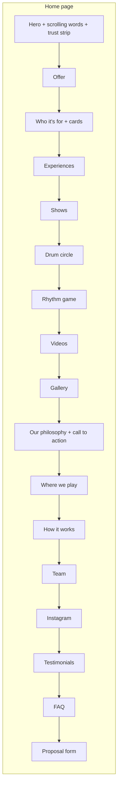

# 02 · Design — The home sections (2.10.0)

The first release of the approved [content programme](01-inception.md) (D1–D6 as recommended): every home section still
without an editor gets one. Schema-driven like every page ([ADR-0014](../../architecture/adr/0014-schema-driven-editors.md)):
the site's components already read these documents, so **the public site's code doesn't change**. No new port, no
dependency.

## What becomes editable

One menu page per site section (0017 U1), in the order the home page shows them. Two small sections join the page of
the section they sit beside.

| Menu page (new in **bold**) | Document(s)                      | Cards and fields                                                                                                                                                                                                                                 | Preview scrolls to |
| --------------------------- | -------------------------------- | ------------------------------------------------------------------------------------------------------------------------------------------------------------------------------------------------------------------------------------------------ | ------------------ |
| Hero (extended)             | `home/marquee`, `home/trust`     | **Scrolling words** (a list of words, up to 12) · **Trust strip** (up to 4 items: icon, title, text)                                                                                                                                             | top                |
| Who it's for (extended)     | `home/audiences`                 | heading, now with the **cards** (up to 6: icon, title, text, tags)                                                                                                                                                                               | for-everyone       |
| **Our philosophy**          | `home/philosophy`, `home/midCta` | heading · **Pillars** (up to 4: title, text) · **Goals** (eyebrow, title, up to 6 items: number, title, text) · **Journey** (eyebrow, title, up to 8 items: when, title, text) · **Call to action below it** (eyebrow, title, two button labels) | philosophy         |
| **Where we play**           | `home/cities`                    | eyebrow, title, introduction · **Cities** (up to 12: name, "Highlighted")                                                                                                                                                                        | cities (new)       |
| **How it works**            | `home/how`                       | eyebrow, title · **Steps** (up to 6: number, title, text)                                                                                                                                                                                        | how                |
| **Instagram**               | `home/instagram`                 | eyebrow, title, follow label, profile link, post label · **Posts** (up to 8: photo from the library, caption, link)                                                                                                                              | insta              |
| **Testimonials**            | `home/proof`                     | eyebrow, title, link label · **Numbers** (up to 4: value, label) · **Testimonials** (up to 6: quote, name, detail, letter) · **Clients** (label, up to 12 names, note)                                                                           | proof              |
| **FAQ**                     | `home/faq`                       | eyebrow, title · **Questions** (up to 12: question, answer, "Open at first")                                                                                                                                                                     | faq                |

- **Icons** are a choice from the icons the site has (as the show formats' are); an unknown one already falls back to
  the sparkle on the site.
- **Limits** go in `CONTENT_MAX_LENGTH` and `COLLECTION_MAX_ITEMS`, as every page's do, sized from today's content
  with room to grow; the writing tips (recommended lengths) follow 0008 D8.
- **Placeholders** such as `[Add a short testimonial…]`, `[YEAR]` or `Logo` stay a **warning** at publish, as now: the
  owner can publish a section before every slot is filled.
- **AI help, drafts, preview, approval, history, backups, Find and the tour** need nothing new: they follow the schema.

## The menu

Six new pages: `EditorTab` gains `philosophy`, `cities`, `how`, `instagram`, `testimonials` and `faq`. Each is added to
the menu (with an icon: procession, map-pin, check, instagram, chat-bubble, document), Find's keywords, the Features
page, and Team access, where a manager's new pages start at **Needs approval**, the default (0019 decision 3).

## The preview anchor

Where we play has no anchor on the site today, so its preview couldn't scroll to it. `PageAnchor.Cities`, the section's
`anchor` (as How it works has) and its entry in `visibility.constants.ts` (so a link to a hidden section lands at the
top) add one. It's the only change to public code: a few bytes, some in the first download, which the build's budget
checks (0.64 kB left).

## The rules

Every new page is one more entry in the lists the rules already keep, nothing new in kind:

| Rule list                                 | Gains                                                                                                                             |
| ----------------------------------------- | --------------------------------------------------------------------------------------------------------------------------------- |
| `homePages()` (who may publish a section) | `marquee`, `trust` → `hero`; `philosophy`, `midCta` → `philosophy`; `cities`; `how`; `instagram`; `proof` → `testimonials`; `faq` |
| `draftPages()` (who may draft it)         | the same nine documents                                                                                                           |
| `approvablePaths()`, `publishablePaths()` | the same, per page                                                                                                                |
| a role's `pages` keys                     | the six new pages                                                                                                                 |

- **Shape:** `isValidHomeSection` already holds a section to its current keys, with limits on eyebrow, title and lead;
  the new documents get the same check. Lists inside are checked by the editor and the site, as for every section
  today (rules can't loop over a list).
- **Rules size:** the two path lists grow by a third. Firestore limits how much one request may evaluate; the rules
  tests cover a manager publishing on a new page and self-approving one, which evaluate the longest paths.

## Tests

- **Unit:** each new section's schema (fields, limits, the list maxima), the menu, Find and Features entries, Team
  access listing the new pages, the role's page keys.
- **Rules (emulator):** the owner publishes each new document; a manager publishes on a page set to publish, is
  refused on one that's hidden, drafts and self-approves on a new page; a document with an extra field is refused.
- **E2E (three sizes, axe):** change a FAQ question and see it in the preview, then published on the site; add a city
  and highlight it; pick an Instagram post's photo from the library; edit a trust strip item; axe on each new page.

## Increments

1. Constants and schemas for the nine documents; the six `EditorTab`s, menu, Find, Features.
2. The cities anchor.
3. Rules and their emulator tests; Team access's page keys.
4. E2E, component tree and data model docs, CHANGELOG.

## Correction to what was said in chat

On 2026-11-22 I suggested making the admin ask for the AI status on every page load. It already does: the status is
asked once per load of the admin, and a full reload asks again. Nothing to change; the live `{"text":false}` came from
the function not seeing its settings.

---

**Approval:** ☑ Approved by Ravi Akhouri on 2026-11-22.
