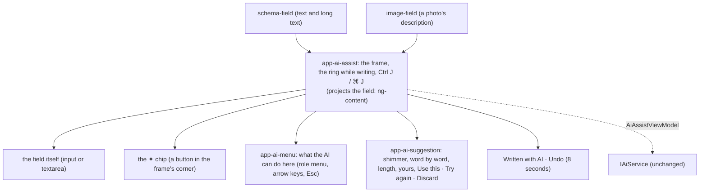
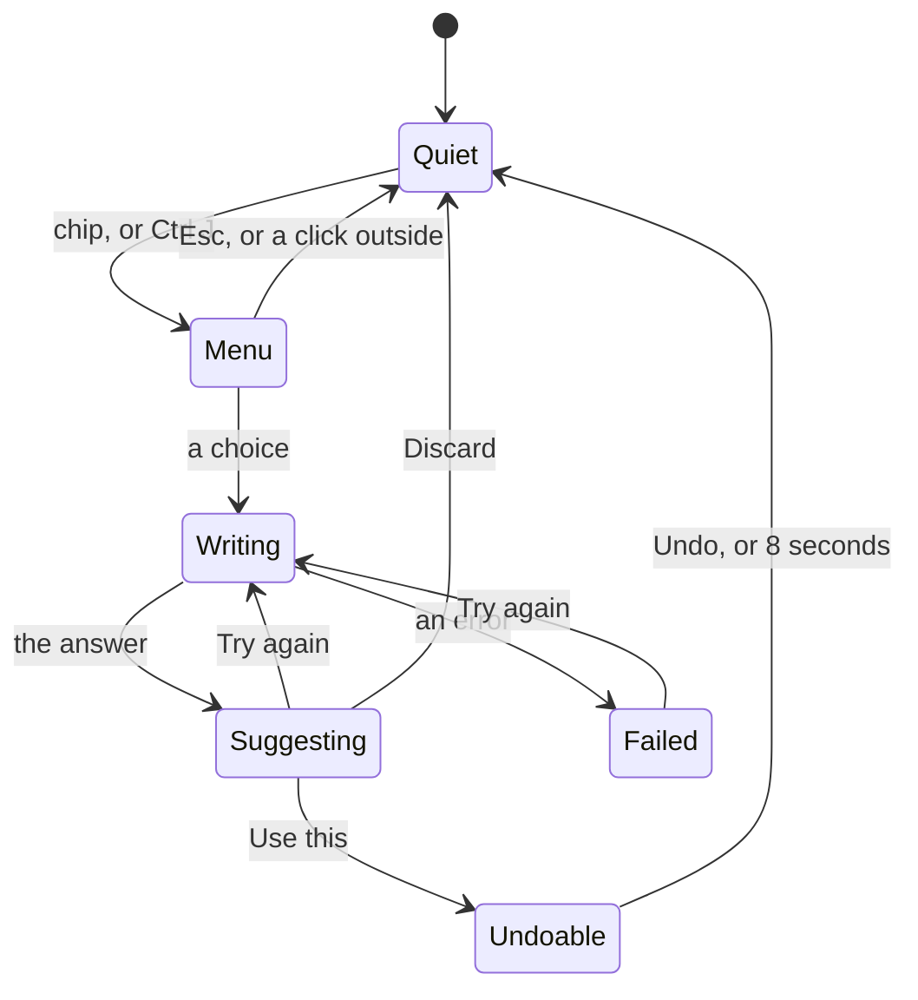
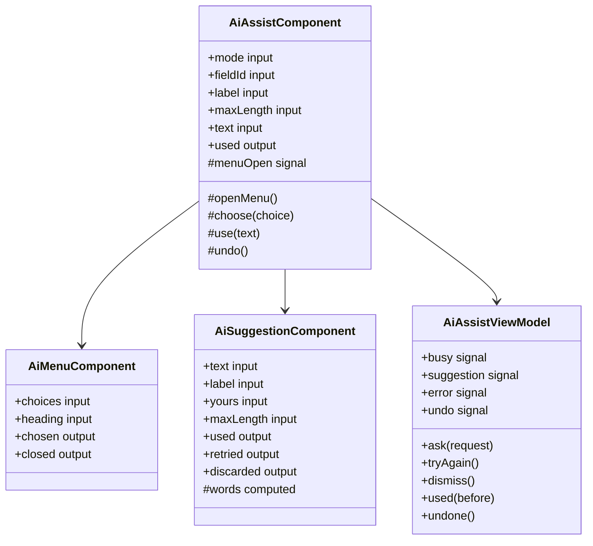

# 02 · Design — AI help that feels good to use (2.13.0)

Built on the approved [inception](01-inception.md) (D1–D6 as recommended). The approved prototype,
[Taal Yatra AI help](https://claude.ai/artifact/6VXWWhFcYLLDDUQ2J7v232), is the visual target. The AI service, its
requests, the Azure function, the rules and the public site don't change: this is the admin's AI help components
only. No new port, no dependency.

## Component tree

Today `app-ai-assist` sits **after** a field, so its button can't be inside the field. In 2.13.0 it **wraps** the
field: the field is projected into its frame, and the chip sits in the frame's corner. The menu and the suggestion
become small components of their own, each with its own styles, to stay inside the 4 kB budget per component.

- **When AI help isn't set up**, `app-ai-assist` still projects the field, and shows nothing else. The field looks as
  it does today.
- **The field keeps room for the chip:** `schema-field` and `image-field` add padding at the field's end (single
  line) or foot (long text) while AI help shows, so text never runs under the chip.

## What each part does

| Part           | Behaviour                                                                                                                                                                                                                                                                                                                                                                                                                                             |
| -------------- | ----------------------------------------------------------------------------------------------------------------------------------------------------------------------------------------------------------------------------------------------------------------------------------------------------------------------------------------------------------------------------------------------------------------------------------------------------- |
| **Chip**       | A pill in the field's corner: the sparkle icon, and a word that opens out (**Write**, **Improve** or **Describe**) while the field is hovered or focused, or always on touch screens (`hover: none`). Its name for screen readers is "AI help for _field_", with `aria-haspopup="menu"` and `aria-expanded`. Disabled while writing                                                                                                                   |
| **Shortcut**   | **Ctrl J**, **⌘ J** on a Mac, while focus is in the field: opens the menu (the browser's own use of it is prevented only there). The chip shows it on hover, not on touch screens                                                                                                                                                                                                                                                                     |
| **Menu**       | Under the chip, right-aligned: a small heading (**Write with AI** or **Rewrite it**), then the choices, each with a glyph: **Write a first version**; or Clearer, Shorter, Warmer, More formal, Fix spelling and grammar; or **Describe the photo**. Focus goes to the first; ↑ ↓ move, Enter chooses, Esc and a click outside close it and return focus to the chip. A line at its foot: "You see it first; nothing changes until you choose it."    |
| **Writing**    | A ring turns slowly around the field (a conic gradient of the theme's accent, amber and clay, on a registered `--spin` angle); the chip's sparkle twinkles; the suggestion's place opens with two shimmering lines and "Writing…"                                                                                                                                                                                                                     |
| **Suggestion** | Under the field: a heading with the sparkle and the choice's name ("Shorter"), the length against the limit (red past it), the text arriving word by word (each word fades from a slight blur, the delay per word `min(45 ms, 1,500 ms ÷ words)`, so any answer finishes within about 1.5 seconds), the owner's text struck through ("Yours: …", shortened past 90 characters), then **Use this** (primary, focused), **↻ Try again** and **Discard** |
| **Use this**   | The field takes the text (through the form, so it autosaves as a draft); a soft amber flash marks it, and "✦ Written with AI. **Undo**" shows for 8 seconds, bringing back the owner's text if chosen. Focus returns to the field                                                                                                                                                                                                                     |
| **Failure**    | The message replaces the suggestion, with **Try again**; the field is untouched                                                                                                                                                                                                                                                                                                                                                                       |

## States

The view model holds the state as signals (`busy`, `suggestion`, `error`, and the new `undo`); the requests stay
one `exhaustMap` (a second choice while writing is ignored, as today). The 8 seconds are an RxJS `timer`, cancelled
by a new request or by Undo (`switchMap`).

## Class diagram

`ai-assist.ts` (models) gains the menu's choices as data (`IAiChoice`: its key, label and glyph), the chip's words,
and the timings (`AI_WORD_DELAY_MAX_MS`, `AI_REVEAL_MAX_MS`, `AI_UNDO_MS`) as constants.

## Motion and accessibility

- **Reduced motion** (the device's setting): no ring turning (it shows still), no twinkle, shimmer, word-by-word or
  flash. Each animation is declared inside `@media (prefers-reduced-motion: no-preference)`, so it's off by default.
- **Screen readers:** the words arrive visually only (`aria-hidden` while arriving); a status region says
  "Suggestion ready: _text_" once. The menu is `role="menu"` with `menuitem`s. Undo is a real button.
- **Themes:** every colour comes from the theme's tokens (accent, amber, clay, surfaces), so the chip, menu, ring
  and suggestion follow all 16 themes and the owner's own; axe checks them on three sizes.

## Data model / endpoints

None. `IAiService`, the requests and the function are unchanged.

## Tests

- **Unit:** the chip's word for an empty field, a filled one and a photo; the menu's keys (↑ ↓ Enter Esc) and focus;
  Ctrl J and ⌘ J opening it, other keys not; the word delays for a short and a long answer; Use this, Try again,
  Discard; Undo within 8 seconds bringing the text back, and gone after; a failure; nothing but the field when AI
  help isn't set up.
- **E2E (three sizes, axe):** `admin-ai-help.e2e.ts` rewritten for the chip: a first version for an empty field,
  Shorter on a filled one, Use this then Undo, Discard leaving the field as it was, a photo's description, Ctrl J;
  axe with the menu open and with a suggestion showing.
- **Screenshots:** the field with its menu open, and with a suggestion, on three sizes (motion off in screenshots).

## Increments

1. The models' choices and timings; `AiMenuComponent`.
2. `AiAssistComponent` wrapping the field, the chip, the shortcut; `schema-field` and `image-field` projecting into it.
3. The writing state and `AiSuggestionComponent` (word by word, comparison).
4. Use this with Undo in the view model.
5. E2E, screenshots, docs, CHANGELOG.

## ADRs raised

None: it's within ADR-0020 (AI help behind `IAiService`).

---

**Approval:** ☑ Approved by Ravi Akhouri on 2026-11-23.
