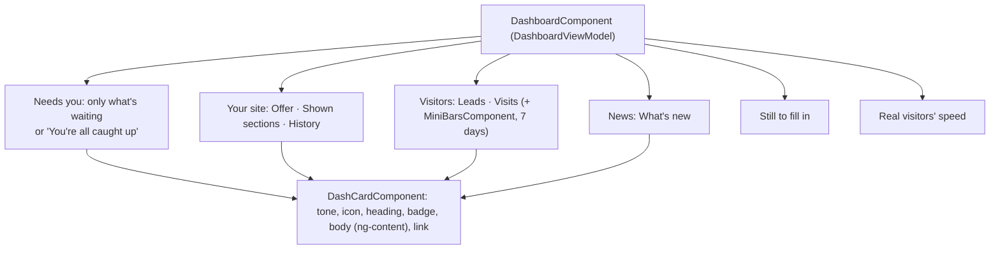
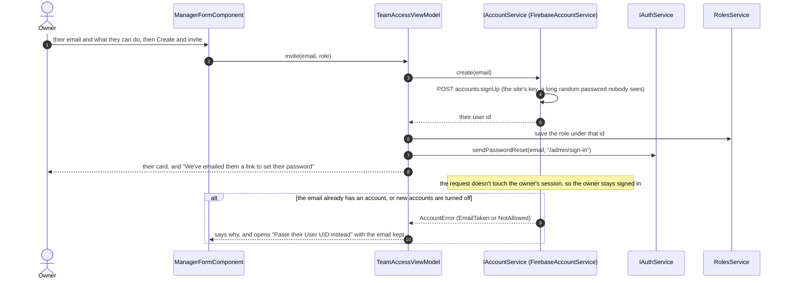
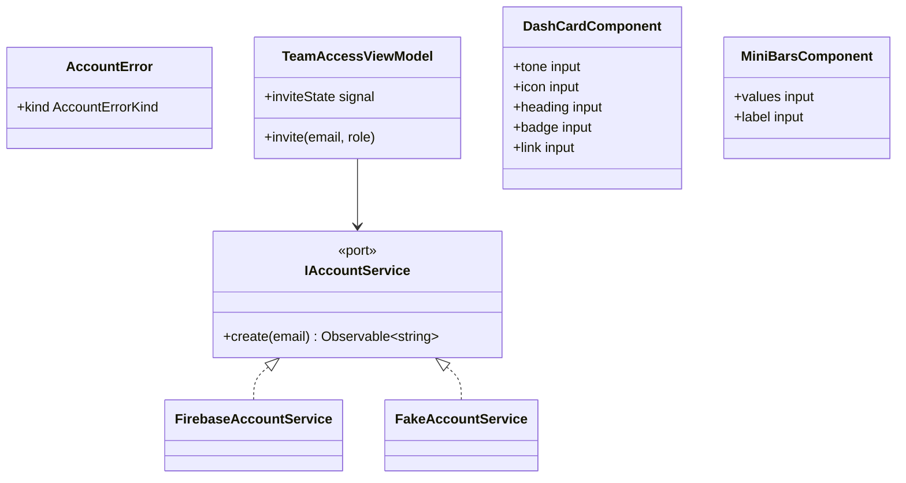

# 02 · Design — An admin that's easier to use (2.14.0)

Built on the approved [inception](01-inception.md) (D1–D6 as recommended). The admin only: the public site, its first
download and the rules don't change. One new port, `IAccountService`, provided on the admin routes only (as
`IAiService` is); no new dependency or secret.

**A correction to the inception:** the publish bar with nothing to publish shows on two pages, the Dashboard and the
Photo library, not seven: Leads, Visits, Features, Team access and What's new never had it.

## 1 · The dashboard

- **Needs you** holds the cards that ask for something, in this order, each only when it does: changes to publish,
  approvals waiting, a backup due, new leads. When none do, one calm line: "You're all caught up." Cards in it are
  marked with their tone's colour more strongly than the rest.
- **The other cards** follow in three small groups, each with a quiet heading.
- **`DashCardComponent`** (new) holds what every card shares: a coloured icon in a soft circle, a tint of the card's
  colour across its top, the heading and an optional badge, the body (projected), and its link. The dashboard's own
  stylesheet keeps only the layout, inside its 4 kB budget.
- **Tones** (`DashTone`), each a colour from the theme mixed with the card's surface, so all 16 themes and the
  owner's own keep them in harmony; text keeps the theme's own colours, so it stays readable:

| Tone      | Cards                      | Colour                     | Icon                     |
| --------- | -------------------------- | -------------------------- | ------------------------ |
| Publish   | Changes not on the website | amber (the theme's accent) | Send                     |
| Attention | Approvals, a backup due    | clay                       | Check / Copy             |
| Visitors  | Leads, Visits              | sage                       | Briefcase / ArrowUpRight |
| Site      | Offer, Shown sections      | bronze                     | Sparkle / Toggle         |
| Quiet     | History, What's new        | the theme's muted ink      | Clock                    |

- **`MiniBarsComponent`** (new): the last 7 days' visits as seven small bars in the Visits card, with the days as its
  description for screen readers ("Visits, last 7 days: 2, 0, 1 …"). It reads the visit days the dashboard already
  loads; nothing new is read.

## 2 · Team access

### Adding a manager with their email

- **`IAccountService`** (new port, `core/interfaces`): `create(email): Observable<string>` (the new account's id),
  failing with an `AccountError` whose kind is `EmailTaken`, `NotAllowed`, `TooMany` or `Unknown`.
  - **`FirebaseAccountService`** (`core/backends/firebase`) posts to Identity Toolkit's `accounts:signUp` with
    `HttpClient` and the Firebase config's API key, at the Auth emulator's address when `authEmulator` is set. The
    password is 32 random characters from `crypto.getRandomValues`, used once and never stored or shown.
  - **`FakeAccountService`** returns an id for any new email and `EmailTaken` for the Fake's existing accounts.
  - Picked by `accountServiceFactory` and provided by `provideAccounts()` in `admin.routes.ts`.
- **The form** asks for the email first. The UID field is gone from the usual path; **Paste their User UID instead**
  (a disclosure) brings it back, for an existing account. Editing a manager shows their email and id as text.
- **No rules change:** a new account can do nothing until its role exists, which only the owner can write.

### What they can do on each page

- Each page's row becomes **three buttons in a row**, a native radio group styled as segments: **Hidden · Needs
  approval · Can publish**, one pressed. A radio group is named by its page, and the arrow keys move within it, as
  they do for any radio group.
- **Set all to** (three small buttons above the list) sets every page at once; the owner then changes the few that
  differ.
- **The explanation** becomes three small chips with a word each, under the heading: "Hidden: not in their menu",
  "Needs approval: you approve", "Can publish: goes live".
- **The form's boxes:** one field style for every box, labels above, hints and errors below, so the email and (when
  shown) the UID line up.

## 3 · Dropdowns, Leads and the publish bar

- **Dropdowns:** a `forms.select` mixin (in `_forms.scss`): the boxes' height, border, corner and focus ring, the
  browser's arrow removed and drawn in the theme's muted ink. Used by the editor's choices, Leads' filters, and
  anywhere else the admin has a `select`.
- **Leads:** "Show all" becomes a small **Clear filters** link at the end of the filters' row, shown only while a
  filter is set.
- **The publish bar** on the Dashboard and the Photo library shows only while there are changes to publish; the
  editor pages keep it always.

## 4 · The Theme spec

`admin-theme.e2e.ts` publishes every theme on three sizes and timed out under the full run's load twice. Its describe
is marked `test.slow()` (three times the timeout), inside the spec; `playwright.config.ts` doesn't change.

## Class diagram

## Tests

- **Unit:** each tone's class; "Needs you" holding only what's waiting, and "all caught up"; the mini bars' heights
  and label; `FirebaseAccountService` (the request, the emulator address, each error mapped) against `HttpTestingController`;
  the Fake; the factory; the view model's invite (role saved under the new id, the email sent, each failure opening
  the UID path, nothing saved on failure); the segmented choice and Set all; the select style present on each select;
  the publish bar shown or not.
- **Rules:** none change; `test:rules` runs as a check.
- **E2E (three sizes, axe):** invite a manager by email, see their card and the "emailed" note; an email already
  used opens the UID path; Set all to Can publish; the dashboard's Needs you with a change and when caught up;
  screenshots of the dashboard and the manager form, re-recorded and checked by eye.
- **Firebase smoke (emulator):** inviting a manager creates the account on the Auth emulator and the role through
  the rules, and the new manager can sign in after setting a password through the emulator's reset link.

## Increments

1. `forms.select` and its use; Leads' Clear filters; the publish bar's condition; the Theme spec's `test.slow()`.
2. `DashCardComponent`, `MiniBarsComponent`, `DashTone`; the dashboard's groups and Needs you.
3. Team access: the segmented choices, Set all, the chips, the aligned fields.
4. `IAccountService`, its adapters, factory and provider; the invite in the view model and the form.
5. E2E, screenshots, the Firebase smoke, docs (component tree, class diagram, sequence diagram), CHANGELOG.

## ADRs raised

**ADR-0021: Creating a manager's account from the admin.** Why the browser calls Firebase's sign-up API with the
public key rather than an Azure function with the admin key: no secret, no dependency, the owner stays signed in,
and the rules already make a new account powerless until its role exists. The trade-off: an email with an account
can't be found, so its id is pasted.

---

**Approval:** ☑ Approved by Ravi Akhouri on 2026-11-23.
