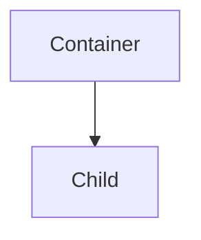
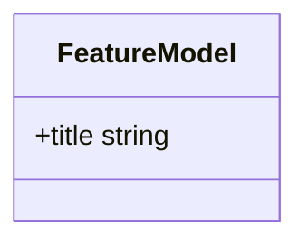

# 02 · Design — <Feature>

## Component tree



## Class diagram



## Sequence diagram

```mermaid
sequenceDiagram
```

## Data model / endpoints

## ADRs raised

---

**Approval:** ☐ Approved by ____ on ____
