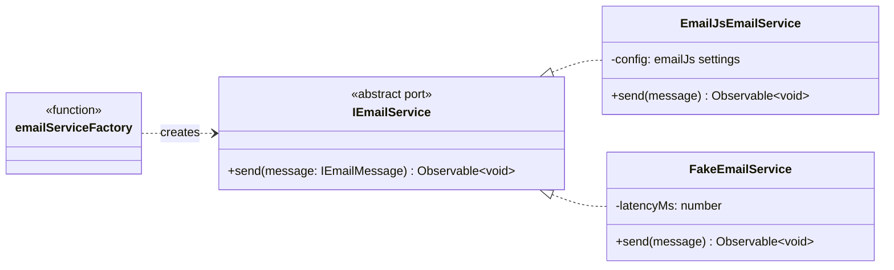
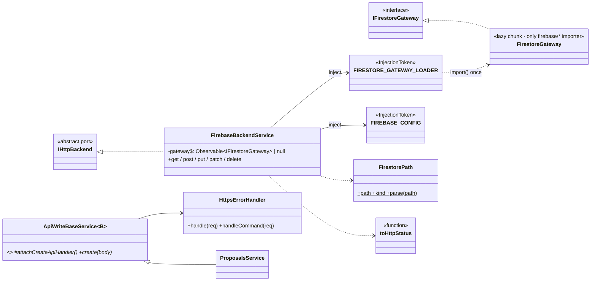
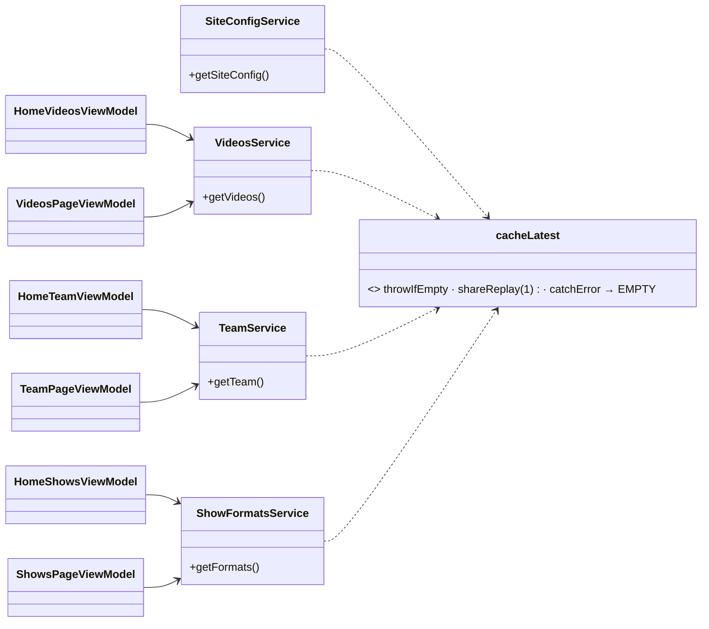
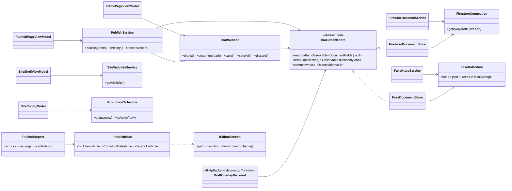

# Class Diagram

Core abstractions. Feature classes (`About*`) show the pattern every feature follows.

The same port → adapter → factory shape applies to `IAuthService`, `IEmailService` and
`IMediaService`. `IEmailService` is implemented (1.1.0):

`IHttpBackend`'s Firestore adapter (1.2.0, [ADR-0009](adr/0009-firestore-data-adapter.md)):

The home page's section classes (contact, assistant) are in
[aidlc/0003-home-page/02-design.md](../aidlc/0003-home-page/02-design.md).

Shared entities and cached services (1.3.0, [ADR-0011](adr/0011-shared-entities-cached-services.md)):

Content editor (1.6.0, [ADR-0013](adr/0013-drafts-publish-preview.md),
[ADR-0014](adr/0014-schema-driven-editors.md), [ADR-0015](adr/0015-site-visibility.md)):

