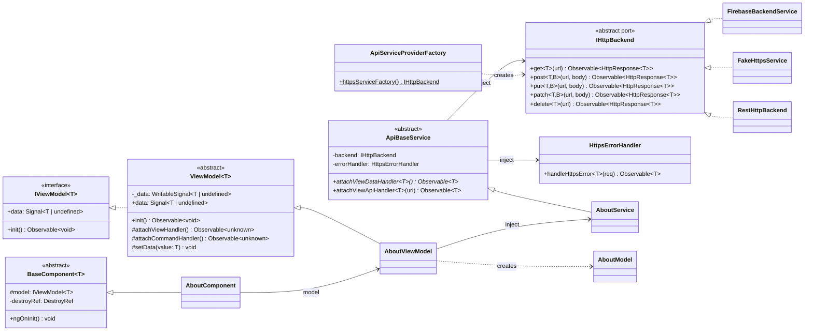

# Class Diagram

Core abstractions. Feature classes (`About*`) show the pattern every feature follows.

The same port → adapter → factory shape applies to `IAuthService`, `IEmailService` and
`IMediaService`. Add them here when they are implemented.
