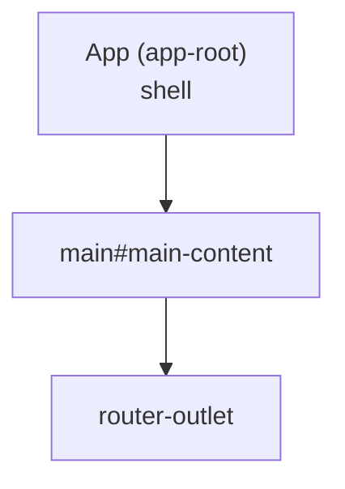

# Component Tree & Routing

## Current (v1.0.0)



`routes` is empty. Each feature adds a lazy route:

```ts
{ path: 'about', loadComponent: () => import('@features/about/components/about/about.component').then(m => m.AboutComponent) }
```

## Conventions

- One **container** component per route. It owns the ViewModel and composes **presentational**
  children, which take signal `input()`s and emit `output()`s and have no injected services.
- Layout components (`layout/`) such as header, footer and nav sit in the App shell around the outlet.
- Update this tree whenever a route or component is added.
