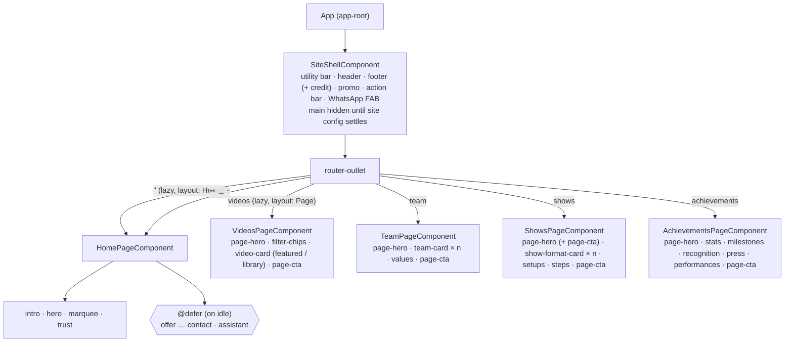

# Component Tree & Routing

## Current (v1.3.0)

The home page's full section tree is in
[aidlc/0003-home-page/02-design.md](../aidlc/0003-home-page/02-design.md), and the inner pages'
in [aidlc/0005-inner-pages/02-design.md](../aidlc/0005-inner-pages/02-design.md). Each inner page
is one container with one view model that combines its `pages/*` document with any shared list,
so it renders in one pass. Page chrome lives in
`shared/components/layout/` and varies per route through `layout` route data (`LAYOUT_CHROME`).

## Conventions

- One **container** component per route. It owns the ViewModel and composes **presentational**
  children, which take signal `input()`s and emit `output()`s and have no injected services.
- Layout components (`layout/`) such as header, footer and nav sit in the App shell around the outlet.
- Update this tree whenever a route or component is added.
