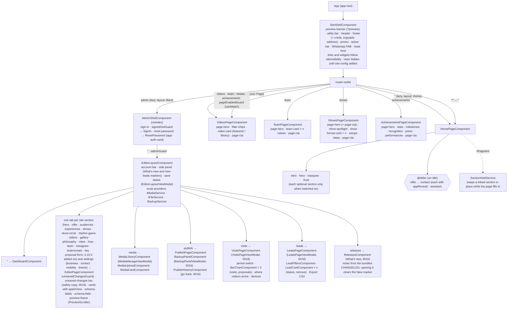
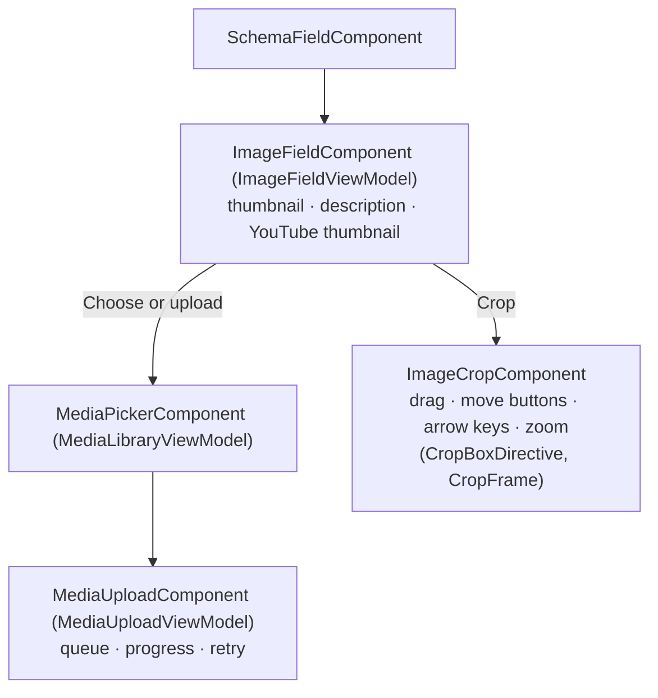
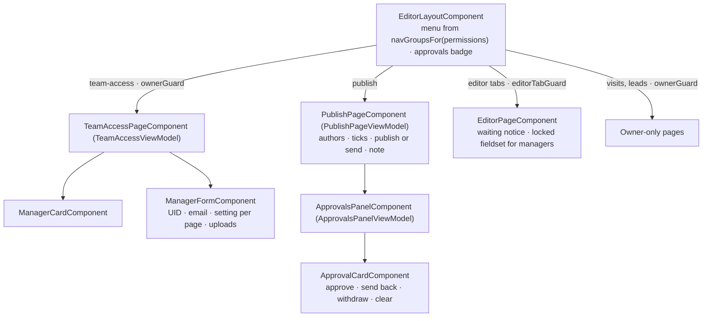
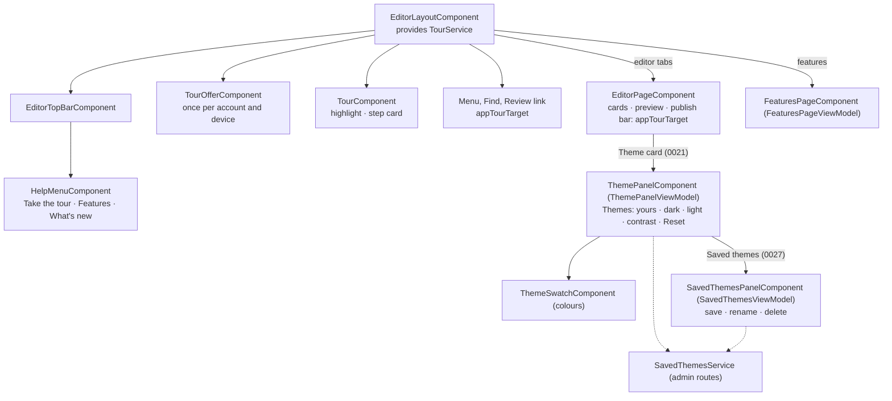
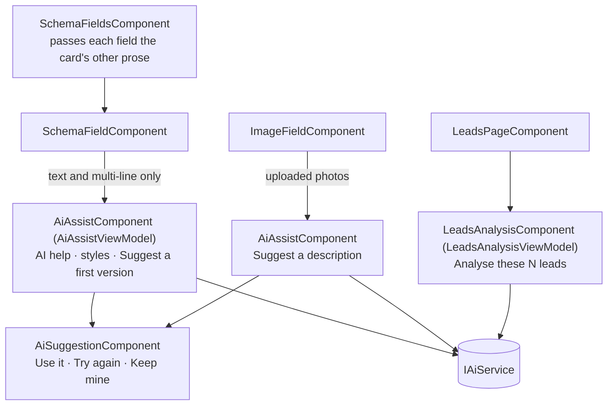
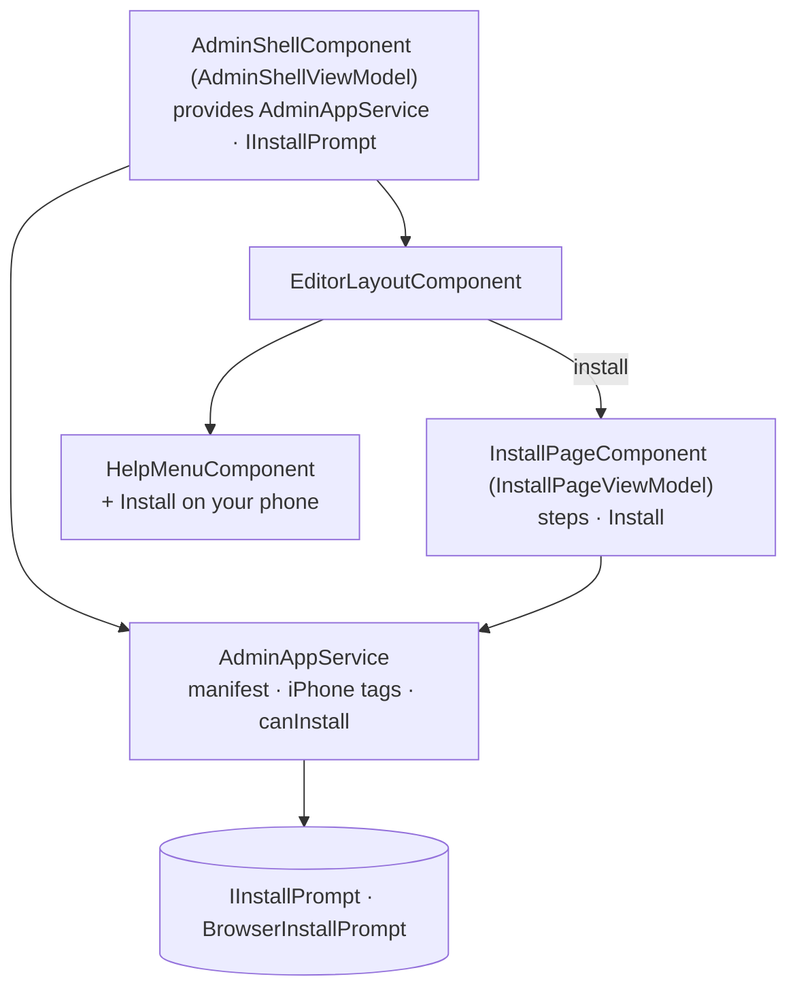

# Component Tree & Routing

## Current (v1.6.0)

The home page's full section tree is in
[aidlc/0003-home-page/02-design.md](../aidlc/0003-home-page/02-design.md), and the inner pages'
in [aidlc/0005-inner-pages/02-design.md](../aidlc/0005-inner-pages/02-design.md). Each inner page
is one container with one view model that combines its `pages/*` document with any shared list,
so it renders in one pass. Page chrome lives in
`shared/components/layout/` and varies per route through `layout` route data (`LAYOUT_CHROME`).

## Conventions

- One **container** component per route. It owns the ViewModel and composes **presentational**
  children, which take signal `input()`s and emit `output()`s and have no injected services.
- Layout components (`layout/`) such as header, footer and nav sit in the App shell around the outlet.
- Update this tree whenever a route or component is added.

## Image field (1.7.0)

`SchemaFieldComponent` renders `FieldKind.Image` as an image field, in lists and groups alike.

## Roles and approvals (2.0.0)

New admin routes and components ([ADR-0018](adr/0018-roles-and-approvals.md)). Every editor route sits behind
`editorGuard` (owner or manager); `editorTabGuard` keeps a manager off hidden pages, and `ownerGuard` keeps them off the
owner's own pages.

## Guided tour and Features (2.1.0)

The tour's state lives in `TourService`, provided by the editor layout. Areas mark themselves with `TourTargetDirective`;
`TourComponent` is the only part that measures them ([0020 design](../aidlc/0020-tour-and-showcase/02-design.md)).

## AI help (2.6.0)

Each prose field and each photo description gets its own `AiAssistComponent` with a component-scoped view model; the
Leads page gets `LeadsAnalysisComponent`. Both ask `IAiService`, provided on the admin routes
([ADR-0020](adr/0020-ai-through-the-function.md), [0025 design](../aidlc/0025-ai-help/02-design.md)).

## The admin as an app (2.8.0)

The shell adds the manifest and iPhone tags while the admin is open, through `AdminAppService`, and keeps the browser's
install offer for the Install page ([0026 design](../aidlc/0026-admin-app/02-design.md)).

