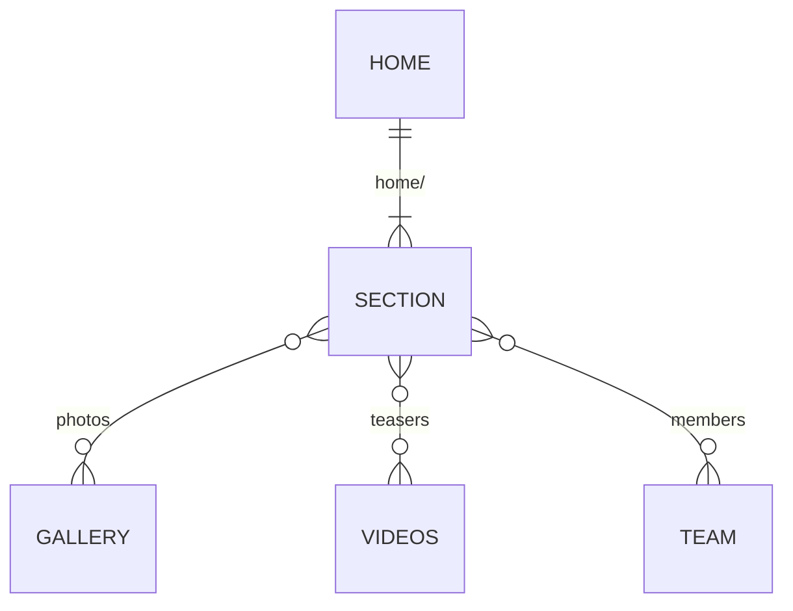

# Data Model (Firestore)

> Firestore is not wired yet. Content is served from `core/backends/fake/fake-db.json`, whose
> paths are the future document paths.

| Path | Shape (DTO) | Used by |
| --- | --- | --- |
| `home/<section>` (`hero`, `marquee`, `trust`, `offer`, `audiences`, `experiences`, `shows`, `drumCircle`, `rhythmGame`, `videos`, `gallery`, `philosophy`, `midCta`, `cities`, `how`, `team`, `instagram`, `proof`, `faq`, `contact`, `assistant`) | `i-*.ts` in `features/home/sections/<section>/` | one home section each |
| `videos` | `IVideo[]` | videos teaser, Videos page (later) |
| `gallery` | `IImage[]` | gallery, lightbox |
| `team` | `ITeamMember[]` | team teaser, Team page (later) |

Site-wide chrome (brand, contact details, socials, promotion) is static for now:
`SITE_CONFIG` token → `DEFAULT_SITE_CONFIG`.

## Conventions

- Firestore paths mirror the `ApiEndpoint` enum, so `IHttpBackend.get(url)` maps
  1:1 to a document path.
- Array sections are stored as `{ items: [...] }` documents and unwrapped by the adapter.
- DTO interfaces (`i-*.ts`) describe stored shapes. Model classes add behaviour.
- Every collection has matching rules in `firestore.rules`, deny-by-default, with tests.

