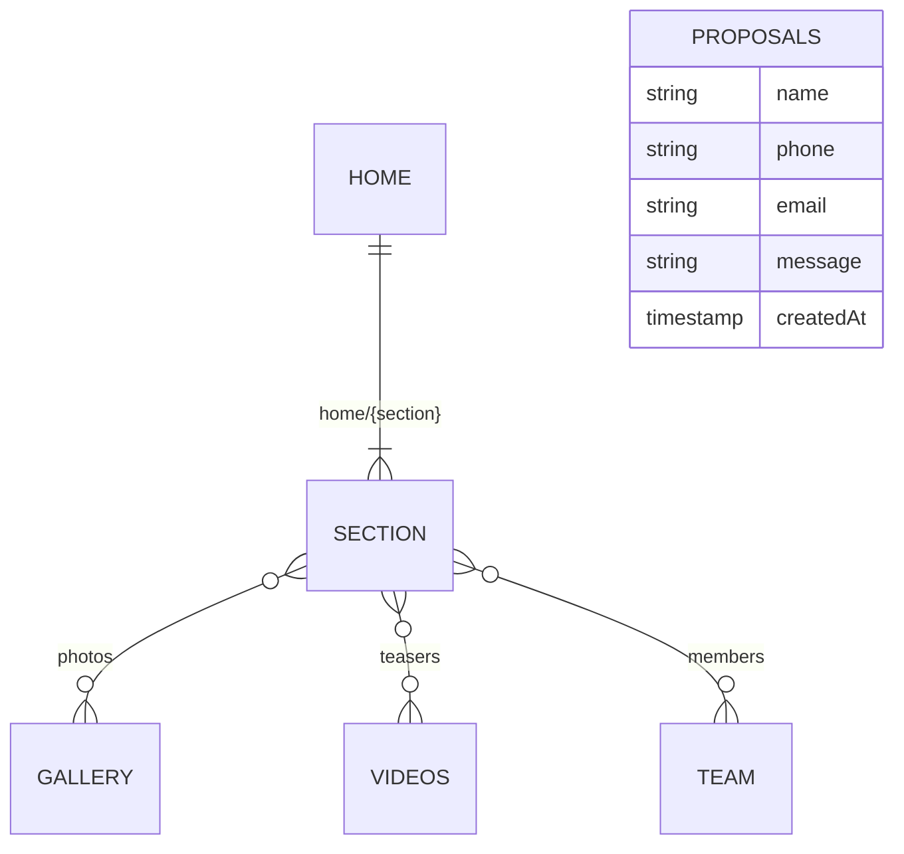

# Data Model (Firestore)

Cloud Firestore, project `taal-yatra` (since 1.2.0, [ADR-0009](adr/0009-firestore-data-adapter.md)).
`core/backends/fake/fake-db.json` stays the source of truth: `npm run seed:firestore` copies it
into Firestore, and development, unit tests and the main e2e suite read it directly.

| Path | Shape (DTO) | Used by |
| --- | --- | --- |
| `home/{section}` (`hero`, `marquee`, `trust`, `offer`, `audiences`, `experiences`, `shows`, `drumCircle`, `rhythmGame`, `videos`, `gallery`, `philosophy`, `midCta`, `cities`, `how`, `team`, `instagram`, `proof`, `faq`, `contact`, `assistant`) | `i-*.ts` in `features/home/sections/<section>/` | one home section each |
| `home/marquee`, `home/trust` | stored as `{ _items: [...] }`, read as the list | marquee, trust |
| `videos/{001…}` | `IVideoDto` + `order` | videos teaser, Videos page (later) |
| `gallery/{001…}` | `IImageDto` + `order` | gallery, lightbox |
| `team/{001…}` | `ITeamMemberDto` + `order` | team teaser, Team page (later) |
| `proposals/{autoId}` | proposal fields + `createdAt` (server time) | written by the contact form; read in the console |

Site-wide chrome (brand, contact details, socials, promotion) is still static:
`SITE_CONFIG` token → `DEFAULT_SITE_CONFIG`.

## Conventions

- Firestore paths mirror the `ApiEndpoint` enum. Two segments are a document; one segment is a
  collection, read with `orderBy('order')`.
- List sections stored as one document use the reserved key `_items`, not `items`, because
  `home/experiences` and `home/faq` already have a real `items` field.
- List item documents are numbered by position (`001`, `002`, …). The adapter removes `order`
  from bodies.
- The adapter stamps `createdAt: serverTimestamp()` on every created document.
- DTO interfaces (`i-*.ts`) describe stored shapes; model classes add behaviour.
- `firestore.rules` denies by default and is tested (`npm run test:rules`). Content is read-only;
  `proposals` is create-only, with exact keys, length limits from `PROPOSAL_MAX_LENGTH`, and
  `createdAt == request.time`.

