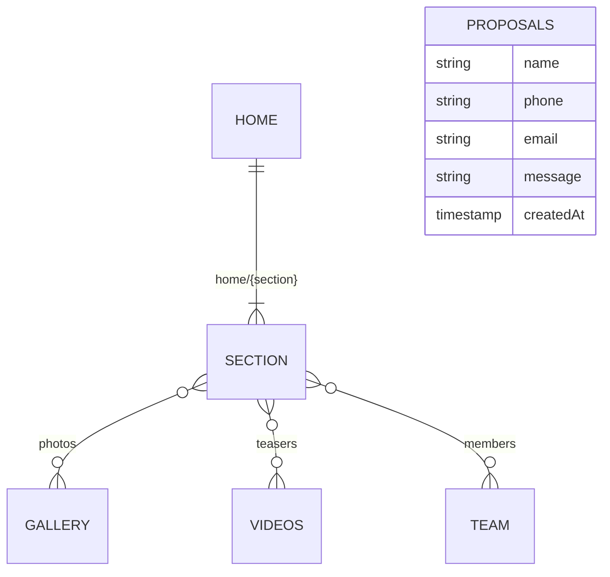

# Data Model (Firestore)

Cloud Firestore, project `taal-yatra` (since 1.2.0, [ADR-0009](adr/0009-firestore-data-adapter.md)).
`core/backends/fake/fake-db.json` stays the source of truth: `npm run seed:firestore` copies it
into Firestore, and development, unit tests and the main e2e suite read it directly.

| Path | Shape (DTO) | Used by |
| --- | --- | --- |
| `home/{section}` (`hero`, `marquee`, `trust`, `offer`, `audiences`, `experiences`, `shows`, `drumCircle`, `rhythmGame`, `videos`, `gallery`, `philosophy`, `midCta`, `cities`, `how`, `team`, `instagram`, `proof`, `faq`, `contact`, `assistant`) | `i-*.ts` in `features/home/sections/<section>/` | one home section each |
| `site/config` | `ISiteConfigDto`: brand, contact, socials (no WhatsApp, it's derived from the phone), promotion, copyright year, `labels` (strings two pages share), `credit` (footer) | utility bar, header, footer, promo badge, action bar, hero, offer, mid-CTA, contact, assistant, intro |
| `home/marquee`, `home/trust` | stored as `{ _items: [...] }`, read as the list | marquee, trust |
| `pages/{videos, team, shows, achievements, admin}` | page copy only (`i-*-page.ts` in `features/<page>/models/`) | that inner page |
| `showFormats/{001…}` | `IShowFormatDto` + `order`: icon, title, text, ensemble, set length, best for, `image`, `featured`, `spotlight` (copy for the featured one, else `null`) | home Shows teaser and Shows page; the featured format (classical tabla recital) is their spotlight |
| `videos/{001…}` | `IVideoDto` + `order` (categories are derived, not stored) | videos teaser, Videos page |
| `gallery/{001…}` | `IImageDto` + `order` | gallery, lightbox |
| `team/{001…}` | `ITeamMemberDto` + `order` | team teaser, Team page |
| `proposals/{autoId}` | proposal fields + `createdAt` (server time) | written by the contact form; read in the console |

Navigation menus and design constants stay in code (`navigation.constants.ts`): they point at
app routes.

## Conventions

- Firestore paths mirror the `ApiEndpoint` enum. Two segments are a document; one segment is a
  collection, read with `orderBy('order')`.
- List sections stored as one document use the reserved key `_items`, not `items`, because
  `home/experiences` and `home/faq` already have a real `items` field.
- `site`, `home` and `pages` are each read whole, independently, the first time one of their
  documents is needed (ADR-0009, ADR-0011). Keep them small.
- **One source per entity** (ADR-0011): videos, team members, show formats and contact details
  are stored once and reach every page through a cached shared service (`cacheLatest`).
- List item documents are numbered by position (`001`, `002`, …). The adapter removes `order`
  from bodies.
- The adapter stamps `createdAt: serverTimestamp()` on every created document.
- Image paths point at files in `public/images`. Photos are WebP (since 1.5.0); the older JPEGs
  stay, so data seeded before a release keeps rendering.
- DTO interfaces (`i-*.ts`) describe stored shapes; model classes add behaviour.
- **Optional parts of `site/config` degrade item by item.** Only brand, contact and year are
  required. Missing `labels` become empty, so "Call us" falls back to the number, the copyable
  address to plain text, and video cards to their titles. A missing `credit` hides the credit, and
  missing `socials` or `promotion` show none. One absent field never blanks a section.
- `firestore.rules` denies by default and is tested (`npm run test:rules`). Content is read-only;
  `proposals` is create-only, with exact keys, length limits from `PROPOSAL_MAX_LENGTH`, and
  `createdAt == request.time`.

