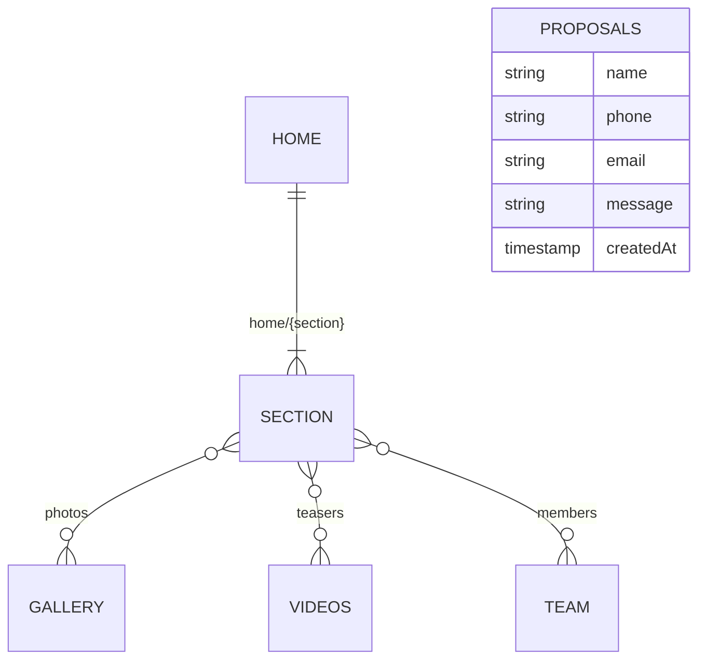

# Data Model (Firestore)

Cloud Firestore, project `taal-yatra` (since 1.2.0, [ADR-0009](adr/0009-firestore-data-adapter.md)).
`core/backends/fake/fake-db.json` stays the source of truth: `npm run seed:firestore` copies it
into Firestore, and development, unit tests and the main e2e suite read it directly.

| Path                                                                                                                                                                                                                                               | Shape (DTO)                                                                                                                                                                                                                                                                                                                                                                                                                                                                                                                      | Used by                                                                                               |
| -------------------------------------------------------------------------------------------------------------------------------------------------------------------------------------------------------------------------------------------------- | -------------------------------------------------------------------------------------------------------------------------------------------------------------------------------------------------------------------------------------------------------------------------------------------------------------------------------------------------------------------------------------------------------------------------------------------------------------------------------------------------------------------------------- | ----------------------------------------------------------------------------------------------------- |
| `home/{section}` (`hero`, `marquee`, `trust`, `offer`, `audiences`, `experiences`, `shows`, `drumCircle`, `rhythmGame`, `videos`, `gallery`, `philosophy`, `midCta`, `cities`, `how`, `team`, `instagram`, `proof`, `faq`, `contact`, `assistant`) | `i-*.ts` in `features/home/sections/<section>/`                                                                                                                                                                                                                                                                                                                                                                                                                                                                                  | one home section each                                                                                 |
| `site/config`                                                                                                                                                                                                                                      | `ISiteConfigDto`: brand, contact, socials (no WhatsApp, it's derived from the phone), promotion, copyright year, `labels` (strings two pages share), `credit` (footer), `seo` (each page's own title and search description, 2.11.0; empty keeps `PAGE_META`)                                                                                                                                                                                                                                                                    | utility bar, header, footer, promo badge, action bar, hero, offer, mid-CTA, contact, assistant, intro |
| `home/marquee`, `home/trust`                                                                                                                                                                                                                       | stored as `{ _items: [...] }`, read as the list                                                                                                                                                                                                                                                                                                                                                                                                                                                                                  | marquee, trust                                                                                        |
| `pages/{videos, team, shows, achievements, admin}`                                                                                                                                                                                                 | page copy only (`i-*-page.ts` in `features/<page>/models/`)                                                                                                                                                                                                                                                                                                                                                                                                                                                                      | that inner page                                                                                       |
| `showFormats/{001…}`                                                                                                                                                                                                                               | `IShowFormatDto` + `order`: icon, title, text, ensemble, set length, best for, `image`, `featured`, `spotlight` (copy for the featured one, else `null`)                                                                                                                                                                                                                                                                                                                                                                         | home Shows teaser and Shows page; the featured format (classical tabla recital) is their spotlight    |
| `videos/{001…}`                                                                                                                                                                                                                                    | `IVideoDto` + `order` (categories are derived, not stored)                                                                                                                                                                                                                                                                                                                                                                                                                                                                       | videos teaser, Videos page                                                                            |
| `gallery/{001…}`                                                                                                                                                                                                                                   | `IImageDto` + `order`                                                                                                                                                                                                                                                                                                                                                                                                                                                                                                            | gallery, lightbox                                                                                     |
| `media/{id}`                                                                                                                                                                                                                                       | `IMediaAssetDto`: `publicId`, `version`, `width`, `height`, `bytes`, `format`, `name`, `description`, `uploadedAt` (1.7.0, ADR-0017, admin-only)                                                                                                                                                                                                                                                                                                                                                                                 | media library, image fields                                                                           |
| `team/{001…}`                                                                                                                                                                                                                                      | `ITeamMemberDto` + `order`                                                                                                                                                                                                                                                                                                                                                                                                                                                                                                       | team teaser, Team page                                                                                |
| `site/visibility`                                                                                                                                                                                                                                  | `ISiteVisibilityDto`: `sections`, `pages`, `widgets`, maps of key → boolean (1.6.0, ADR-0015)                                                                                                                                                                                                                                                                                                                                                                                                                                    | shell, home page, link lists, `pageEnabledGuard`                                                      |
| `site/theme`                                                                                                                                                                                                                                       | `ISiteThemeDto`: `preset`, six `#rrggbb` colours, `backdrop`, `textSize`, `headingWeight`, `fonts`; each optional, empty is today's look (2.2.0, ADR-0019)                                                                                                                                                                                                                                                                                                                                                                       | shell (every page, the admin too), Theme page                                                         |
| `savedThemes/{uuid}`                                                                                                                                                                                                                               | `ISavedThemeDto`: `name` (1–40), `savedAt`, `theme` in exactly `site/theme`'s shape without `preset`; one per saved theme, apart from the site, so visitors never read them (2.9.0)                                                                                                                                                                                                                                                                                                                                              | Theme page (Themes, Saved themes), backups                                                            |
| `drafts/{id}`                                                                                                                                                                                                                                      | `{ path, content, savedAt, savedBy? }`: an unpublished document, signed by its last author from 2.0.0; id is the path with `__` for `/` (1.6.0, ADR-0013, admin-only)                                                                                                                                                                                                                                                                                                                                                            | editor, preview mode                                                                                  |
| `publishes/{id}`                                                                                                                                                                                                                                   | `{ publishedAt, changed, before, by?, byEmail?, approvedFrom? }`: the latest 20 publishes, each with the previous versions and, from 2.0.0, who published, `selfApproval { title, note }` for a manager's own approval (2.4.0), `forOwner: true` when a super manager approved it (2.5.0)                                                                                                                                                                                                                                        | editor history and undo                                                                               |
| `selfApprovals/{uid}`                                                                                                                                                                                                                              | `{ record, paths }`: a manager's latest self-approved publish, rewritten in its commit; the rules check it with each live write (2.4.0, 0023)                                                                                                                                                                                                                                                                                                                                                                                    | Review & publish (written), `firestore.rules`                                                         |
| `adminState/backups`                                                                                                                                                                                                                               | `{ lastAt }`: when the last backup was made, so every device shows the same reminder (1.12.0, 0016, admin-only; only this document and field are accepted)                                                                                                                                                                                                                                                                                                                                                                       | dashboard and Review & publish backups card                                                           |
| `vitals/{autoId}`                                                                                                                                                                                                                                  | `page`, `device`, `connection`, `lcp`, `fcp`, `ttfb`, `ready`, `cls`, `createdAt` (server time): an anonymous speed report from a real visit (0012). Nothing in it identifies anyone. Create-only for visitors; the admin reads and deletes; removed after 30 days when the report is loaded                                                                                                                                                                                                                                     | written by the site shell; read on the admin dashboard                                                |
| `proposals/{autoId}`                                                                                                                                                                                                                               | proposal fields + `createdAt` (server time); `status` (`new`, `contacted`, `won`, `lost`), `statusAt` and, from 2.3.0, `statusBy` (the marker's email) once marked (0018, 0022)                                                                                                                                                                                                                                                                                                                                                  | written by the contact form; read, marked and deleted on the Leads page                               |
| `visits/{autoId}`                                                                                                                                                                                                                                  | `page`, `device`, `createdAt` (server time): one anonymous visit (0018). Create-only for visitors; the admin reads and deletes                                                                                                                                                                                                                                                                                                                                                                                                   | written by the after-load chunk; added up and removed by the admin area                               |
| `visitDays/{YYYY-MM-DD}`                                                                                                                                                                                                                           | `total`, `pages` (by path), `devices`: a finished day's visits added up, India time (0018). Admin create-only, never changed                                                                                                                                                                                                                                                                                                                                                                                                     | written and read by the Visits page and dashboard                                                     |
| `roles/{uid}`                                                                                                                                                                                                                                      | `{ email, pages: { <EditorTab>: hidden \| approval \| publish }, uploads, areas?, canApprove?, addedAt }`: a content manager's permissions (2.0.0, ADR-0018); `areas` (2.3.0) switches on `leads`, `visits`, `backups`, `goingBack`; `canApprove` (2.4.0) lets them approve their own changes; `superManager { since, untilMs }` (2.5.0) makes them stand in for the owner until `untilMs` (ms, `null` for good), checked against each request's time. Owner writes; a super manager reads all; any other manager only their own | Team access, `AccessService`, the upload function                                                     |
| `approvals/{id}`                                                                                                                                                                                                                                   | `{ by, email, paths, note, sentAt, status: waiting \| approved \| sent-back, answer?, answeredAt?, answeredBy? }`: changes sent for the owner's approval (2.0.0); `answeredBy` is the answerer's email, the owner's or a super manager's (2.5.0)                                                                                                                                                                                                                                                                                 | Review & publish, menu and dashboard badges, editor notice                                            |
| `locks/{draftKey}`                                                                                                                                                                                                                                 | `{ approval }`: a draft waiting for approval, which managers can't change (2.0.0)                                                                                                                                                                                                                                                                                                                                                                                                                                                | the rules, written with its request                                                                   |

Navigation menus and design constants stay in code (`navigation.constants.ts`): they point at
app routes.

## Conventions

- Firestore paths mirror the `ApiEndpoint` enum. Two segments are a document; one segment is a
  collection, read with `orderBy('order')`.
- List sections stored as one document use the reserved key `_items`, not `items`, because
  `home/experiences` and `home/faq` already have a real `items` field.
- `site`, `home` and `pages` are each read whole, independently, the first time one of their
  documents is needed (ADR-0009, ADR-0011). Keep them small.
- **One source per entity** (ADR-0011): videos, team members, show formats and contact details
  are stored once and reach every page through a cached shared service (`cacheLatest`).
- List item documents are numbered by position (`001`, `002`, …). The adapter removes `order`
  from bodies.
- The adapter stamps `createdAt: serverTimestamp()` on every created document.
- Image paths point at files in `public/images`. Photos are WebP (since 1.5.0); the older JPEGs
  stay, so data seeded before a release keeps rendering. **Since 1.7.0, `IImage.src` can also be** an
  uploaded image, `[c_crop,x_…,y_…,w_…,h_…/]v…/<id>`, or a full URL such as a YouTube thumbnail.
- **Collections in drafts (1.7.0):** `drafts/gallery`, `drafts/team`, `drafts/showFormats` and `drafts/videos`
  hold `{ path, content: { _items: [...] }, savedAt }`. Publishing expands the list into numbered documents
  with `order` and deletes unused numbers. Limits, enforced by rules through the highest id: gallery 60, team
  24, shows 20, videos 60.
- **Since 1.6.0, Firestore is the source of truth for live content**: the owner edits it.
  `seed:firestore` creates missing documents only (`--overwrite` replaces after listing), and
  `export:firestore` backs the content up. `fake-db.json` stays the fixture for development
  and e2e.
- `site/config.promotion` has `live`, `startsOn` and `endsOn` (YYYY-MM-DD, Pune time); missing
  means on with no dates.
- DTO interfaces (`i-*.ts`) describe stored shapes; model classes add behaviour.
- **Optional parts of `site/config` degrade item by item.** Only brand, contact and year are
  required. Missing `labels` become empty, so "Call us" falls back to the number, the copyable
  address to plain text, and video cards to their titles. A missing `credit` hides the credit, and
  missing `socials` or `promotion` show none, and a missing or empty `seo` entry keeps the page's
  default title and description. One absent field never blanks a section.
- `firestore.rules` denies by default and is tested (`npm run test:rules`). Visitors can only read content, and
  only the admin may change it, with the shape the site renders; `site/theme` accepts only its listed fields, colours as
  `#rrggbb` and the rest from fixed lists, and the site ignores a stored theme that fails the contrast check (2.2.0);
  `savedThemes/{uuid}` are read and written by whoever sees the Theme page, and read and restored (not deleted) by
  Backups; the 20-theme limit and distinct names are the page's, since rules can't count documents (2.9.0);
  `site/visibility` may also hold `folded`, one of `never`,
  `phone`, `desktop`, `always` per foldable section (1.10.0) (the editable `home` sections are listed in
  `EDITABLE_HOME_SECTIONS`; `drumCircle` joined them in 1.9.0, and every other section but `assistant` in 2.10.0, each on its editor page in `homePages()`); `pages/{videos, team, shows, achievements}` are updatable since 2.11.0 the same way (`innerPages()`, keys kept, the heading's limits checked), never `pages/admin`; `proposals` is create-only for visitors, with exact keys, length limits from `PROPOSAL_MAX_LENGTH`, a required email (since 1.8.1), and
  `createdAt == request.time`; the admin reads and deletes them and may change only `status` and `statusAt` (1.13.0). `visits`
  accept only a listed page and device with the server's time; `visitDays` are admin create-only.

