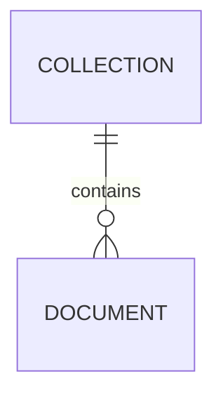

# Data Model (Firestore)

> To be designed during the first data-driven feature's Inception/Design phase.

## Conventions

- Firestore paths mirror endpoint constants (`UrlConstants`), so `IHttpBackend.get(url)` maps
  1:1 to a document path.
- Array sections are stored as `{ items: [...] }` documents and unwrapped by the adapter.
- DTO interfaces (`i-*.ts`) describe stored shapes. Model classes add behaviour.
- Every collection has matching rules in `firestore.rules`, deny-by-default, with tests.

