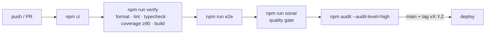

# Deployment & Environments

| Environment   | Backend                        | Purpose                       |
| ------------- | ------------------------------ | ----------------------------- |
| `development` | Fake or Firebase (dev project) | Local work                    |
| `e2e`         | Fake                           | Deterministic Playwright runs |
| `production`  | Firebase (prod project)        | Live site                     |

Runtime secrets (Firebase web config, EmailJS public key) are injected through
`public/runtime-config.js`, which is git-ignored and generated per environment at deploy time.

## CI pipeline (target)

Hosting target (Firebase Hosting or another option) is decided by ADR when the first deploy is planned.
