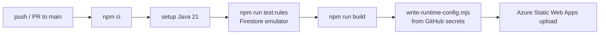
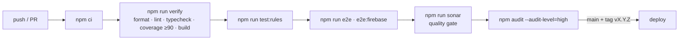

# Deployment & Environments

| Environment / build | Backend                                        | Purpose                                   |
| ------------------- | ---------------------------------------------- | ----------------------------------------- |
| `development`       | Fake (`fake-db.json`)                          | Local work                                |
| `emulator`          | Firebase, local emulator (`demo-taal-yatra`)   | Firebase smoke suite (`npm run e2e:firebase`) |
| e2e (main suite)    | Fake                                           | Deterministic Playwright runs             |
| `production`        | Firebase, project `taal-yatra`                 | Live site                                 |

**Firestore:** Native mode, project `taal-yatra`, location `asia-south2` (Delhi). The location
can't be changed.

**Site addresses:** `https://calm-mud-0ca950310.4.azurestaticapps.net` (Azure default) and
`taalyatra.in` (custom domain). Both are Firebase Auth authorized domains. PR preview environments
get their own `calm-mud-0ca950310-<n>.4.azurestaticapps.net` addresses, which aren't authorized
(Firebase has no wildcards). Email/password sign-in still works there; only the reset email's
"continue" link needs an authorized domain.

**Auth email sender:** custom domain `taalyatra.in`, verified 2026-10-28 (SPF, DKIM and
verification records at GoDaddy).

**Hosting:** Azure Static Web Apps (`.github/workflows/azure-static-web-apps-*.yml`). Firebase
Hosting isn't used.

**Runtime config:** the Firebase web config is public by design (it's protected by
`firestore.rules`) but kept out of git (CLAUDE.md §10).
- `public/runtime-config.js` is git-ignored. Copy it from `public/runtime-config.example.js`
  for local production builds.
- In CI, `scripts/write-runtime-config.mjs` writes it into the build output from the GitHub
  secrets `FIREBASE_API_KEY`, `FIREBASE_AUTH_DOMAIN`, `FIREBASE_PROJECT_ID`,
  `FIREBASE_STORAGE_BUCKET`, `FIREBASE_MESSAGING_SENDER_ID` and `FIREBASE_APP_ID`. The job fails
  if any is missing.
- `public/staticwebapp.config.json` serves the file with `no-cache`, and sets the
  **`navigationFallback`** to `/index.html`, so deep links (`/videos`, `/admin`…) load the app
  instead of a 404. Static files (`/images/*`, `/icons/*`, scripts, styles, images) are excluded,
  so a missing asset still returns 404.

**Rules and data (manual, from a developer machine):**
1. `npx firebase login`
2. `npm run deploy:rules`
3. `npm run seed:firestore -- <key.json> --dry-run`, then the same with `--yes`

The service-account key is never committed or pasted anywhere.

## CI pipeline (current)

PR preview environments get the production config, so a proposal submitted on a preview lands in
the real `proposals` collection (create-only).

## CI pipeline (target)

