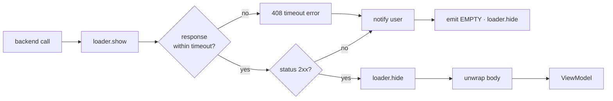
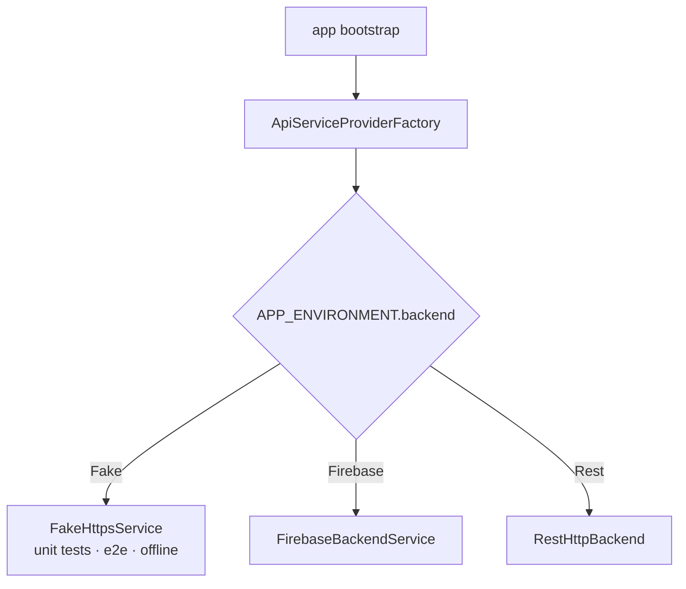

# Flow Diagrams

## Request pipeline (`HttpsErrorHandler`)



## Backend selection (factory)



## Feature delivery (AIDLC)

```mermaid
flowchart LR
  I[Inception<br/>stories · AC] -->|approve| D[Design<br/>diagrams · ADRs]
  D -->|approve| C[Construction<br/>code + tests]
  C --> V{npm run verify<br/>+ e2e green?}
  V -- no --> C
  V -- yes -->|approve| O[Operations<br/>release:minor · CHANGELOG · deploy]
```

## User journeys

Add one flowchart per journey (navigation, contact, sign-in …) as features are designed.
