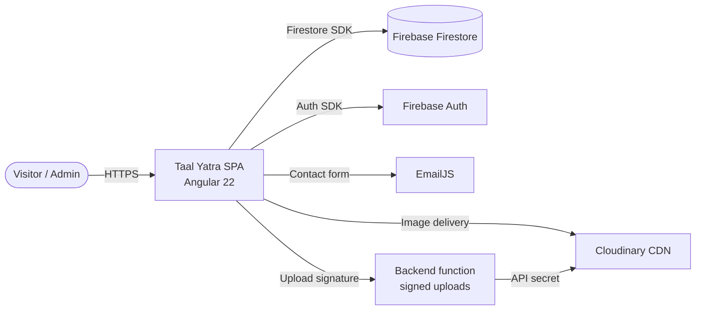

# Architecture Overview

## System context



## Layers (MVVM + ports & adapters)

```mermaid
flowchart TB
  subgraph View
    C[Component<br/>OnPush, template only]
  end
  subgraph Presentation
    VM[ViewModel<br/>@Injectable, component-scoped<br/>signals + RxJS]
  end
  subgraph Application
    S[Feature Service<br/>@Service root<br/>endpoints]
    B[ApiBaseService<br/>+ HttpsErrorHandler]
  end
  subgraph Ports
    P{{IHttpBackend · IAuthService<br/>IEmailService · IMediaService}}
  end
  subgraph Adapters [core/backends]
    F[Firebase*]
    K[Fake*]
    R[Rest / EmailJS / Cloudinary]
  end
  C --> VM --> S --> B --> P
  P -. factory picks one .-> F & K & R
```

## Dependency rules

1. `features → shared → core/interfaces`. Arrows never point back up.
2. Features never import other features. Shared code moves to `shared/`.
3. Only `core/backends` imports SDKs (`firebase/*`, `@emailjs/browser`, `HttpClient`).
4. Only factories in `core/factories` reference concrete adapters.
5. Components never inject services that do data access. They talk to their own view model.

## State model

- **Signals** hold state: VM `data`, `computed()` values, component `input()`.
- **RxJS** moves data: loading, user commands, retries, timeouts.
- Promises exist only inside adapters (wrapped with `defer`) and in tests.
