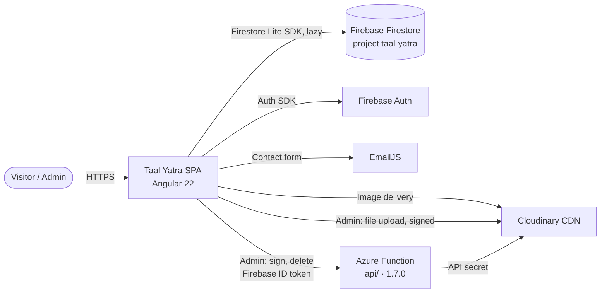
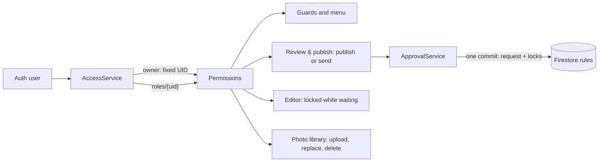

# Architecture Overview

## System context



## Layers (MVVM + ports & adapters)

```mermaid
flowchart TB
  subgraph View
    C[Component<br/>OnPush, template only]
  end
  subgraph Presentation
    VM[ViewModel<br/>@Injectable, component-scoped<br/>signals + RxJS]
  end
  subgraph Application
    S[Feature Service<br/>@Service root<br/>endpoints]
    B[ApiBaseService<br/>+ HttpsErrorHandler]
  end
  subgraph Ports
    P{{"IHttpBackend · IAuthService (1.4.0)<br/>IDocumentStore (1.6.0) · IEmailService<br/>IMediaService · IClipboardService<br/>IFileService (1.12.0, admin only)"}}
  end
  subgraph Adapters [core/backends]
    F[Firebase*]
    K[Fake*]
    R[Rest / EmailJS / Cloudinary]
  end
  C --> VM --> S --> B --> P
  P -. factory picks one .-> F & K & R
```

## Content editing (1.6.0)

The owner edits content at `/admin` (0008). Edits autosave as **drafts** (`drafts/*`) through
`IDocumentStore`, which reads fresh and commits atomically. **Publish** writes every draft live in
one commit and keeps the previous versions in `publishes/*` for undo. `?preview` shows the real
site with the drafts through `DraftOverlayBackend`
([ADR-0013](adr/0013-drafts-publish-preview.md)). Editors are built from field schemas
([ADR-0014](adr/0014-schema-driven-editors.md)). `site/visibility` switches home sections, inner
pages and widgets ([ADR-0015](adr/0015-site-visibility.md)). `site/theme` sets the colours, background,
text size and fonts of every page, the admin's too, through CSS variables; its code loads only when a
theme is stored ([ADR-0019](adr/0019-editable-theme.md)). Only the admin UID may write, by
`firestore.rules`.

## Media (1.7.0)

The owner uploads photos at `/admin/media`, or from any image field. The browser sends each file straight to
Cloudinary, and an Azure Function in `api/` signs the request for the admin only. Editors for the gallery, team,
shows and videos use `FieldKind.Image`, with a crop per use. A collection is drafted as one list and expanded into
numbered documents when published ([ADR-0017](adr/0017-upload-function-and-media.md)).

## Real-phone speed reports (0012)

Once the page has loaded and the browser is idle, the site shell loads a small chunk that measures the visit with the browser's
own `PerformanceObserver`, and stores one anonymous report in `vitals/*`. It sends nothing from the admin area or previews, or when
the browser asks not to be tracked, and failures are silent. The owner reads the results on the dashboard.

## Visits and leads (0018)

The same after-load chunk (`BrowserAfterLoad`) also counts the visit: one anonymous `{ page, device }` in `visits/*`, once
per tab (a `sessionStorage` yes, never an id), not from robots, test browsers, previews, browsers that ask not to be
tracked, or a browser where the admin area has been opened. The admin area adds each finished day (India time) up into one
create-only `visitDays/{date}` document and removes that day's single visits (`VisitsService`); the Visits page draws visits
and proposals by day, week, month or year with its own SVG bars. The Leads page reads `proposals`, changes only a lead's
`status` and `statusAt`, exports CSV through `IFileService`, and deletes a lead on request.

## Roles and approvals (0019, 2.0.0)

The owner is fixed by UID; managers are added on Team access (`roles/{uid}`) with a setting per editor page and an
upload switch ([ADR-0018](adr/0018-roles-and-approvals.md)). `AccessService` turns the signed-in account into a
`Permissions` model that guards, the menu, the dashboard, Review & publish, the editor and the photo library ask.
`firestore.rules` enforce the same per page and per part of `site/config`, and the upload function reads the
manager's upload setting with their own sign-in.



## Dependency rules

1. `features → shared → core/interfaces`. Arrows never point back up.
2. Features never import other features. Shared code moves to `shared/`.
3. Only `core/backends` imports SDKs (`firebase/*`, `@emailjs/browser`, `HttpClient`). `api/` is a separate
   package, and never imports from `src/`.
4. Only factories in `core/factories` reference concrete adapters.
5. Components never inject services that do data access. They talk to their own view model.

## State model

- **Signals** hold state: VM `data`, `computed()` values, component `input()`.
- **RxJS** moves data: loading, user commands, retries, timeouts.
- Promises exist only inside adapters (wrapped with `defer`), in tests, and in the Node tooling
  scripts under `scripts/`.

## Runtime configuration

The Firebase web config comes from `runtime-config.js` (`globalThis.__FIREBASE_CONFIG__`), loaded
before the app bundle and read by the `FIREBASE_CONFIG` token. The emulator build overrides it with
`environment.firebase`. See [deployment.md](deployment.md).
