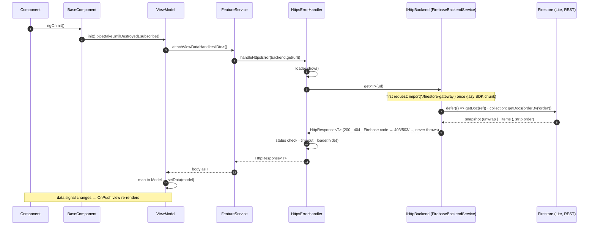
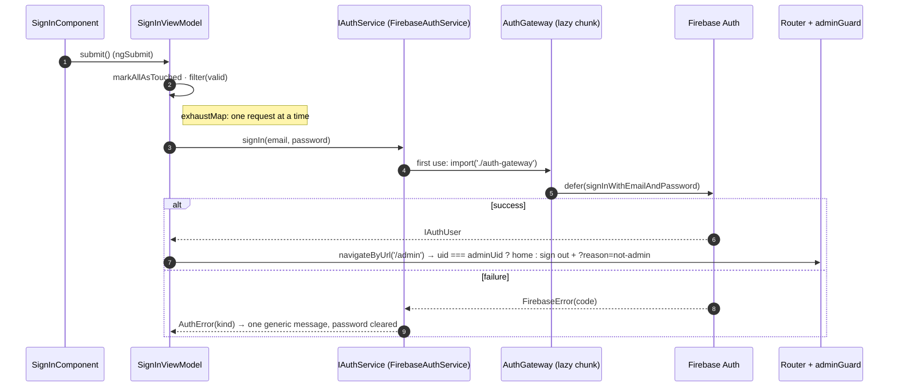
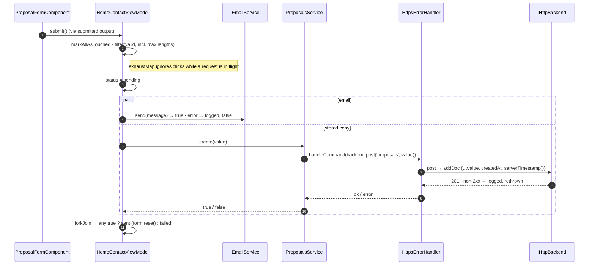
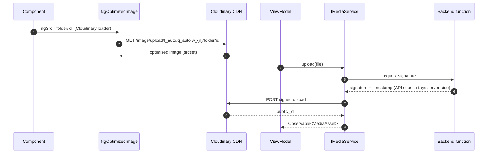
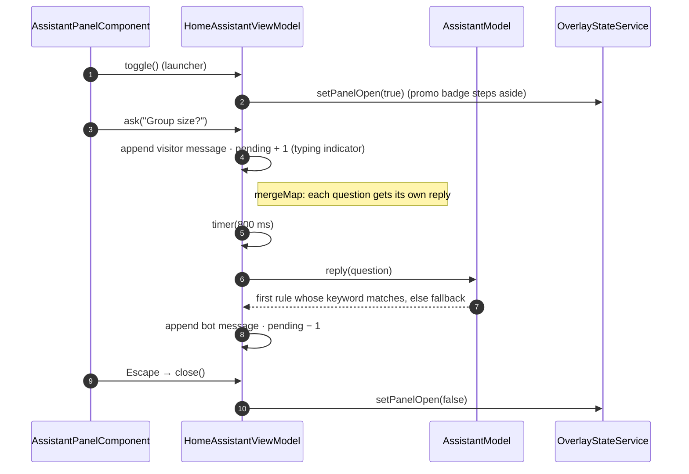
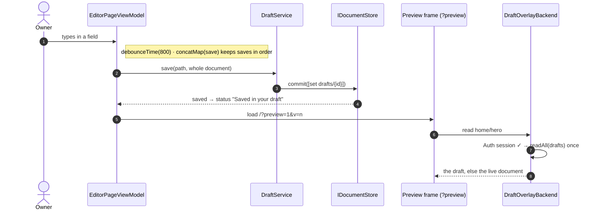
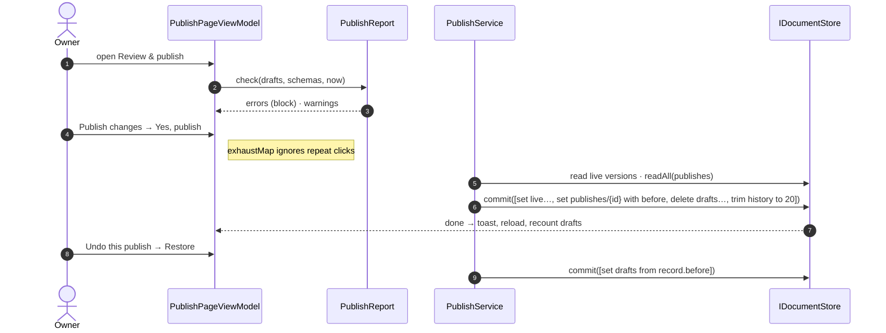

# Sequence Diagrams

## 1. Loading view data (every feature)



## 2. Admin sign-in (Firebase Auth, 1.4.0)



## 3. Proposal request (EmailJS + Firestore)



## 4. Media delivery and upload (Cloudinary)



## 5. Chat assistant question



## 6. From a home teaser to an inner page (shared data read once)

```mermaid
sequenceDiagram
  autonumber
  participant HV as HomeVideosViewModel
  participant VS as VideosService (cacheLatest)
  participant P as IHttpBackend
  participant VP as VideosPageViewModel
  HV->>VS: getVideos()
  VS->>P: get('videos'), first subscriber only
  P-->>VS: videos
  VS-->>HV: replay
  Note over HV,VP: visitor follows "View all videos"
  VP->>VS: getVideos()
  VS-->>VP: replayed, no request
  VP->>P: get('pages/videos') (the `pages` collection, read whole once)
  VP->>VP: combineLatest → one render; chip click → computed filter, no I/O
```

## 7. Edit, autosave and preview (1.6.0)



## 8. Publish and undo (1.6.0)


