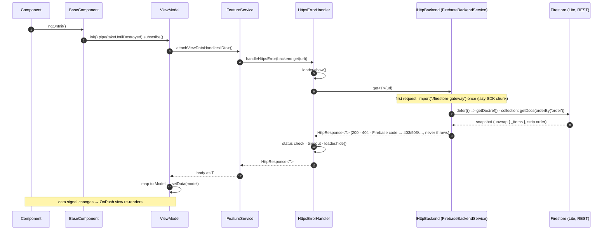
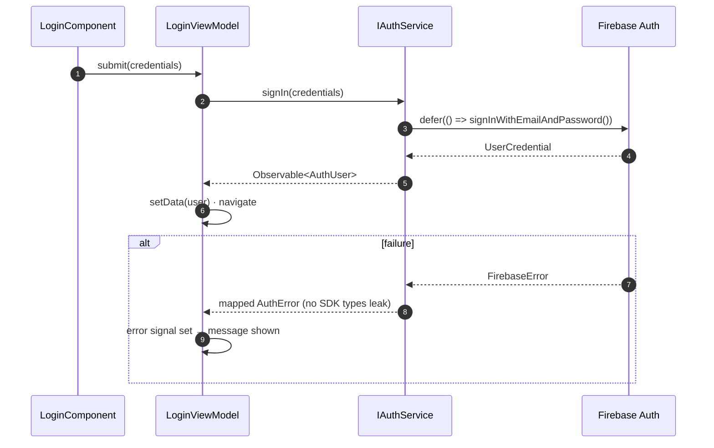
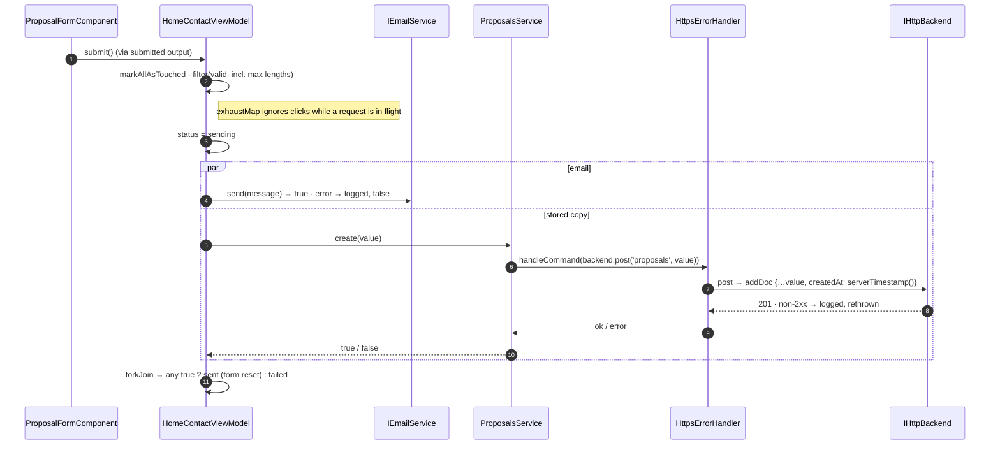
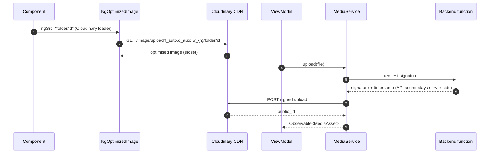
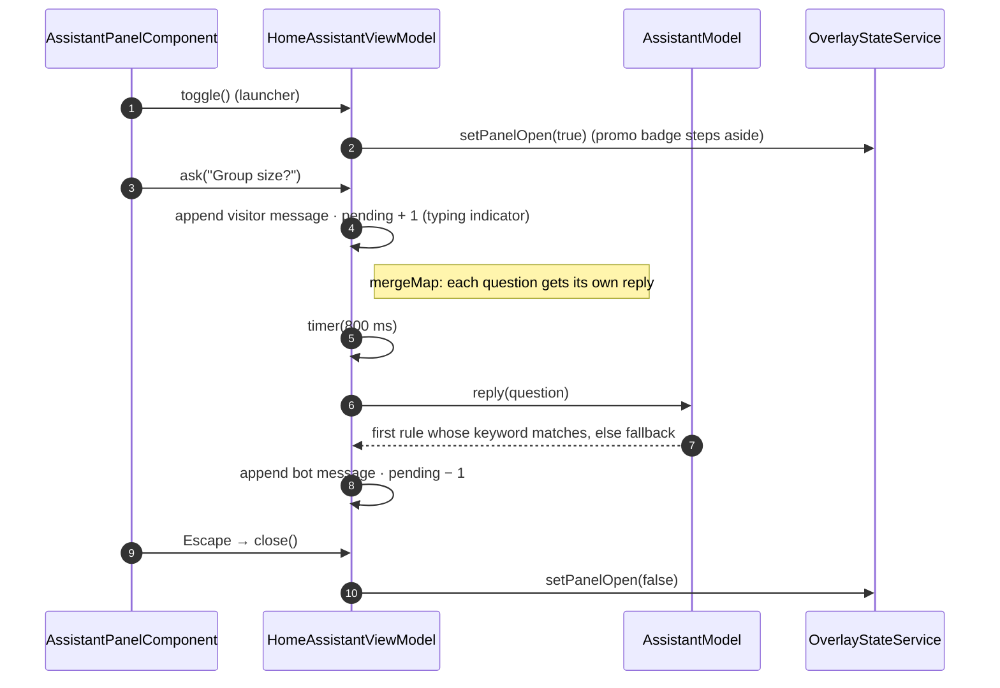

# Sequence Diagrams

## 1. Loading view data (every feature)

## 2. Sign-in (Firebase Auth)

## 3. Proposal request (EmailJS + Firestore)

## 4. Media delivery and upload (Cloudinary)

## 5. Chat assistant question

